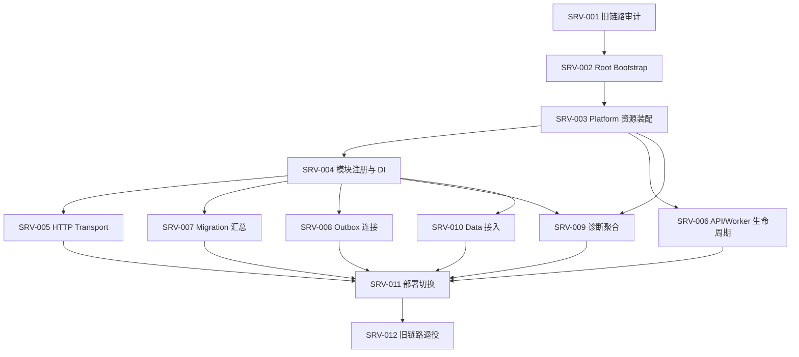

# Server 层实施规划

> 文档状态：实施规划（项目级 L1 契约已冻结；Server 的模块装配、消费者符合性和真实运行验收仍按任务证据推进）
> 适用代码分支：`feat/research-analysis-flow-native-go`
> 文档目录：`doc/server/`
> 代码范围：Server 运行入口、应用装配、HTTP Transport、Worker 生命周期、Migration 汇总、事件连接和运行诊断。
> 本文是 Server 分支的唯一任务主计划。模块内部实现仍以各模块自己的 `doc/<module>/` 为准；项目级架构和跨模块契约以 `feat/design_doc` 上的项目总览及契约目录为准；当前项目总览权威路径为 `doc/整体任务规划/01-项目总览/整体任务规划总览.md`，契约登记簿为 `doc/contract/PLAT-002-项目级契约冻结登记簿.md`。

## 1. 目标与边界

Server 是应用组合根（Composition Root）和进程运行入口。它负责把 Platform 与业务模块组装成可运行服务，并管理进程级资源和生命周期；不实现业务领域规则，不拥有业务数据和业务状态机。

### 1.1 Server 负责

- 统一启动入口、配置装载和启动参数校验。
- 创建并管理 Platform 公共资源，明确资源所有权、共享方式和关闭顺序。
- 创建业务模块实例，并通过公开构造入口和 Application Port 完成依赖注入。
- 注册 HTTP 路由、中间件、认证授权接入和统一错误映射。
- 按运行角色启动 API、Worker 或组合进程，并处理优雅关闭。
- 收集模块 Migration，由 Platform Migration Runner 执行。
- 按已冻结的事件契约连接生产方 Outbox 与 Notification Inbox。
- 聚合平台及模块的 Health、Readiness、Diagnostics。
- 分阶段切换新 Go 服务并退役旧 Analysis/Python 启动链路。

### 1.2 Server 不负责

- 不实现 Data/News/Quant/Research/Researchflow/LLM/Notification 的领域逻辑、Repository、业务状态机或业务重试策略。
- 不把模块私有实现、数据库表或 Repository 暴露给其他模块。
- 不在 Server 内复制模块 Migration；模块拥有自身 Migration 内容。
- 不把 Platform Task Queue 改造成业务 DAG、Outbox Relay 或通用业务任务平台。
- 不把 Notification 当作 Researchflow 的同步 Stage Provider。
- 不在 `integration` 分支开发 Server 功能或修复业务问题。

### 1.3 依赖规则

1. Server 可以依赖 Platform 和各模块的公开装配入口。
2. 业务模块不得反向 import Server 私有实现。
3. 模块之间的调用必须遵循项目契约定义的 Application Port；Server 负责注入，不替代调用方执行业务逻辑。
4. 模块间事件通过明确的 Outbox/Inbox 契约连接；不得直接访问对方数据库。
5. Platform 只提供公共技术原语和资源能力，不承接业务语义。


### 1.4 架构决议（与项目总览对齐，作为本分支执行基线）

经复审，采用以下唯一方案，不再保留入口路径的并行候选：

1. **唯一进程入口**：继续使用根 Go Module 的 cmd/analysis-api/main.go。它在迁移完成后仍是可执行入口，逐步缩减为启动参数/信号处理和对 internal/server/bootstrap 的委托；不新增 cmd/server/main.go，不同时维护两套启动链路。
2. **唯一组合根**：新 Server 实现落在 internal/server/**。Bootstrap 负责配置、资源、模块装配和启动；Transport 负责统一 HTTP 接入；Runtime/Lifecycle 负责组件启停。目标目录仅是渐进落位，不代表当前代码已存在。
3. **统一 API 宿主**：Root Server 是唯一对外 HTTP 宿主。模块拥有自己的 Application Port、传输 DTO 和 HTTP Handler/Adapter；Server 只显式注册经批准且已实现的 Handler，不代替模块实现业务接口，不自动公开所有内部 Port。
4. **模块化单体优先**：同进程调用使用强类型 Application Port，不通过 localhost HTTP 或伪造 API Key；只有有明确隔离/扩缩容/安全需求并完成网络契约评审时才考虑拆进程。Data 迁移完成前，保留有明确边界的 Remote Adapter，不做静默 InProcess/Remote fallback。
5. **公共能力归 Platform**：配置/Secret、Security、Request ID/Fault、受控 HTTP Client、Storage、Migration Runner、Diagnostics Runner 由 Platform 提供；Server 负责创建、装配、路由接入和生命周期，不复制实现。旧 internal/platform/httpapi 与 internal/platform/taskqueue 是历史 Analysis 专用代码，不视为通用 Router/Worker。
6. **领域所有权不变**：Data、News、Quant、Research、Researchflow、LLM、Notification 拥有各自领域规则、Repository、Migration 内容、公开 Port 和模块 Worker；Server 不新增领域模型或业务状态机。Researchflow 是跨模块流程编排者，Server 不是工作流引擎。
7. **共享根改动集中协调**：根入口、DI、路由注册、Worker 启动、根 Migration 汇总和部署配置属于受控集成面；模块分支不得各自修改。integration 只做代码聚合，不承接 SRV 开发任务。

以上决议与项目总览 doc/整体任务规划/01-项目总览/整体任务规划总览.md 第 2.4～2.6 节一致。若项目级权威文档后续改变，以 feat/design_doc 的新决议为准，并在本文件同步，不自行创造第二套架构规则。

### 1.5 Platform 与 Server 最终职责决议（依据 Stock-Platform (53)）

本节将 Platform 公共能力交付与 Server 实际服务接入分开。项目级跨模块语义仍以总规划和契约登记簿为唯一权威；本节只冻结 Server 的消费和装配责任，不创建第二套 Platform 标准。

#### 职责边界

| 能力 | Platform 负责 | Server 负责 | 领域模块负责 |
|---|---|---|---|
| Config / Secret | 环境变量基础解析、Secret 脱敏类型及公共原语 | 每个服务的 Config Bootstrap、校验、Secret 装载和注入 | 定义本模块 Config Schema 和业务参数约束 |
| HTTP Client | DestinationPolicy、DNS/IP/SSRF、受控 Dial、重定向、超时、响应大小、并发、缓冲与流式传输 | 创建共享 Client、按目标建立固定 BoundDoer、注入消费者、管理 Client 生命周期 | Provider/模型协议、来源授权、业务错误及领域重试策略 |
| Fault / Request ID | 公共 Fault 类型、字段校验、Request ID 生成/传播原语 | HTTP 入口接入、可信上下文传递、Fault 到 HTTP 状态码和安全响应 DTO 的映射 | 领域错误分类、业务错误码和消费侧处理 |
| Security | Owner/Service 身份认证、Principal、Scope、Authenticator、Router/RoutePolicy 等公共原语 | 显式注册路由、选择认证策略、注入可信 Principal/Scope、隔离外部与内部入口 | 资源级授权、AuthorizationRef 签发/复核及业务权限规则 |
| Web Session | 仅提供经项目契约正式批准的通用 Session/密码/CSRF 等公共原语；当前已交付能力不包含完整 Web Session | 在公共原语和契约具备后装配登录/登出、Session 路由、Cookie 策略及用户权限接入 | 不负责 Web 登录；领域资源授权仍由领域模块复核 |
| Storage | SQL/Redis 连接、连接池、Ping、关闭和通用 Migration Runner | 创建共享资源、配置连接池、注入 Repository、统一关闭 | Repository、SQL、事务边界、领域表结构和 Migration 内容 |
| Migration | 通用 Runner、namespace/version 执行机制及底层锁 | 收集模块注册项、校验、排序、显式触发、汇总结果并阻止未完成迁移的实例 Ready | 创建和维护自己的 Migration 内容及版本 |
| Diagnostics | Check/Observation/Report Schema、Runner、限额、取消和通用聚合原语 | 注册模块 Check、执行聚合、定义 Required/Optional、Readiness 门禁和受保护 HTTP 入口 | 实现真实领域/依赖 Check，定义 reason_code、safe_message、evidence_ref 和状态映射 |
| HTTP / Runtime | 不提供根应用宿主和业务启动编排 | 唯一 HTTP Server、根路由、中间件组合、模块装配、Worker/HTTP 生命周期、优雅关闭 | 提供公开 Handler、Application Port、Worker 和模块关闭语义 |

#### 不可越界事项

- Platform 不负责 Root Bootstrap、根 HTTP 路由、模块 DI、模块 Migration 总注册、模块 Worker 编排或部署拓扑。
- Server 不复制 Platform 的 HTTP Client、Fault、Security、Storage、Migration Runner 或 Diagnostics Runner。
- Server 不实现模块领域规则，不直接访问其他模块 Repository、私有 Domain 或数据库表。
- 领域模块不得自行创建绕过 Platform DestinationPolicy 的生产 HTTP Client；Provider endpoint 安全策略与领域来源授权是两个不同门禁，前者由 Platform 执行，后者由领域模块决定。
- 旧 internal/platform/httpapi 和 internal/platform/taskqueue 是历史 Analysis 专用代码，不是新模块可复用的通用 Router/Worker。旧链路迁移由 Server 负责。
- integration 只做代码聚合，不承担上述任何一方的日常开发任务。

#### PLAT-CTR-005 流式 HTTP 的最终接入边界

Platform 已在 internal/platform/httpclient 提供 Client.OpenStream / BoundDoer.OpenStream。Platform 流式 A1 包级验收通过，表示传输原语可供消费者使用，不表示 LLM A2 或生产部署 A3 已完成。

- **Platform**：复用现有安全 Transport、DestinationPolicy、受控 DNS/Dial、重定向策略、Context 生命周期、响应头/Body 字节限制、空闲读取超时、流并发额度、Fault 分类和脱敏统计；不解析 SSE、JSON、Responses 事件或模型业务终态。
- **Server**：在 Bootstrap 创建共享 Platform HTTP Client；按稳定 Dependency 和精确目标配置 DestinationPolicy；为固定上游创建 BoundDoer；将 BoundDoer 和必要的 Provider Config/Secret 注入 LLM 的公开构造入口；保证所有消费者先停止、再关闭共享 Client。不得把裸 Transport 或可任意改写目标策略的 Client 暴露给领域模块。
- **LLM**：调用注入的 BoundDoer.OpenStream；负责 SSE/Responses 事件解析、增量输出、模型终态、工具调用、模型错误映射和业务重试策略；必须在 EOF、错误或提前退出时关闭 Body，并传播调用方 Context。
- **消费者生命周期**：StreamResponse.Body 所有权在成功返回后转交调用方；调用方必须 Close，Close 幂等；Platform 在 EOF/Read Error/Context Cancel/Close 时执行底层清理并释放流并发额度。响应头交付后的读取终止错误不得被透明重放；HTTP 4xx/5xx 由 LLM 按模型协议解释，不是传输层 Fault。
- **验收分层**：Platform A1 是公共包级证据；LLM 真实 Gateway/SSE/取消/终态联调是 A2；DNS/egress/Secret/运行时和长连接资源限制是 A3。Server 负责完成依赖注入和部署接线，不得把 A1 记作 A2/A3。

#### Server 当前执行原则

1. 优先消费 Platform 当前分支已存在且有测试的 API；只有发现公共原语缺陷才反馈 Platform 修复，不在 Server 创建替代实现。
2. 所有 Config 在 Bootstrap 读取并校验，启动后作为不可变快照；模块只接收自己的配置和所需 Secret，不自行散落读取环境变量。
3. 共享资源由 Server 创建并拥有；模块借用资源，不得提前关闭；关闭顺序必须保证消费者先于资源提供方停止。
4. Server 只注册模块已经公开且可构造的 Port、Handler、Worker、Migration 和 Check；模块入口未就绪时保持阻塞，不写空 Registry 或虚构构造函数。
5. 项目级 CTR 状态只以 PLAT-002 登记簿为准；已 `frozen` 的项目级语义必须按定义实现，但不代表消费者证据齐备。`deferred` 项不得作为已发布接口使用；消费者证据由对应模块和组合集成验收补齐。

## 2. 代码目录与文档目录

### 2.1 目标代码目录

以下是 Server 目标目录，不代表这些目录目前都已存在。实施时按任务逐步创建，避免一次性生成空目录或占位文件。

```text
cmd/
  analysis-api/
    main.go                    # 唯一进程入口；逐步委托 internal/server/bootstrap

internal/
  server/
    app.go                      # 应用对象及统一生命周期入口
    bootstrap/
      bootstrap.go              # 配置、资源、模块和运行角色的启动编排
    config/
      config.go                 # Server 进程配置结构、默认值和校验
    modules/
      registry.go               # 模块构造、注册和 Application Port 装配
    transport/
      http/
        server.go               # net/http Server 创建、启动和关闭
        router.go               # 路由注册
        middleware/             # 请求 ID、日志、认证授权接入等 HTTP 中间件
        handlers/               # Server 层或模块公开 HTTP Handler 的挂载适配
    runtime/
      roles.go                  # api、worker、all 等运行角色定义与解析
      lifecycle.go              # 组件启动顺序、失败回滚和关闭顺序
    worker/
      manager.go                # Worker 注册、启动、停止和错误汇总
    migration/
      registry.go               # 汇总模块 Migration 注册项
      runner.go                 # 调用 Platform Migration Runner
    events/
      wiring.go                 # Outbox/Inbox 适配器装配；不实现业务投递规则
    health/
      handler.go                # Health/Readiness HTTP 入口
      aggregate.go              # Platform 与模块诊断结果聚合
    observability/
      logging.go                # Server 进程级日志初始化（复用 Platform 约定）
      diagnostics.go            # 进程级诊断上下文和关联信息

doc/
  server/
    README.md                   # 本文件：Server 唯一任务主计划
```

目录约束：

- 当前及目标进程入口统一为 `cmd/analysis-api/main.go`；项目总览 2.4/2.5 已明确沿用该入口渐进迁移。不得创建 `cmd/server/main.go`，不得保留第二套配置、资源或生命周期入口，也不得擅自重命名现有命令。
- `internal/server/**` 只放进程级装配、Transport、生命周期和跨模块连接代码。
- `internal/platform/**` 继续归 Platform 所有；Server 通过公开接口使用，不复制实现。
- `internal/{data,news,quant,research,researchflow,llm,notification}/**` 继续归各业务模块所有。
- 旧 `cmd/analysis-api`、`internal/service` 和旧 Analysis 适配器在新链路验收及退役门禁完成前，暂作为迁移中的实现依赖保留；这不构成继续维护旧 Analysis HTTP API 公共兼容契约的承诺。依据 DEC-PLAT-002-018，旧 API 不作为长期支持接口；新 Researchflow API 验收后，按决议删除旧路由及其专属适配代码。
- 具体目录可根据仓库现有包结构微调，但必须保持上述所有权边界，不为迎合目录树而搬动模块代码。

### 2.2 文档目录规则

- `doc/server/README.md` 是 Server 分支唯一任务主计划和实施状态入口。
- Server 的设计决策、任务拆分、验收标准和风险在本文件更新，不另建重复路线图。
- 跨模块契约若涉及公共语义，应回到 `feat/design_doc` 的契约目录维护；本文件只记录 Server 的消费方式和对应阻断条件。
- 模块自身的接口、Migration 和 Worker 实现细节留在模块文档，不复制到 Server 文档。

## 3. 运行模型

### 3.1 进程角色

目标上至少支持以下运行角色：

| 角色 | 运行内容 | 说明 |
|---|---|---|
| `api` | HTTP API、Health/Readiness | 不启动非必要后台 Worker |
| `worker` | 被配置启用的模块 Worker、事件消费循环 | 不对外提供业务 API；是否提供内部诊断端口由部署契约决定 |
| `all` | API 与 Worker | 适合本地开发或单实例部署 |

角色名称是规划目标，最终命名和部署拓扑需要结合现有部署约束确认。API 与 Worker 应共享一致的配置和装配代码，但启动集合必须显式可控。不能把“同进程”写成模块架构前提；同一二进制应能按角色运行，后续可独立部署。

### 3.2 启动顺序

1. 加载并校验进程配置及模块配置。
2. 初始化进程日志和诊断上下文。
3. 创建 Platform 公共资源。
4. 构造模块的轻量装配描述/实例，注册公开 Application Port，并收集模块 Migration 注册项；此阶段不得启动对外流量或后台 Worker。
5. 按显式 Migration 策略调用 Platform Migration Runner；未启用迁移时必须验证所需 Schema 已满足运行条件。
6. 完成模块依赖注入及组件装配，注册 Health/Readiness。
7. 按角色启动模块 Worker。
8. 启动 HTTP Server（api/all 角色）。
9. 全部必需组件就绪后标记 Readiness 为 ready。

启动失败必须返回明确错误，并按已成功启动的逆序回滚；不能遗留 goroutine、连接池或 Worker。

### 3.3 关闭顺序

1. Readiness 切换为 not-ready，停止接收新工作。
2. HTTP Server 停止接收新请求并在超时内完成在途请求。
3. Worker 停止领取新任务，按各模块契约完成或中止在途工作。
4. 停止事件 Dispatcher/Consumer（其所有权契约冻结后接入）。
5. 关闭模块级资源。
6. 关闭 Platform 资源（DB、Redis、HTTP Client 等）。
7. 刷新日志并退出。

具体顺序需以实际依赖图确定；资源提供方必须晚于所有消费者关闭。关闭操作应幂等、有超时，并保留首个错误及后续错误信息。

## 4. 配置设计要求

Server 配置应集中定义、校验和记录来源，不允许各模块在启动入口重复读取任意环境变量。

建议配置分组：

- `server.name`、`server.environment`、`server.role`
- `http.address`、`http.read_timeout`、`http.write_timeout`、`http.idle_timeout`、`http.shutdown_timeout`
- Platform 资源配置：引用 Platform 已定义的配置结构，不重新定义连接池和客户端语义
- `migration.enabled`、`migration.mode`（最终值以 Platform Migration 契约为准）
- 各模块配置：由模块提供配置结构或解析接口，Server 负责汇总和传递
- Worker 启停开关、并发和关闭超时：具体业务参数由模块拥有，Server 只负责运行角色与生命周期配置
- Diagnostics/Health 暴露策略

配置要求：

1. 环境变量、配置文件和默认值的优先级必须统一并写入配置说明。
2. 敏感值不得写入日志、诊断输出或错误文本。
3. 配置错误应在启动早期失败，不能静默回退到不安全默认值。
4. 记录生效配置时只输出非敏感字段。
5. 不在 Server 中复制模块内部全部配置项；通过模块公开配置契约装配。

## 5. 模块装配契约

每个模块接入 Server 前，必须具备可被 Server 使用的公开装配边界。具体接口名称由模块现有代码和项目契约决定，不在此文档中臆造统一构造函数。

接入检查至少包括：

- 模块配置如何解析和校验。
- 模块实例如何构造，构造失败如何释放已创建资源。
- 模块对外提供哪些 Application Port/HTTP Handler/Worker。
- 模块依赖哪些 Platform 资源，以及是否共享 Server 创建的实例。
- 模块是否提供 Migration 注册项。
- 模块是否提供 Health/Readiness/Diagnostics 贡献项。
- Worker 的启动、停止、超时和失败语义。
- 模块关闭是否幂等。

Server 的 Registry 负责装配，不得因此把模块内部 Service、Repository 或 Domain 类型提升为跨模块公共接口。跨模块依赖只能使用冻结的公开 Port。

## 6. Migration 所有权与执行

采用三层职责：

| 层 | 所有权 |
|---|---|
| 业务模块 | 创建和维护自己的 Migration 内容、版本及领域表结构 |
| Platform | 提供数据库连接能力和通用 Migration Runner |
| Server | 收集已启用模块的 Migration 注册项，建立唯一执行入口和顺序 |

要求：

- Server 不编写业务表 DDL，不复制模块 Migration 文件。
- 模块 Migration 必须有稳定的模块标识、版本和可诊断结果。
- Migration 注册必须避免同一模块重复注册、版本冲突和不确定执行顺序。
- 执行失败应阻止依赖该 Schema 的服务进入 Ready。
- 是否在 API 启动时自动执行 Migration，必须由部署策略显式配置；生产环境不能依赖多个副本同时无协调地执行。
- Migration Runner 的具体 API、锁和事务能力以 Platform 契约为准；若能力缺失，回 Platform 分支补齐，不在 Server 复制 Runner。

## 7. Outbox / Notification 事件连接

目标关系：

```text
Quant Outbox ─────────┐
Research Outbox ──────┼──> Notification Inbox -> Subscription -> Delivery -> Channel
Researchflow Outbox ──┘
```

Server 只负责把生产方公开的 Outbox 读取/Dispatcher 能力与 Notification 接收入口连接起来，并管理相关组件生命周期。事件 Schema、业务事件产生时机、重试语义、Inbox 去重和 Delivery 状态由相应模块所有。

**未冻结决策：Dispatcher 所有权。** 当前存在两种候选方案：

- 方案 A：每个事件生产方拥有自己的 Dispatcher；Server 注入 Notification 接收适配器并统一启停。
- 方案 B：Server 运行统一 Relay，但必须通过每个生产方公开的 Outbox Port 访问，不能直接读写生产方表。

在项目契约明确选择之前，SRV-008 只能完成接入设计和接口准备，不得把任一方案写成既定事实。Platform Task Queue 不能被默认当作 Outbox Relay。

## 8. HTTP Transport 与安全边界

Server HTTP 层负责：

- 路由注册和版本前缀。
- 请求 ID / Trace 上下文传递。
- 认证和授权中间件的装配；身份校验具体能力使用 Platform 或项目已冻结的 Auth 契约。
- 统一 Fault 到 HTTP 状态码和响应结构的映射。
- 请求体大小、超时、并发和优雅关闭限制。
- Health/Readiness/Diagnostics 端点的访问策略。
- OpenAPI 聚合或生成入口（各模块 API 描述的所有权需明确）。

Server 不重写模块业务 Handler 的校验和领域错误，不在路由层拼接 SQL 或调用 Repository。所有外部请求必须经过明确的认证授权策略；不能因为是个人使用就把管理接口默认暴露为匿名接口。

## 9. Health、Readiness 与 Diagnostics

至少区分：

- **Liveness**：进程是否仍能运行。
- **Readiness**：当前实例是否能够安全接收目标流量/工作。
- **Diagnostics**：依赖和模块能力的详细状态，包含 pass/degraded/fail/skipped/not-comparable 等项目约定状态。

聚合规则：

- Server 聚合模块诊断结果，不擅自改变模块给出的业务判定。
- 非关键可选依赖不可用时，是否 degraded 由系统级服务等级策略定义。
- 必需 DB、Migration 或关键模块未就绪时，不得错误报告 Ready。
- 诊断必须保留 reason_code、evidence_ref、dependency 等契约字段，不能只输出自由文本。
- Health 响应不得泄露凭证、内部地址中的敏感部分或用户数据。

## 10. 任务清单与验收标准

任务状态统一使用：`未开始`、`进行中`、`待契约`、`阻塞`、`完成`。任务完成必须有代码、测试或可复核证据；仅文档设计不等于实现完成。

### SRV-001：旧系统和启动入口审计

- 状态：完成（旧入口、路由、资源生命周期、旧 Migration、部署边界及模块接入就绪度已形成迁移归属记录）
- 工作内容：
  - 审计 `cmd/analysis-api/main.go`、`internal/service/wiring.go`、旧 HTTP API、Task Queue、Storage、Market Data Adapter、Python Adapter。
  - 绘制当前启动依赖和资源生命周期。
  - 将旧 API 路由、配置项、Worker、Migration、诊断端点逐项映射到新 Server 或对应业务模块。
  - 标注保留、迁移、替换、删除及其前置条件。
- 交付物：旧链路迁移清单、现状依赖图、配置映射表、删除门禁。
- 验收：
  - 所有旧启动职责均有唯一归属。
  - 不将旧 Analysis 业务逻辑误归到 Server。
  - 未提前删除仍在使用的入口和适配器。

### SRV-002：Root Bootstrap

- 状态：进行中（运行装配、HTTP 配置和 Platform 共享资源已拆出；剩余重点是模块 Registry 与统一启动编排）
- 前置：SRV-001；复用现有 `cmd/analysis-api/main.go`，不新增第二进程入口
- 工作内容：将现有入口逐步收敛为参数/信号处理和 Bootstrap 委托；在 `internal/server/bootstrap` 实现统一配置装载、Platform 资源构造、模块装配、启动和错误返回。先抽离可验证的最小垂直切片，不一次性重写旧启动链路。
- 交付物：由现有 `cmd/analysis-api` 启动的 Root Server Bootstrap；旧入口仍可在迁移阶段兼容运行。
- 验收：配置错误可诊断；启动失败返回非零退出；入口不包含业务逻辑；有启动和失败路径测试。
### SRV-003：Platform 资源装配

- 状态：进行中（DB、Redis、HTTP Client 已纳入 Server 统一资源容器；后续补齐模块资源注入和诊断接入）
- 前置：SRV-002；依赖 Platform 已公开能力
- 工作内容：创建 DB、Redis、HTTP Client 等公共资源；明确资源共享、超时、关闭顺序和失败回滚。
- 交付物：资源 Registry/Container 和生命周期管理。
- 验收：资源只创建一次或按契约隔离；创建失败能回滚；关闭顺序正确；不复制 Platform 实现。

### SRV-004：模块注册与依赖注入

- 状态：阻塞（已完成模块接入面初审；多数模块尚无完整生产装配入口，不能先写空 Registry 或虚构统一构造函数）
- 前置：SRV-003；各模块提供可用公开装配入口
- 工作内容：按明确的依赖 DAG 显式创建模块实例；注入强类型 Application Port；校验缺失、重复和循环依赖。不得通过扫描私有包、隐式全量注册或 Server 直接访问 Domain/Repository 来装配。
- 交付物：模块 Registry、依赖装配图和模块接入清单。
- 验收：不 import 模块私有实现；无隐式全局单例；每个跨模块依赖都有契约依据；模块可独立构造和关闭。

### SRV-005：HTTP Transport

- 状态：进行中（旧 Analysis 路由已使用 Platform 显式认证 Router；Server 已接入不信任外部 Request ID 的 Platform Middleware、Fault→HTTP 映射工具、请求体上限和并发准入限制；现有旧 Analysis Handler 仍保留自身业务错误 DTO，后续模块 Handler 接入时使用统一 Fault 映射；Web Session、CSRF、可信代理边界仍受项目契约与 Platform 原语交付门禁约束）
- 前置：SRV-004；认证、Fault、Request ID 等公共契约可用
- 工作内容：建立 Router、通用中间件、统一错误映射、路由注册和 OpenAPI 汇总机制。
- 交付物：HTTP Server、路由清单、安全配置和 Transport 测试。
- 验收：认证授权按路由生效；错误映射稳定；超时和请求限制生效；业务逻辑仍由模块实现。

### SRV-006：API/Worker 运行角色和生命周期

- 状态：进行中（已实现 SERVER_ROLE=api|worker|all；旧 Analysis Worker 与 HTTP Server 均已纳入 runtime.Lifecycle，具备启动失败回滚预算、Readiness 先降级、HTTP 在途请求排空和超时强制关闭；Lifecycle 已覆盖启动期间 Context 取消、并发 Stop 竞争和逆序回滚。HTTP 活动 Handler 排空受关闭 Context 限制，超时会返回错误；组件仍须遵守 Context 取消契约。独立子进程真实 OS SIGTERM 顺序测试已存在；完整 Bootstrap/真实数据库/生产容器验收仍待完成。
- 前置：SRV-003、SRV-004
- 工作内容：实现角色解析、组件选择、启动依赖排序、失败回滚、优雅关闭和超时。
- 交付物：Runtime Role 与 Lifecycle Manager。
- 验收：api 角色不启动非必要 Worker；worker 角色不启动业务 HTTP API；all 角色可组合运行；启动失败和 SIGTERM 路径均有测试。
- 待决：生产环境 API/Worker 是分进程部署还是允许同进程部署，由部署架构决策冻结；代码必须支持显式角色隔离。

### SRV-007：Migration 注册与执行

- 状态：进行中（Server Registry 已接入 News、Research、Researchflow、Notification 四个业务模块 Migration，以及 Platform Owner Credential、Server Security Audit 两个安全基础设施 namespace；按 namespace 和版本号稳定排序，执行由 `MIGRATION_ENABLED` 显式开启；只读 Schema 预检要求数据库 namespace/version 集合与当前 Registry 完全一致且状态均为 `applied`。真实 MariaDB 故障/恢复集成及 Platform checksum 只读验证能力仍待完成）
- 前置：SRV-003；其余模块提供可用 Migration 后再注册；核对 Platform `storage.ApplyMigrations` 实际签名和各模块 Migration 注册形态
- 工作内容：在模块装配阶段收集各模块拥有的 Migration 描述，校验 namespace/version 唯一性及顺序，再按部署策略调用 Platform Runner，输出可追踪结果。MariaDB DDL 部分执行失败后的恢复按 Platform Runner 契约执行，不在 Server 自行重试失败 Migration。
- 交付物：`internal/server/migration.Registry`、显式执行配置和模块注册测试；真实 MariaDB 集成验收待执行。
- 验收：Server 不拥有业务 DDL；重复注册和版本冲突可检测；失败阻止启动进入 Ready；Platform Runner 使用 namespace 级 MariaDB advisory lock，防止并发副本无协调执行。

### SRV-008：Outbox 事件交付集成

- 状态：待契约
- 前置：SRV-004；生产方 Outbox Port、Notification Inbox Port 和 Dispatcher 所有权决议冻结
- 工作内容：装配事件适配器、启动停止相关 Dispatcher/Relay、传递诊断和错误。
- 交付物：事件连接配置、生命周期集成和端到端测试。
- 验收：不直接访问其他模块数据库；重复事件不会绕过去重契约；失败可重试且可诊断；不依赖 Platform Task Queue 的隐式语义。

### SRV-009：Health、Readiness、Diagnostics 聚合

- 状态：进行中（Platform Runner、Server Aggregator/Readiness 门禁、DB/Redis 基础检查和 Owner 保护的结构化诊断入口已实现；真实模块 Check 注册及故障场景验收仍待完成）
- 前置：SRV-003、SRV-004；Platform Diagnostics 契约可用
- 工作内容：聚合进程、公共资源和模块状态；区分 liveness/readiness/diagnostics。
- 交付物：健康端点、聚合器和故障场景测试。
- 验收：必需依赖故障时 Ready=false；可选依赖降级不被误报为成功；保留结构化诊断证据；不泄露敏感信息。

### SRV-010：Data 迁移成果接入

- 状态：阻塞（等待 Data 迁移门禁）
- 前置：Data M0/M1 迁移门禁通过；Data 公开 Application Port、配置、Migration 和生命周期契约可用
- 工作内容：将迁移后的 Data 模块接入模块 Registry、资源、Migration、诊断和 API 路由。
- 交付物：Data Server Adapter/注册配置和端到端查询链路。
- 验收：浏览器不持有 Provider API Key；凭证只在服务端；Data 查询通过公开 Port；不在 Server 重写 Provider 或 Repository。

### SRV-011：部署切换

- 状态：未开始
- 前置：SRV-005、SRV-006、SRV-007、SRV-009、SRV-010；核心模块运行链路可用
- 工作内容：整理环境变量、容器/进程入口、健康检查、Worker 副本策略、迁移执行策略、回滚步骤和日志采集。
- 交付物：部署配置、运行手册、切换/回滚清单。
- 验收：新旧入口切换可控；服务启动和停止可重复；配置无凭证泄露；回滚路径经过演练。

### SRV-012：系统集成与旧链路退役

- 状态：未开始
- 前置：SRV-011；新链路通过系统验收；旧数据/任务迁移策略确认
- 工作内容：验证端到端业务流程，停止旧 Analysis API/Runner/Python Adapter/旧 Task Queue；删除不再使用的代码和配置。
- 交付物：端到端验收记录、旧链路删除清单、退役说明。
- 验收：新链路覆盖已确认的旧能力；无流量或任务仍依赖旧入口；数据库兼容窗口和回滚期限明确；旧代码删除后全仓构建与测试通过。

## 11. 任务依赖图



这是逻辑依赖图，不要求所有任务串行执行。各业务模块可以并行实现；Server 按已冻结的公开契约逐步装配。项目级 `deferred` 项及尚未形成公开定义的 Server 接口保持待契约，不得用临时私有接口绕过。

## 12. 当前代码基线与迁移映射

### 12.1 第一轮代码审计结果（历史基线：`3cccc7d365d106f2dc75823a335316ba8b0bdad2`）

本节保留首次审计时的历史事实，不能代表当前 HEAD。当前代码状态以 12.3/12.4 节和最新分支提交为准；SRV-002 已建立 `internal/server/bootstrap`，后续继续拆分公共资源和模块装配。

| 现有位置 | 已核实职责与事实 | Server 迁移边界/注意事项 |
|---|---|---|
| `cmd/analysis-api/main.go` | 当前唯一根模块 Go API 入口；加载 `.env`、日志、MariaDB/Redis 与 Market Data 配置；创建 Store、Analysis Runner、旧 Task Queue；启动 Worker 和 HTTP Server；处理 SIGTERM 与 HTTP Shutdown | 入口仍直接装配具体实现；逐步将装配委托给 Server Bootstrap。项目总览要求沿用该入口，不得未经决议新增并行入口 |
| `internal/service/wiring.go` | 构造旧 Analysis Runner 的具体领域组件，连接 Market Data、Python API、策略/风险等组件 | 这是旧业务装配，不应整体搬入 Server；待各新模块公开 Application Port 接入后逐项替换 |
| `internal/platform/httpapi/server.go` | 旧 Analysis 专用 HTTP Handler；包含 `/healthz`、`/readyz`、同步 Run、Run 查询/事件、异步 Task 创建/查询；自行实现 Request ID、日志、Recover、错误响应和部分输入校验 | 不能直接当作通用 Platform Router；先盘点路由与 DTO，再把入口中间件迁移到 Server，业务 Handler 归属需按模块拆分 |
| `internal/platform/observability/request_id.go` | 已有 Request ID 校验/生成、Context 传递、响应头写回和出站传播能力 | 可复用，不在 Server 重复实现；后续统一中间件时应保留该能力并核对项目 Request ID 契约 |
| `internal/platform/httpclient/**` | 已有受控 HTTP Client、DestinationPolicy、超时/响应大小/并发/重试及流式相关公共实现 | 由 Server 创建并按模块公开构造入口注入；不得为 Market Data、LLM 等复制 HTTP Client |
| `internal/platform/taskqueue/queue.go` | 旧 MariaDB 分析任务队列；直接依赖 `internal/analysis/domain`，包含旧 Analysis Run 恢复、Worker 启停和任务持久化 | 不是通用 Platform Worker，也不是 Researchflow DAG/Outbox Relay；不能直接注册为新模块 Worker，旧链路退役前保留 |
| `internal/adapters/storage/mysqlredis/config.go`、`store.go` | 直接读取 DB/Redis 环境变量；打开连接、Ping、可选执行旧 Analysis Migration、检查 4 张旧表、Health/SelfTest；Store 暴露 `*sql.DB` 与 Redis Client | 属于旧 Analysis Storage Adapter，不是已确认的公共 Platform Storage Container 或 Migration Runner；不得把旧表 Migration 当作新模块 Migration 汇总 |
| `internal/adapters/marketdata/**` | 旧 Analysis 的 Go Market Data HTTP Adapter；配置含 API Key、超时、历史窗口、并发、响应大小、复权和时区 | Data 并入 Root Server 仍受 Data MDM 门禁约束；Server 只注入 Data 公开 Port，不接管 Provider 规则 |
| `internal/adapters/pythonapi/**` | 旧 Python API Adapter，含 Bearer/Cookie、HTTP 请求和响应解码 | 作为迁移/退役对象审计，不得把它当新 Go 模块的长期默认依赖 |
| `docker-compose.yml`、`Dockerfile` | 当前部署仍以 `stock-analysis-server` 容器构建 `./cmd/analysis-api`；Market Data 是独立容器，WebUI 单独容器；Server 通过 `MARKET_DATA_BASE_URL` 和 API Key 访问 Data | 部署尚非 Data 与 Root Server 同进程的最终形态；切换必须等待 Data 迁移门禁，不能在本任务提前改部署 |

第一轮审计确认：`internal/platform` 已有可复用的 Request ID、受控 HTTP Client、类型化 Config/Secret 原语、Diagnostics Check/Runner、SQL/Redis 生命周期和 Migration Runner。Platform 文档明确 PLAT-005 的服务 Config Bootstrap 接入、PLAT-006 的服务入口/Worker/日志接入、PLAT-007 的领域 Adapter/受保护诊断路由、PLAT-009 的生产拓扑/共享资源生命周期仍待 Server 或领域消费者完成；旧 `mysqlredis.Store` 尚未切换到 Platform Storage。`internal/platform/httpapi` 和 `internal/platform/taskqueue` 则是旧 Analysis 专用实现，不能误当通用 Router/Worker。Server 应直接使用 Platform 已有原语；仅当确认公开接口缺失时才回 Platform 补齐，禁止复制实现。

### 12.2 SRV-001 审计完成情况

旧系统和启动入口审计已收敛。当前旧 Analysis 启动链路、HTTP 路由与认证现状、四张旧 Analysis 表、Worker/Storage 生命周期、Market Data/Python Adapter 和部署边界均已明确归属。模块自身的领域实现质量由对应模块分支负责；Server 只在公开装配契约具备后接入，不重复审计或复制模块内部实现。

模块接入就绪度和旧链路逐项处置见 12.3 节。SRV-001 不再作为 SRV-002 的阻塞项；后续发现的具体缺口归入对应 SRV 任务或模块所有权分支。

### 12.3 SRV-001 审计收敛记录（基于 HEAD `c33128a2c3e0305f00e2b94f3b340ae6e495b5db`）

本轮已完成旧启动链路的职责归属审计。结论是：旧 Analysis 链路暂时保留，由 SRV-002 建立 Bootstrap 边界；后续按模块公开契约逐项替换，不把旧实现伪装成新模块。

| 旧职责/位置 | 当前实际行为 | 归属与处置 |
|---|---|---|
| `cmd/analysis-api/main.go` | 加载 .env、读取 DB/Redis/Market Data 配置、创建 Store/Runner/Task Queue/HTTP API、监听 HTTP、处理 SIGTERM | 唯一入口保留；SRV-002 起只负责信号和 Bootstrap 委托 |
| `internal/platform/httpapi/server.go` | 注册 `GET /healthz`、`GET /readyz`、`GET /`、`POST /api/v1/analysis/runs`、`GET /api/v1/analysis/runs/{run_id}[ /events ]`、`POST /api/v1/analysis/tasks`、`GET /api/v1/analysis/tasks/{task_id}[ /events ]`；Handler 链为 Request ID、请求日志、Recover | 属于旧 Analysis Transport；当前未看到认证中间件挂载。迁移时按模块归属拆 Handler，不能直接升级为通用 Router |
| `internal/service/wiring.go` | 构造旧 Analysis Runner 及其策略、风险、行情采集、持久化依赖 | 旧 Analysis 领域装配；在新模块公开 Port 可用前保留，不能搬进 Server 作为长期领域实现 |
| `internal/platform/taskqueue` | MariaDB 持久化旧 Analysis Task，负责领取、恢复、执行和停止 Worker；直接依赖旧 Analysis Domain | 旧 Analysis 兼容组件；不作为 Researchflow Worker、Platform 通用队列或 Outbox Relay |
| `internal/adapters/storage/mysqlredis` | 创建 MariaDB/Redis 连接；可按 `DB_AUTO_MIGRATE` 执行旧 Analysis DDL；检查 `analysis_runs`、`analysis_stage_events`、`analysis_snapshots`、`analysis_tasks` 四张表 | 旧 Analysis Storage Adapter。迁移期间保留；不得把四张旧表混入模块 Migration Registry |
| `internal/adapters/marketdata` | 旧 Analysis 通过受控 Go Market Data Client 访问独立 Data 服务 | Data 迁移门禁通过前保留 Remote Adapter；Server 不接管 Provider/Repository |
| `internal/adapters/pythonapi` | 历史 Python 数据适配器仍在代码树中 | 作为待退役兼容代码，不进入新 Bootstrap 的默认依赖 |
| `docker-compose.yml`、`Dockerfile` | 当前根服务仍构建 `cmd/analysis-api`；Market Data 独立部署 | SRV-011 再切换；本阶段不改部署拓扑 |

模块接入就绪度按当前代码树作保守判断：

- News：已有 Application Port、Source/Storage Adapter、模块 Migration 和 Diagnostics；尚不能仅凭这些认定完整 HTTP/Worker 生命周期已可由 Server 装配。
- Research：已有 Application、公开 Port 相关实现、Storage Migration、Outbox 和诊断；Outbox Dispatcher 接入仍受 SRV-008 所有权契约约束。
- Researchflow：已有 CreateRun Application 用例；当前不能认定持久化、Worker 和完整模块生命周期均已就绪。
- Quant：当前树中尚未核实到可直接供 Server 使用的完整 Application Facade/Storage/Worker 接入面。
- LLM：有协议/适配器实现；当前尚未核实到可直接装配的完整模块生命周期入口。
- Notification：已有 Application Ports、Storage Migration、投递/重试用例；Dispatcher/Worker 的完整公开装配入口仍需后续核实。
- Data：仍是独立服务迁移阶段；未通过模块化单体迁移门禁前不接入 Root Server。

审计边界：以上结论只确认 Server 当前入口、旧链路和本轮可见模块接入面，不替代各模块自己的功能验收；模块未就绪项在 SRV-004/SRV-008/SRV-010 中按依赖条件推进。旧 API 当前未见认证中间件挂载，这是部署暴露面风险，必须在 SRV-005 接入统一认证策略前保持网络边界受控。

### 12.4 SRV-002 Bootstrap 与配置实施记录（含 `7cc71ce`、`4565d1b`、`5f96c82`）

- 新增 `internal/server/bootstrap/bootstrap.go`，将 .env/配置读取、旧 Analysis Runner、旧 Task Queue、旧 HTTP API 和 HTTP Server 生命周期集中到 Bootstrap。
- 新增 `internal/server/config`，集中解析 HTTP_ADDR、HTTP_READ_TIMEOUT、HTTP_WRITE_TIMEOUT、HTTP_IDLE_TIMEOUT 和新增的 HTTP_SHUTDOWN_TIMEOUT；复用 Platform Env/校验能力，并为默认值、空地址兼容和非法超时增加单元测试。
- `cmd/analysis-api/main.go` 收敛为默认日志、SIGINT/SIGTERM 上下文和 Bootstrap 委托；未新增第二个进程入口。
- Bootstrap 使用父 Context 控制运行；收到取消后先 Shutdown HTTP Server，再按 defer 顺序关闭旧 Worker 和 Store。
- 旧 `mysqlredis.Store` 仍负责旧 Analysis 四表 Migration/Schema 检查；连接创建和生命周期已改由 Server 通过 Platform Storage API 管理。本阶段没有把旧 DDL 错误地并入 Platform Migration Runner。
- 这只是 Root Bootstrap 的迁移边界，不代表 Platform 资源容器、模块 Registry、统一 Router 或新模块已接入完成。

### 12.5 SRV-003 Platform 资源容器实施记录（含 `8a4b69e`、`49aae20`、`3339999`）

- 将资源所有权从单纯的 Storage 扩展为 `internal/server/resources.Resources`，统一持有 MariaDB、Redis 和 Platform HTTP Client。
- DB 通过 Platform Storage 的 `OpenSQL` 创建，Redis 通过 `OpenRedis` 创建，HTTP Client 通过 `platform/httpclient.New` 创建；未复制连接池、网络安全或 HTTP 请求实现。
- 初始化顺序为 DB、Redis、HTTP Client；失败时按已创建资源的逆序清理。旧 Analysis Store 仅借用 DB/Redis，不拥有共享连接。
- 关闭顺序为 HTTP Client 空闲连接、Redis、DB；资源容器使用 `sync.Once` 保证重复关闭安全。模块消费者必须先停止，Server 再关闭共享资源。
- 保留 `Storage` 类型别名和旧构造函数作为迁移兼容入口；Bootstrap 已改为调用 `OpenLegacyAnalysisResources`。
- 当前 HTTP Client 使用 Platform 默认 Config。模块后续通过自己的公开配置/目的地址策略绑定使用，不在 Server 预设 Provider Host allowlist。
- 本次增加资源容器重复关闭测试。GitHub 文件写入已完成，但本轮尚未执行 Go 编译和测试；不能据此认定测试通过。
### 12.6 模块装配就绪度复核（2026-11-09）

 > 历史快照：其中 Researchflow/Notification/LLM 的缺口描述已被后续实现部分取代；当前状态以 12.61 节为准。

本节用于确定 SRV-004 的真实前置条件，不代表替代各模块自己的任务验收。

| 模块 | 当前已具备 | Server 接入缺口 | 判断 |
|---|---|---|---|
| News | Domain/Application Port、Provider/Source Adapter、Storage Migration、Diagnostics Check；不计划独立 HTTP API | Query Facade/PIT 与当前授权复核仍未完成；生产 BoundDoer 注入、Migration 注册由组合根接入 | 部分可用，暂不注册生产查询能力 |
| Research | Context/Evidence/Event/Claim Application Port、SQL Repository Adapter、Migration、Context/Event/Claim Diagnostics Port | Owner 当前授权复核与真实来源 Adapter 未完成；Migration 和诊断 Runner 尚未由 Server 统一装配 | 基础 Port 可用，生产链路不完整 |
| Researchflow | CreateRun Application、Domain、模板/DAG、Context Assembly、Tool Policy、Result Validation | 缺生产模块 Facade、Repository、Migration、Worker；Research/Quant 等生产 Adapter 未就绪 | 不可装配 |
| Quant | CalculationContext、Indicator/Factor 函数和 Registry 基础能力 | 缺可供 Server 注入的 Application Facade、持久化/结果输出边界及完整模块生命周期 | 不可装配 |
| LLM | Provider Port、Responses JSON/SSE Adapter、Schema 校验；当前分支已有 Platform Client.OpenStream 与 BoundDoer.OpenStream | LLM 的 HTTPStreamDoer 使用模块自有响应 DTO，Server 需提供窄包装适配；还需注入 ProviderConfig、Platform Secret、CapabilityState 和时钟 | 协议能力可用，Server 组合装配尚未完成 |
| Notification | Application Ports、Migration、Subscription/Delivery/Attempt Storage Adapter | Inbox 持久化、Fanout/Dispatcher/Worker 尚未完成 | 不可装配 |
| Data | 独立 Data 服务及迁移工作 | 模块化单体迁移门禁、公开 Application Port 和配置/生命周期契约未满足 | SRV-010 保持阻塞 |

执行约束：

1. SRV-004 不提前创建只有空注册表、没有实际调用方的抽象。
2. 每个模块必须先提供可编译的公开构造入口，并明确共享资源参数、Application Port、Migration、Diagnostics、Worker 和 Close 所有权。
3. 按真实模块依赖关系建立 DAG；不因代码目录存在就推断模块可装配。
4. 先接入具备完整公开边界的模块；缺失项回对应模块分支补齐，Server 不越权修改模块代码。
5. News 当前不注册独立 HTTP 路由；Researchflow 是业务流程编排者，Server 只负责依赖注入和生命周期。

### 12.7 SRV-007 Migration Registry 实施记录（2026-11-09）

- 新增 `internal/server/migration.Registry`，接收模块提供的 `[]platform/storage.Migration`；注册时校验 namespace、非空迁移集、版本非零、描述/SQL 非空和同 namespace 内版本重复。
- Registry 对 Migration 和 Statements 做深拷贝，避免调用方后续修改影响已注册清单；namespace 重复注册直接失败。
- 执行时按 namespace 字典序调用 Platform `storage.ApplyMigrations`，任一 namespace 失败立即停止后续 namespace；checksum、历史账本、MariaDB advisory lock、DDL 失败恢复仍完全由 Platform Runner 负责。
- Bootstrap 已从当前根 Go Module 可用的模块中注册 News（`internal/news/adapters/storage.Migrations`）、Research（`internal/research/storage.Migrations`）和 Notification（`internal/notification/storage.Migrations`）。没有为尚未具备 Storage Migration 的 Quant、Researchflow、LLM、Data 虚构注册项。
- 新增 `MIGRATION_ENABLED`（默认 false）和 `MIGRATION_TIMEOUT`（默认 2m，最大 30m）。只有显式启用时才在模块运行组件构造前执行；执行失败立即中止 Bootstrap，不启动 Worker/HTTP。
- 旧 Analysis 四表仍由兼容 Store 的既有迁移开关管理，本次不将其混入模块 namespace。
- 本轮已增加 Registry 校验/不可变快照/重复 namespace/确定性排序测试、Bootstrap 三模块注册测试和配置测试。GitHub API 已写入代码；本轮尚未执行 gofmt/go test 或真实 MariaDB 集成，不能标记测试通过。
- 相关代码提交：`b345d6c`（Registry）、`d210ac8`/`f8774a7`（Registry 测试）、`9c6866e`/`00910e6`（执行配置与测试）、`1ee90ee`/`7a1270d`（Bootstrap 接入与测试）、`6e0cf82`（依赖导入格式整理）。


### 12.8 SRV-009 系统诊断聚合实施记录（2026-11-09）

- 新增 `internal/server/diagnostics.Aggregator`，复用 Platform `diagnostics.Runner` 执行检查，不复制并发限制、超时、panic 恢复、Fault 归一化或 Summary 聚合。
- Server Readiness 与 Platform Diagnostics Summary 分开表达：至少注册一项 Required Check，且所有 Required Check 必须为 `healthy` 才返回 Ready；Required 的 `degraded/unavailable/failed/skipped` 均阻止 Ready。Optional 检查降级或失败保留在 Diagnostics Summary，但不阻塞 Readiness。
- 空 Required 检查集直接返回 `ErrNoRequiredChecks`，避免 Platform 对空集合返回 `skipped` 后被误判为 Ready。
- 新增共享资源检查 `StorageChecks`：MariaDB 使用 `PingContext`，Redis 使用带 Context 的 `Ping`；二者均为 Required、只读、带独立超时，不执行 Schema 修改或 Migration。
- Research/News 已有 Diagnostics Adapter，但当前公开构造函数主要检查调用方传入的快照或模块配置，不等同于模块运行实例的动态健康状态。本轮不把静态快照检查冒充生产模块 Readiness，也不虚构 Quant/Researchflow/LLM/Notification 的运行检查。
- 新增 `diagnostics.Service` 作为统一检查集组合入口：固定注入共享 MariaDB/Redis 检查，接受模块拥有的 Check 分组；每次 Run 都实时执行，不缓存 Ready 状态。重复 Check ID 由 Platform Runner 统一拒绝。
- 本轮增加 Readiness 规则和 Service 组合测试：无 Required、Required 各状态、Optional 降级不阻塞、重复 Check ID、缺失资源不可 Ready。
- 已通过 `internal/server/health.Handler` 接入统一 `http.ServeMux`：`/healthz` 只反映进程存活，不触发依赖检查；`/readyz` 每次实时执行 Platform Runner 检查 MariaDB/Redis，未就绪返回 503。两个接口保留旧 Analysis API 的响应字段形态，避免现有探针/部署脚本发生不必要变化。旧 API Handler 暂作为其他路径的 fallback，未新增第二个 HTTP Server。
- 当前 Health/Readiness 不输出底层错误、连接串或诊断详情；`/readyz` 对外只返回通用依赖不可用错误。详细诊断报告尚未公开暴露，后续需结合认证/运维访问策略再决定接口。
- GitHub API 已写入实现和测试；尚未执行 gofmt/go test，也没有真实 MariaDB/Redis 连通性集成结果。不能标记为编译或测试通过。
- Go workflow 原 push 分支白名单不包含 Server，本轮已将当前 Server 分支加入白名单，并将该分支的 gofmt 检查范围限定为 `cmd/analysis-api` 与 `internal/server`，避免替其他模块修复其格式问题；其他模块仍由各自分支负责。另修复了 Workflow shell 中错误的反斜杠续行写法。
- CI 运行 `42591218043`（提交 `0a0e1cc`）：Server 相关包 `internal/server/{bootstrap,config,diagnostics,health,migration,resources}` 在根模块测试输出中均为 `ok`，Server 范围 gofmt 通过；`go-core` 的 gofmt、test、race、vet 全部通过。根模块整体 `go test ./...` 仍失败，失败集中在 LLM、News、Notification、Quant、Research、Researchflow 等其他模块（包括编译错误和既有断言失败），不属于本分支 Server 目录，本轮未越界修改。根模块 race/vet 因 test 失败未执行。
- 相关代码提交：`f9c879c`（Aggregator）、`e787b3c`（聚合测试）、`4c65a1e`（共享存储检查）、`1d83680`（Service 组合入口）、`aad2ed1`（Service 测试）、`50286bc`/`984c25e`（Health Handler）、`ad21cd4`（统一宿主接入）、`3f0a876`（Handler 测试）。


### 12.22 SRV-002 Server 进程配置快照第一阶段（2026-11-09）

#### 实施内容

- 新增 `internal/server/config.Process` 与 `LoadProcess`，在 Bootstrap 启动早期一次性解析 Server 进程级配置：日志级别、旧 Analysis 超时/Worker/队列限制、运行角色、Migration、安全认证和 HTTP 配置。
- Bootstrap 只消费该配置快照，不再分别调用多个 Server 配置加载器，也不再直接读取 `LOG_LEVEL`、`ANALYSIS_TIMEOUT`、`ANALYSIS_WORKERS`、`ANALYSIS_MAX_QUEUED`。
- 将旧 Analysis 参数范围校验统一放入 Server Config：超时大于 0 且不超过 30 分钟；Worker 为 1～32；队列容量不小于 Worker 数且不超过 10000。
- Worker-only 角色不加载 HTTP 和 Owner HTTP 认证配置，避免后台进程被不需要的 HTTP Secret 阻塞。
- 存储和行情配置仍由现有兼容 Adapter 的 `LoadConfigFromEnv` / `ConfigFromEnv` 负责。它们属于现有 Adapter 配置所有权，本阶段不在 Server 复制其 Schema；后续模块公开配置契约就绪后，再统一改为显式 Config 注入。
- 新增默认配置、Worker 角色跳过 HTTP/安全配置、非法日志级别/超时/Worker/队列/Migration 配置等测试。

#### 当前边界

- 本阶段完成的是 Server 进程级配置快照，不代表所有领域模块配置已完成统一装载。
- .env 文件仍由 Bootstrap 在配置解析前加载；敏感值仍通过 Platform Env Secret 类型进入 Security 配置。
- 代码提交：`c39ff76fba2cec50a6a6d1dff5a1ec3001e1fb37`（Process 配置）、`d544d13547072270a787b901c744e98edc2461cf`（Bootstrap 接入）、`6abb254909431bc22b27a75d904d6e4449272f20`（保留旧 Analysis 超时兼容范围）。
- 测试提交：`f025acd773ff6a7b0cd2314e786f3a841df94b53`、`e30678d9813e7d93a82963c7ee0857f211c4f8b0`（Process 配置测试）、`676112dd32921677b88474cd5542417a056f61f4`（清理迁移后的 Bootstrap 测试）。
- 本批次尚未运行当前 SHA 的 gofmt、Server 包测试或 Go Workflow；GitHub 当前 SHA Combined Status 尚无状态记录，不得标记编译/测试通过。

### 12.23 SRV-007 Migration 执行报告第一阶段（2026-11-09）

#### 实施内容

- 在 Server Migration Registry 增加 `RunWithReport`，保留原 `Run` error-only 接口作为兼容封装，现有调用方不需要一次性迁移。
- 报告记录整体开始/结束时间、耗时、总状态，以及按 namespace 字典序执行的逐项结果和耗时。
- namespace 执行失败时记录 `failed` 和稳定 `reason_code`，优先保留经 Platform Fault.Validate 确认的 Platform Fault Code，否则回退 `server.migration.namespace_failed`；保留已完成 namespace 的结果，并在首个失败处停止后续 namespace。
- 报告不输出 SQL、数据库驱动错误详情或连接凭据；原始错误仅作为内部启动错误链和受控服务端日志，不进入公开 HTTP 响应。
- Bootstrap 在 Migration 成功和失败时均结构化记录报告；失败仍阻止启动流程继续，不会将未完成 Migration 的服务标记为 Ready。
- 新增空 Registry 前置失败报告测试，覆盖状态、时间边界和空结果。

#### 当前边界

- Platform 仍拥有 Migration 锁、版本历史、Checksum 和 SQL 执行；Server 报告只记录 namespace 级执行尝试，不自行推断每条 SQL 的执行/跳过状态。
- 当前 Registry 仍只注册 News、Research、Notification 已公开的 Migration；其他模块接入依赖其公开 Migration 入口。
- 本批次尚未运行 gofmt、Server 包测试或 Go Workflow；MariaDB 成功/失败集成验收未完成。
- 代码提交：`698eef3e5b57ff2476219dd191e1e9d939c60aae`（执行报告）、`584bc2889d92241cd8567a15097b3eea9370c0d6`（Bootstrap 结构化日志）。
- 测试提交：`a31e9e5f858fd864f501fd27da8eb19902e1425a`。

### 12.24 SRV-003 共享 HTTP Client BoundDoer 装配入口第一阶段（2026-11-09）

#### 实施内容

- `Resources` 新增 `BindHTTPDestination`，使用启动时创建的共享 Platform HTTP Client，按调用方提供的固定 `DestinationPolicy` 创建 `BoundDoer`。
- Server 不在通用资源层硬编码任意上游域名、端口或重定向策略；各模块/部署配置必须提供精确 allowlist 后，才能绑定自己的 Dependency。
- 绑定策略由 Platform `Client.Bind` 复制并固定，后续请求不能替换目标策略。
- Resources 增加关闭状态保护：Close 开始后不再允许创建新的 BoundDoer，避免关闭阶段仍有消费者获得新依赖；既有消费者仍必须先由 Lifecycle 停止，再关闭 Resources。
- 新增共享 Client 绑定成功、缺少 Client、非法策略和关闭后拒绝绑定测试。

#### 当前边界

- 这是 Server 的共享资源绑定入口，不代表 LLM 等消费者已经完成生产注入；模块公开构造入口和实际上游配置仍未交付时，不创建虚假 DestinationPolicy。
- HTTP Client 当前仍使用 Platform 默认资源限制；各真实 Dependency 的并发配额、域名、端口和流式配额需依据模块生产配置逐项注入。
- Platform Client 目前公开 `CloseIdleConnections`，Resources 继续按现有生命周期关闭空闲连接；完整消费者停止和流式 Body 关闭仍由模块 Lifecycle/A2 验收。
- 代码提交：`cf917b675dbef448ad300822563b52927d612d0b`。
- 测试提交：`9996e740d187578af0d2d92afef1bc8cb1c91614`。
- 本批次尚未运行 gofmt、Server 包测试或 Go Workflow。

#### Migration 报告补充

- Server 从 Platform Fault 中提取通过 `Validate()` 的稳定 `Code` 作为 namespace 失败 `reason_code`；非 Platform Fault 或元数据非法时回退为 Server 通用原因码。
- 不读取或序列化 Platform Fault 的 Cause/Dependency，不在结构化报告暴露底层 SQL 语句和驱动错误。
- 修正提交：`a1d637cea8c1038ab9e0da5952a8acfbc91f71ea`。

### 12.25 SRV-004 模块 DI 所有权与 Migration 恢复诊断补强（2026-11-09）

#### SRV-004 责任划分

- **Server Owner 对 SRV-004 最终负责**：维护唯一组合根，按依赖 DAG 创建模块实例，注入共享资源和 Application Port，注册 Handler、Worker、Migration、Diagnostics，并统一管理启动/停止。
- **模块 Owner 负责提供可装配入口**：公开稳定的生产构造函数/Module Factory、模块配置结构、Application Port、真实 Handler/Worker/Check/Migration 贡献项，以及资源所有权说明。模块不能自行创建 Server 共享 DB/Redis/HTTP Client，也不能自行启动脱离 Server Lifecycle 管理的后台 Worker。
- **Platform Owner 负责公共原语**：提供 Config/Secret、Storage、HTTP Client、Fault、Diagnostics、Migration Runner 等技术能力；不承担模块业务构造，也不承担 Server 组合根。
- Server 不创建占位 Factory、空 Worker 或假 Check。模块构造入口缺失时，Server 只推进已具备入口的模块，不将 SRV-004 整体标记完成。
- 当前 Server Migration Registry 已实际注册 News、Research、Notification；这只是 Migration 接入证据，不等于这些模块的 Handler/Worker/Diagnostics DI 全部完成。其余模块按各自公开生产入口交付情况接入。

#### Migration 恢复诊断补强

- namespace 失败结果新增 `recovery_required`。
- Platform 返回 `platform.storage.migration_requires_recovery`、`migration_apply_failed`、`migration_record_failed`、`migration_lock_release_failed` 时标记需要人工检查/恢复。
- 当前 Platform `storage.ApplyMigrations` 对未知历史版本、缺失中间版本和 checksum 不匹配返回未导出的 sentinel 包装错误，没有稳定公开 Fault Code；Server 不解析私有错误文本。此类错误暂映射为 `server.migration.namespace_failed`，不能可靠标记 `recovery_required`。需要 Platform 提供稳定 Fault Code 后再恢复精确分类；`migration_requires_recovery` 等已公开 Fault Code 仍标记需要人工恢复。
- 普通连接失败保留 Platform 稳定故障码，但不错误标记为部分 DDL 已执行。
- 无效 Fault 元数据不会进入诊断报告，统一降级为 `server.migration.namespace_failed`。
- 新增上述原因码及恢复标记单元测试；未模拟真实 MariaDB DDL 中断，真实恢复流程仍需集成环境验收。

#### 提交与验证

- Migration 恢复判定实现：`73fee1d5b08dbb0994ddaa08f3ef415d928c48f3`。
- Migration 恢复判定测试：`e0affc01bc1ebf943ca701b05ee12f2bc9285c66`；补齐测试 fmt 导入：`389694c0b8b49e37c4cfe6f23bbad179c773d11c`。
- 本批次尚未运行 gofmt、Server 包测试或 Go Workflow；不标记为通过。

### 12.26 SRV-006 共享资源关闭顺序显式化（2026-11-09）

#### Review 发现与修正

- 原 Bootstrap 通过两个分散的 defer 隐式依赖 LIFO 顺序保证 Lifecycle.Stop 先于 Resources.Close。虽然当前顺序正确，但后续调整 defer 位置容易无意破坏消费者与共享资源的所有权边界。
- 现改为单一关闭路径：先调用 Lifecycle.Stop，再关闭 Resources；即使消费者停止返回错误，也继续关闭共享资源，并通过 `errors.Join` 同时保留两类关闭错误。
- 共享资源打开后立即注册关闭路径；若 Migration、旧 Analysis 构造或模块装配在 Lifecycle 创建前失败，仍会执行资源关闭。
- 关闭预算在进程配置阶段确定：API/All 角色使用 HTTP Shutdown Timeout，Worker-only 使用 10 秒默认值。
- 新增测试验证消费者停止先于资源关闭、两类错误均保留，以及 Lifecycle 尚未创建时仍能关闭资源。

#### 提交与验证

- Bootstrap 实现：`3599b1b5a01fd1fa06dcaec53e0b073d888f0ada`。
- 关闭顺序测试：`d7a445abee6a2f005cf2990d40fc6b7fe565c469`。
- 本批次尚未运行 gofmt、Server 包测试或 Go Workflow；真实容器退出仍需部署验收。

### 12.27 SRV-002 显式配置源注入第一阶段（2026-11-09）

#### 实施内容

- Platform `config.Env` 已是统一、可注入的配置读取原语。本阶段不复制领域配置 Schema，也不让 Server 解析 DB/Redis/行情业务参数。
- `mysqlredis.LoadConfig(env)` 新增显式配置源入口，DB/Redis 的字段、默认值和校验仍归存储 Adapter；旧 `LoadConfigFromEnv()` 保留并委托新入口，兼容现有调用方。
- `marketdata.LoadConfig(env)` 新增显式配置源入口，行情 API 地址、密钥、历史窗口、并发、响应大小、指数列表、时区和复权配置仍归行情 Adapter；旧 `ConfigFromEnv()` 保留并委托新入口。
- Bootstrap 现在创建一个 Platform `config.Env`，将同一个配置源分别传给 Process、Storage Adapter 和 MarketData Adapter。Bootstrap 不再调用 Adapter 的隐式环境变量读取入口。
- 密钥仍通过 `Env.Secret` 读取；Adapter 在构造实际连接配置时显式提取值，错误信息不包含密钥。

#### 测试与边界

- 新增 Storage Adapter 显式配置源测试，覆盖 DB/Redis 配置读取和非法 DB_PORT。
- 新增 MarketData Adapter 显式配置源测试，覆盖 URL、API Key、历史窗口、并发、指数去重、复权方式和非法历史窗口。
- 旧环境变量入口保留，避免一次性破坏其他尚未迁移的调用方。
- 本阶段没有把 DB/Redis 或行情配置字段搬进 Server Process；下一阶段再评估由 Server 提供显式 Adapter Config 值，而不是重复维护第二份配置 Schema。
- 代码提交：`1cdf03b`（Storage Adapter）、`a1eef1a`（MarketData Adapter）、`054b563`（Bootstrap 注入）、`696bcc0`（Storage 测试）、`8297dde`（MarketData 测试）。

### 12.28 SRV-003 Resources 并发绑定关闭边界（2026-11-09）

- 新增并发测试：多个 goroutine 同时尝试 BindHTTPDestination，Resources.Close 返回后再次绑定必须失败。
- 现有互斥锁保证 Bind 与 Close 的 closed 状态切换串行化；Close 返回后不存在新的成功绑定。Close 前已返回的 BoundDoer 属于已创建消费者，仍必须先停止消费者再关闭底层 Client。
- 测试提交：`7adeba4`。
- 尚未配置真实 Dependency 配额和域名 allowlist：需要各消费者模块交付实际上游目标、Dependency 标识和生产配置后再逐项装配，不在 Server 猜测。
- 本批次尚未运行 gofmt、测试、race 或 Go Workflow；不得标记为通过。

### 12.29 SRV-009 Readiness 依赖结果动态化（2026-11-09）

#### Review 发现

- `/readyz` 虽然由 Platform Runner 执行已注册的 Required Checks，但成功响应中的 `dependencies` 原先固定写死 `mariadb` 和 `redis`。
- 当 Server 后续接入模块 Check 时，Readiness 判定会包含模块依赖，但探针响应无法展示这些真实检查项；这会造成诊断结果与探针摘要不一致。

#### 实施内容

- `/readyz` 成功响应现在从本次 Runner Report 的 Results 动态生成依赖状态，使用稳定 CheckID 作为键；healthy 继续映射为既有兼容值 `ok`，其他状态保留 `degraded/unavailable/skipped/failed`。
- 现有 Storage Check 仍显示为 `server.storage.mariadb`、`server.storage.redis`；未来模块 Check 会自然进入结果，不要求 Server 为每个模块追加硬编码字段。
- 不输出 Check Name、Fault Cause、Dependency 内部字段或未验证的自由文本。
- MariaDB Ping 现在与 Redis Ping 一样，保留 Context Canceled/DeadlineExceeded 语义，由 Platform Runner 统一分类为取消/超时，而不是错误包装成普通依赖不可用。

#### 测试与提交

- Readiness 动态状态实现：`78b318a`。
- 动态依赖结果测试：`d01693a`。
- 兼容性用例更新：`28b6b83`。
- MariaDB Context 语义修正：`aee6d19`。
- 保留健康状态兼容值：`74d0b3b`；对应测试：`41f9007`。
- 可选依赖降级状态仍会出现在 Readiness 摘要中（不阻断 Ready）：`2cc4546`。
- 本批次尚未运行 gofmt、Server 测试或 race；需以最新 SHA 的 Workflow 结果验收。

### 12.30 SRV-007 Migration Registry 并发安全（2026-11-09）

#### Review 发现

- Registry 的 `Register` 会写入 namespace map，而 `RunWithReport` 和 `Namespaces` 会并发读取该 map。
- 当前 Bootstrap 在启动阶段顺序注册后再执行 Migration，正常路径没有并发写入；但 Registry 本身是可复用导出组件，缺少并发安全约束，未来装配或诊断调用并行时可能触发 map concurrent read/write 或数据竞争。

#### 实施内容

- 为 Registry 增加读写锁，注册时只在完成定义校验和深拷贝后持锁写入。
- `RunWithReport` 和 `Namespaces` 通过受保护的快照读取 namespace 集合。
- 已注册 Migration 定义在插入后不可变，快照仅复制 map，不重复复制 SQL 字符串切片。
- 重复 namespace 的并发注册由锁内唯一性检查保证，仅允许一个注册成功。
- Platform Migration Runner、锁、Checksum 和 SQL 执行逻辑没有重复实现或修改。

#### 测试与提交

- Registry 并发保护：`59d5209`。
- 并发注册/读取及重复注册竞争测试：`8b5154e`。
- 本批次尚未运行 gofmt、Server 测试或 race；需在后续统一联调/CI 中验收。

## 13. 分支与协作规则

- 本规划及 Server 代码实施位于 `feat/research-analysis-flow-native-go`。
- `feat/design_doc` 负责项目级架构和跨模块契约；Server 不在本分支私自改变公共契约语义。
- 各业务模块在自己的分支实现领域能力和公开装配接口。
- `integration` 只做代码聚合：接收已完成的模块/Server 代码，处理合并冲突并运行聚合 CI。不得在 integration 承接 SRV 任务、业务缺陷修复或跨模块开发。
- 如果聚合后发现问题，按所有权回到 Server、Platform 或对应业务模块分支修复，再重新聚合。
- 只在当前 Server 分支修改 Server 代码和 `doc/server/**`；不得代替其他模块修改其目录。
- 每个功能批次按完整交付聚合提交，提交信息和文档使用中文。

## 14. 完成定义

Server 层完成不是“服务能够启动”这么简单。至少同时满足：

1. 新入口具备可配置、可诊断、可优雅关闭的生命周期。
2. 所有模块通过公开装配契约注册，不存在业务模块反向依赖 Server。
3. API 与 Worker 角色可显式控制，部署拓扑明确。
4. Migration 由模块拥有内容、Server 统一注册、Platform 负责执行。
5. Outbox/Inbox 按冻结契约可靠连接，具备幂等、重试和诊断证据。
6. Health、Readiness、Diagnostics 语义一致且不泄露敏感信息。
7. Data 迁移和服务端凭证边界通过验收。
8. 旧 Analysis/Python 链路已完成替换和退役，或每项保留项均有明确理由和期限。
9. 当前分支编译、单元测试、集成测试和部署构建通过。
10. 所有任务状态、验收证据和未决风险在本文件中更新。

## 15. 当前状态总表

| 任务 | 状态 | 说明 |
|---|---|---|
| SRV-001 | 完成 | 已记录旧入口、路由与认证现状、旧 Analysis Migration 四表、Worker/Storage 生命周期、部署边界及各模块接入就绪度；详细见 12.3 节 |
| SRV-002 | 进行中 | Process 配置快照、显式 Env 注入、Bootstrap 配置传递和部分初始化失败逆序清理已实现；当前仍以旧 Analysis Runner/Task Queue/HTTP API 作为运行对象，完整模块 Registry 与生产装配尚未完成；详见 12.22、12.27、12.32、12.35、12.36 节 |
| SRV-003 | 进行中 | DB、Redis、HTTP Client 已由 Resources 统一创建和关闭；BoundDoer 与 LLM JSON/SSE 传输桥接及 Responses Adapter 构造入口已实现；当前 Server 独立 CI 已通过，未再存在文档所述 `internal/llm` 未使用导入导致的编译阻断；Provider/Secret/CapabilityState 可信配置装配、News Provider/Source 真实注入及生产流式 E2E 仍待完成；详见 12.24、12.28、12.40～12.42 节 |
| SRV-004 | 阻塞 | Integration 最新代码复核已确认：Research MySQL Repository/Service、Researchflow MySQL WorkerStore/Scheduler/WorkerPool、Notification EventReceiver/FanoutDispatcher/Delivery 执行服务均已存在，不再将这些基础设施误列为缺失；当前阻断为 News 生产 SourceCatalog/Endpoint 授权与 BoundDoer/ProviderOutputPolicy 装配、Research 可信 EvidenceAuthorizer、Researchflow 生产 StageExecutor 与周期调度/Worker 生命周期、Quant 完整计算 Application Facade/持久化 Repository、LLM 可信 ProviderConfig/Secret/CapabilityState 注入、Notification 生产 FanoutPlanFactory/渠道 Adapter/身份目录/Worker 接入；详见 12.61 节 |
| SRV-005 | 进行中 | 已接入 Platform Bearer Owner 认证、入口 Request ID、Fault HTTP 映射工具、请求体与并发限制；补齐 GET/HEAD 探针的状态、响应头、身份策略及过载豁免测试；现有旧 Analysis Handler 保留原业务错误 DTO；Web Session/密码登录、CSRF、登录限流、模块 Service Scope 和可信代理边界仍待契约/模块入口，现有 WebUI 尚未携带 Analysis Owner 凭证，不能视为浏览器认证链路已完成；详见 12.31 节 |
| SRV-006 | 进行中 | 已实现 SERVER_ROLE=api|worker|all；旧 Analysis Worker 与 HTTP Server 纳入统一 Lifecycle，覆盖启动回滚预算、Readiness draining、HTTP 活动连接排空和超时强制关闭；已有独立子进程真实 OS SIGTERM 测试，验证 HTTP 先进入 draining、再停止 Worker；仍缺真实 Bootstrap + MariaDB/Redis 的 SIGTERM 及生产容器退出验收、新模块 Worker 接入；详见 12.17～12.19、12.26、12.34、12.38、12.50～12.51、12.56～12.58、12.61 节 |
| SRV-007 | 进行中 | Server Migration Registry 已注册 News、Research、Researchflow、Notification 四个模块 namespace；确定性排序、执行报告、稳定原因码、快照冻结及 namespace/version 完整集合只读预检已实现；Integration CI Run `43178908392`（代码 SHA `fdc19b8591223dabccb533389d472713bfecc415`）全仓测试通过；真实 MariaDB Migration 成功/部分失败恢复/多实例并发验收及 Platform checksum 只读验证 API/Fault Code 仍待完成 |
| SRV-008 | 待契约 | Dispatcher 所有权未冻结 |
| SRV-009 | 进行中 | Server 当前仅注册 MariaDB/Redis 基础资源与 Migration Schema 检查；News Provider/Parser/Source/Storage Check、Research Snapshot Check、Researchflow StageAssessment Adapter 已有模块侧实现，但没有实际模块实例注入 Server；Notification 当前诊断转换为 Recovery Report 投影，不是完整实时 Check；Quant/LLM 也无可直接装配的完整 Check 组；故障注入与真实模块 Check 注册仍待完成，详见 12.8、12.20、12.29、12.33、12.55、12.61 节 |
| SRV-010 | 阻塞 | 等待 Data 迁移门禁和公开接口 |
| SRV-011 | 未开始 | 等待核心运行能力 |
| SRV-012 | 未开始 | 等待新链路验收 |

> 状态说明以本文件编写时已检查的 Server 代码基线为起点。每次继续实施前，必须重新核对当前分支 HEAD 和对应模块契约，不得把历史状态当作实时状态。


### 12.9 SRV-005 HTTP 路由认证第一阶段（2026-11-09）

- 新增 Server Security 配置，启动时必须读取 `PLATFORM_ADMIN_TOKEN`；缺失或格式不符合 Platform 要求时拒绝启动，不以匿名/空凭证降级运行。
- Bootstrap 复用 Platform `security.Authenticator` 与 `security.Router`，没有在 Server 复制 Token 摘要、常量时间比较或 Scope 校验实现。
- 当前路由策略明确：`GET/HEAD /healthz` 仅匿名白名单；`GET/HEAD /readyz`、根服务信息、旧 Analysis Run/Task 读写路由均要求 owner Bearer Token。当前没有任何业务 service Scope 被虚构或开放。
- 移除旧 API 的根路径 catch-all 作为 Root Server 路由注册方式，改为逐条显式注册受保护路径；未登记路径由 Router 返回 404。
- 新增配置测试和 Router 访问矩阵测试，覆盖匿名 liveness、readiness 未认证、业务路由未认证/owner 认证、未注册路径。
- 当前属于兼容期安全收口：旧 Analysis 仍是业务 Handler 的所有者；待各模块公开 Handler 和真实 Scope 契约具备后，按模块替换 owner-only 临时策略。Readiness 仅对 owner 开放，部署探针需使用受保护的内网代理/认证探针配置。
- `.env.example` 已补充 `PLATFORM_ADMIN_TOKEN` 必填项说明；部署时必须替换为密码学安全随机生成的 32～256 字节 URL-safe Token。
- 本轮尚未执行 gofmt/go test/CI；不能标记编译或测试通过。

### 12.10 安全边界与 Web 登录演进约束（2026-11-09）

本项目按“默认不对公网开放业务 API、所有业务请求必须在服务端鉴权”的原则实施。个人部署不构成匿名开放的理由。

#### 当前部署事实与风险

- docker-compose.yml 将 Root Server 的宿主机端口绑定到 127.0.0.1:8092，不是公网地址；Web Nginx 容器通过 Docker 内部网络访问 Server。该绑定是当前部署的重要保护层，但不能代替应用层认证。
- Server 容器仍加入共享的 1panel-network，同网络其他容器可能直接访问其容器端口；不能把宿主机仅 loopback 发布当成唯一安全边界。
- Web Nginx 当前将 /analysis-api/ 直接代理到 Server，未提供用户登录、服务端会话或 CSRF 防护。
- 当前 Server 使用 PLATFORM_ADMIN_TOKEN 作为 Owner Bearer 凭证；该机制适合可信运维/服务端调用，不应将长期 Owner Token 下发到浏览器。
- Web 当前 web/src/api.js 的设置模型仍保留 apiKey 并存入 localStorage；该值主要用于 Data API。未来登录方案不得把 Owner Token 或 Web 管理密码复用到该字段。Web 分支的迁移由 Web Owner 负责，本 Server 分支不直接修改 Web 代码。

#### 目标身份模型

1. Web 用户身份：未来提供独立登录账号/密码。密码只在服务端验证，持久化只保存经审慎选择的密码哈希（优先 Argon2id；算法参数需经安全实现审查），不保存明文密码。
2. Web 会话：登录成功后由 Server 建立服务端可撤销会话，浏览器只持有随机高熵 Session Cookie；Cookie 使用 HttpOnly、HTTPS 下 Secure、SameSite 和受限 Path，设置合理空闲/绝对过期时间。服务端保存会话摘要而非原始 Cookie；支持退出、轮换、撤销和会话过期。
3. CSRF 与浏览器边界：所有 Cookie 认证的状态变更请求必须有 CSRF 防护；校验 Origin/Host，禁止宽泛 CORS；登录、失败认证和敏感操作必须限流并审计。不得仅依赖 SameSite 或 CORS 作为唯一 CSRF/访问控制。
4. Owner 管理凭证：PLATFORM_ADMIN_TOKEN 仅供受信任运维/自动化客户端使用，不进入 Web 页面、不写 localStorage、不通过 URL/Query 传递。
5. 模块间服务身份：Service Credential 只授予最小 Scope；禁止把 Owner Token 用作模块调用凭证。服务身份不能由请求体、Query 或普通 Header 自报。
6. 权限边界：登录只证明身份，不自动等于 Owner。未来需要明确 Web 用户角色/权限及敏感操作授权；模块 AuthorizationRef 仍由对应模块 Owner 实时复核，不能由 Web 登录态覆盖。

#### API 暴露策略

- 生产部署优先让 Root Server 只在 loopback 或私有容器网络监听；宿主机不发布业务 API 公网端口。外部流量只经过受控反向代理入口。
- Data、Root Server 不应因处于同一 Docker 网络而默认信任任意容器；所有跨服务调用使用独立 Service Credential + 最小 Scope，网络策略再做第二层隔离。
- 公开路由必须逐条注册并绑定明确策略；未注册路由返回 404。除 Liveness 外，业务、Readiness、诊断详情均不得匿名。
- Nginx 只承担 TLS/静态资源/反向代理/网络限制，不替代 Server 的认证授权。X-Forwarded-* 只有在可信代理链校验后才能用于安全决策。
- CORS 不是鉴权。禁止 Access-Control-Allow-Origin: * 与凭证 Cookie 同时使用；浏览器业务请求保持同源代理优先。
- 生产环境建议增加公网入口 IP/网段 allowlist、请求体上限、连接/请求速率限制、登录失败退避、审计日志和异常告警；不能只依赖隐藏 URL 或前端按钮。

#### Platform 能力缺口与后续门禁

当前 Platform Security 提供 Owner/Service Bearer 认证和路由策略，但没有 Web 密码验证、服务端 Session Store、Cookie 签发/轮换/撤销、CSRF Token、登录限流等公共实现。Server 不应在此分支复制通用安全框架。Web 登录进入实现前，需要在项目级契约中明确账号初始化/恢复方式、密码哈希算法与参数、Session 存储/撤销、CSRF、Cookie 属性、用户角色与审计事件，并由 Platform 提供可复用的公共安全原语；Server 负责装配，Web 负责登录交互。

在上述能力具备前，当前 Owner Bearer 只作为临时的可信管理入口；不得为了让浏览器调用方便而把 Owner Token 写入 Web localStorage 或静态 Nginx 配置。现有 WebUI 与 Root Server 的 Owner 认证存在接入缺口，必须在 Web 登录契约落地前保持部署入口受限，不能宣称已具备完整用户访问体验。
### 12.11 SRV-006 运行角色第一阶段与安全接入缺口（2026-11-09）

- 新增 SERVER_ROLE：api、worker、all；默认 all 保持既有单进程行为，未知值启动失败。
- api 角色创建旧 Analysis Task Queue 但不调用 Start，因此不启动后台轮询 Worker；仍可持久化异步任务，由 worker 角色消费。
- worker 角色启动旧 Analysis Worker，不构造、不监听业务 HTTP API；等待进程取消后关闭 Worker 与共享资源。
- all 角色保持现有 API + Worker 组合运行。
- 旧 Analysis Queue 已通过 Server Lifecycle Adapter 管理；模块 Worker 尚未具备统一生产装配入口，因此不注册占位组件。HTTP Server 的优雅关闭仍由 Bootstrap 直接管理，完整 SIGTERM 集成测试仍待实现。
- `.env.example` 已加入 SERVER_ROLE=all，并说明 api/worker 的部署切分方式。
- CI 曾对 `ea6b3b3` 报 gofmt 失败；随后已修复格式并触发新 SHA 验证。以最新 Workflow 结果为准，不将旧失败误报为当前通过。

#### Web 与 API 的当前兼容性缺口

- Server 的 Analysis 路由现在要求 Authorization: Bearer Owner Token；Web Nginx 只是反向代理，不注入凭证；当前 web/src/api.js 对 Analysis API 的请求也没有附加 Owner Bearer Token。因此现有浏览器 Analysis 请求与新认证策略不兼容，预计会收到 401。
- 不允许通过 Nginx 静态配置注入 PLATFORM_ADMIN_TOKEN，也不允许把 Owner Token 放进浏览器 localStorage 解决该问题。
- 正确的后续方案是先由 Platform 提供服务端 Session/CSRF 等公共安全能力，再由 Server 装配登录、会话和用户权限路由，Web 通过同源 HttpOnly Cookie 调用 API。Web 分支负责登录页面与客户端会话状态，不负责保存服务端凭证。
- 在 Web Session 契约和实现完成前，Analysis API 应继续保持 Owner Bearer 保护和受限网络入口；不能为了当前 UI 可用而回退成匿名业务 API。

### 12.12 SRV-006 统一组件生命周期第一阶段（2026-11-09）

- 新增 `internal/server/runtime.Lifecycle`，统一组件注册、按注册顺序启动、按逆序停止。
- 生命周期注册阶段拒绝空组件、空名称、重复名称；启动后禁止继续注册。
- 任一组件启动失败时，Lifecycle 将失败组件本身和此前已尝试启动的组件按逆序 Stop，避免组件 Start 部分成功后资源泄漏；返回值保留原始启动错误和回滚错误。
- Stop 幂等，并通过 `errors.Join` 汇总所有组件停止错误，不因一个组件关闭失败而跳过其他组件。
- 旧 Analysis Task Queue 通过 Server Adapter 接入 Lifecycle。api 角色不启动 Queue Worker，但仍在进程退出时关闭 Queue；worker/all 角色由 Lifecycle 启动 Worker。
- 当前 Lifecycle 已在 Bootstrap 的旧 Analysis Worker 垂直切片中实际使用，不是孤立工具包。HTTP Server 仍由 Bootstrap 负责优雅关闭，后续可在模块公开组件接口稳定后统一纳入。
- 新增顺序启动/逆序停止、失败回滚、重复注册/启动后注册拒绝、停止错误汇总测试。
- 当前未把模块 Worker 注册到 Lifecycle：Researchflow、Quant、LLM、Notification 等模块仍缺完整生产 Worker 装配入口，继续遵守 SRV-004 门禁。

### 12.13 Platform/Server 职责最终收敛与执行计划（2026-11-09）

本节依据 Stock-Platform (53) 讨论，并交叉核对 Platform 的受控 HTTP 流式传输方案、公共平台剩余开发任务清单、PLAT-002 公共契约差异记录及当前 Server 代码。职责总原则见第 1.5 节。

#### 12.13.1 当前代码证据与状态校正

- Server 的 internal/server/resources.Resources 已持有共享 Platform HTTP Client、DB 和 Redis；当前 OpenLegacyAnalysisResources 已创建 HTTP Client，并在资源关闭时调用 CloseIdleConnections。这证明共享资源创建/关闭有基础实现，但尚未证明 BoundDoer 已按目标注入所有消费者。
- Server 的 internal/server/diagnostics.Aggregator 已委托 Platform Runner 执行 Check，并要求至少一个 Required Check 且所有 Required Observation 为 healthy 才 Ready；Storage Check 已有基础实现。模块真实 Check 尚未全部注册，不能将聚合器存在等同于完整领域诊断接入。
- Server 的 internal/server/runtime.Lifecycle 已统一组件注册、顺序启动、逆序停止和失败回滚；旧 Analysis Worker 已接入。HTTP Server 仍由 Bootstrap 单独启动/关闭，尚未形成完整统一生命周期。
- Server Migration Registry 已注册 News、Research、Notification 三个模块的 Migration；Migration 内容仍归模块，Server 只汇总调用 Platform Runner。
- Platform 流式 HTTP A1 已有 OpenStream、Body 生命周期、并发额度、超时/字节限制、Fault 和统计能力及包级测试证据。A2（LLM 真实消费者接入）和 A3（生产网络/Secret/资源限制验收）仍是独立门禁。
- Platform 当前本地公共原语达到其文档所述交付基线；项目级 PLAT-CTR-001～007 已由 PLAT-002 登记簿正式登记为 `frozen`。这不代表消费者 A2 或生产部署 A3 已完成；公共包 CI 与消费者/生产验收仍分别记录。

#### 12.13.2 Server 责任拆分为可执行工作包

| 工作包 | Server 必须完成的内容 | 依赖/交付门禁 |
|---|---|---|
| S-01 Bootstrap 与 Config | 收敛唯一入口；集中加载/校验 Server Config；装载模块 Config/Secret；移除新增模块散落环境变量读取 | Platform Config/Secret 原语；启动失败测试 |
| S-02 共享资源与 HTTP Client | 统一创建 DB/Redis/HTTP Client；按目标配置 DestinationPolicy；创建并注入固定 BoundDoer；模块停止后关闭共享资源 | Platform HTTP Client A1；消费者公开构造入口 |
| S-03 模块 DI | 按依赖 DAG 装配模块 Application Port、Adapter、Handler、Worker、Migration、Check；只接入真实公开 API | 各模块公开生产构造入口；不得填充空 Registry |
| S-04 HTTP Transport 与安全 | 显式路由、RoutePolicy、Principal/Scope Context、Request ID、Fault→HTTP 映射、请求体/超时/并发限制、可信代理边界 | Platform Security/Fault/Request ID；项目路由与身份契约 |
| S-05 生命周期 | 将 HTTP Server、模块 Worker、旧兼容 Worker 纳入统一生命周期；Readiness 先降级，HTTP 停止接收新请求并完成在途请求，再停 Worker/Dispatcher，最后关闭 DB/Redis/HTTP Client | 模块 Worker 公开生命周期契约；启动回滚和 SIGTERM 集成测试 |
| S-06 Migration 汇总 | 注册模块自有 Migration；唯一入口、显式启用、执行结果诊断；失败不得 Ready | Platform Migration Runner；各模块 Migration 交付 |
| S-07 Diagnostics 聚合 | 注册真实模块 Check；Required/Optional 策略；受保护只读诊断摘要；保留结构化 reason_code/evidence_ref | 模块 Check 和 Platform Observation 契约；故障注入验收 |
| S-08 Web/API 访问边界 | 保持业务 API 默认拒绝；Owner/Service/Web 用户身份隔离；不向浏览器下发 Owner Token；反向代理和容器网络不能绕过认证 | 当前 Platform Bearer 原语；Web Session/CSRF 项目契约与公共原语尚未交付前，不实现自制 Session 框架 |
| S-09 部署和集成 | API/Worker 角色、内部网络、代理入口、Secret、探针、迁移执行策略、回滚和生产验收 | 核心模块 L2、组合集成 L3 和部署证据 |

#### 12.13.3 当前优先级和推进顺序

1. **先完成可独立推进的 Server 基础工作**：S-05 将 HTTP Server 纳入 Lifecycle，补优雅关闭和 SIGTERM 集成测试；S-04 完成 Fault→HTTP 映射、请求限制及路由安全测试；S-07 接入当前已具备公开 Check 的模块真实诊断。
2. **并行推进模块生产装配**：按模块公开 Facade/Port/Handler/Worker/Migration/Check 的实际成熟度逐个接入，不以所有模块同时完成为前置；缺少公开构造入口的模块继续由对应模块分支补齐。
3. **完成流式 HTTP 消费者接线**：Server 将共享 Client 按固定 DestinationPolicy Bind 后注入 LLM；LLM 自己完成 A2；Server/部署 Owner 配合完成 A3。不得由 Server 解析 SSE。
4. **处理 Web 登录安全门禁**：当前只维持 Owner/Service Bearer 保护和受限网络入口。Web Session/密码认证/CSRF 先由项目级契约确认范围与所有权，再由 Platform 提供批准的公共原语，Server 装配会话与权限路由，Web 负责登录交互。未完成前不放开匿名业务 API、不把 Owner Token 写入浏览器。
5. **最后完成部署切换与旧链路退役**：等待 Data 模块化迁移门禁和各模块生产入口具备后，执行端到端集成；不得提前删除旧 Analysis 兼容路径。

#### 12.13.4 明确不由 Server 承担的工作

- 不实现 Platform 缺失的通用 HTTP、Session、Fault、Diagnostics、Storage 或 Migration 原语；发现公共 API 缺陷时提交具体调用场景和阻塞证据，由 Platform 修复。
- 不实现 LLM SSE/Responses Parser、模型事件状态机或模型业务重试。
- 不实现 News 来源授权、Research 证据授权、Quant 算法、Researchflow DAG、Notification 投递策略或 Data Provider 规则。
- 不为未提供公开生产装配入口的模块制造虚构统一构造函数、空 Worker 或假健康 Check。
- 不在 Server 文档复制项目契约定义；跨模块语义变更回项目总规划/契约登记簿，本文件只维护 Server 消费方式和实施状态。

#### 12.13.5 验收口径

- Platform package/A1、领域模块自身 CI、消费者 A2、生产部署 A3 分开记录；skipped、blocked、not_run 不计为通过。
- Server 任务完成必须有当前分支代码、对应测试或可复核的精确 SHA/CI 证据；文档方案本身不代表代码完成。
- Required Check 任何非 healthy 状态均不得 Ready；Optional Check 异常保留诊断结果但按策略不阻断 Ready。
- 所有共享资源在消费者停止后关闭；启动失败必须逆序回滚；关闭错误必须汇总且不能跳过其他组件。
- 对外业务 API 必须有显式认证授权策略；网络隔离只是纵深防御，不替代应用认证。


### 12.14 SRV-006 HTTP Server 纳入统一生命周期（2026-11-09）

#### 实施内容

- 新增 `httpServerComponent` 并实现 `runtime.Component`；Listener 在 Start 阶段同步创建，端口占用等绑定错误直接导致启动失败。
- HTTP Server 注册在旧 Analysis Worker 之后，逆序关闭时先停止 HTTP 接入，再停止 Worker；Worker 运行 Context 不直接绑定 SIGTERM Context，避免信号到达时 Worker 提前退出，实际停止由 Lifecycle 在 HTTP 排空后调用 Queue.Close；Storage 在 Lifecycle 停止后关闭，保证在途请求和 Worker 退出时 DB/Redis 仍可用。
- Stop 首先调用 Health Handler 的 `MarkDraining`，Readiness 立即返回 503；随后调用 `http.Server.Shutdown` 停止接收新连接并等待在途请求。
- Shutdown 超时或失败时执行 `http.Server.Close` 强制释放连接，并汇总关闭错误；Serve 非预期退出通过 Done 通知 Bootstrap。
- Lifecycle Stop 使用 `HTTP_SHUTDOWN_TIMEOUT`；Worker-only 角色使用 10 秒默认关闭预算。
- `/healthz` 语义不变；draining 状态下 Readiness 不再调用依赖诊断 Runner。

#### 新增验收覆盖

- Listener 地址占用时 Start 同步失败。
- 在途请求未结束时 Stop 不提前返回；Readiness 先降级，再等待请求完成。
- Shutdown 超时触发强制 Close 并返回关闭错误。
- Readiness draining 状态返回 503，且不调用依赖诊断 Runner。

#### 未完成门禁

- 本批次新增测试尚未在当前执行环境运行；由当前分支 Go Workflow 验证编译、竞态及包测试。
- 当前覆盖组件级取消/Stop 路径，尚未启动独立子进程并发送真实 SIGTERM；真实进程信号和生产容器退出验收仍待 L2/L3。
- 模块 Worker 尚未全部具备公开生产装配入口，继续按模块交付状态逐个接入，不注册占位组件。


### 12.15 SRV-005 HTTP Transport 安全基线第一阶段（2026-11-09）

#### Platform 契约复核结论

- 本次只读核对 `feat/platform-foundation` HEAD `7e8f0f8d3b96fbd79040952127b247f74a3099c5` 及 `feat/design_doc` 契约登记簿：Platform 的 Web Session 设计仍是候选稿，PLAT-CTR-001～007 在项目登记簿仍为 `pending_evidence`，GOV-004 仍为 NO-GO。
- 本分支不实现密码、Credential Store、Session、Cookie Session、CSRF、登录限流或 Security Audit 的替代版本；保持 Owner Bearer 保护，不向浏览器下发 Owner Token，不开放匿名业务 API。
- Web Session 后续严格按 Platform 提供公共原语、Server 装配登录/登出与路由策略、Web 实现交互的边界推进；参数/Schema/API 必须以项目契约正式批准版本为准。

#### 本批次实现

- HTTP 入口使用 Platform `observability.MiddlewareWithOptions`，零值选项不信任客户端提供的 `X-Request-ID`；每个请求生成新的 Request ID，并通过响应头回传。
- 新增 Server-owned Fault HTTP mapper：仅映射经过 `Fault.Validate()` 的 Platform Fault；按项目候选映射 400/401/403/404/409/503/504/500，公开响应仅包含 `class/code/message/retryable`，不输出 Dependency 或 Cause。无效 Fault 元数据归一化为通用 500。
- 新增全局请求体上限（默认 4 MiB，可配置 1 KiB～64 MiB），Content-Length 超限直接返回 413；未知长度请求通过 `http.MaxBytesReader` 限制实际读取。
- 新增全局并发准入限制（默认 64，可配置 1～1024）；超限返回 503 和 Retry-After: 1。GET/HEAD `/healthz` 绕过业务并发闸门，避免过载时失去存活探针。
- HTTP ReadTimeout/WriteTimeout/IdleTimeout/ShutdownTimeout 继续在 `http.Server` 层强制执行；不新增全局 Handler Context 截止时间，避免覆盖模块自己的业务 deadline 或未来流式响应生命周期。长任务仍使用业务配置的 `ANALYSIS_TIMEOUT`，模块路由接入时必须声明自己的 Context deadline。

#### 验收覆盖

- 外部伪造 Request ID 会被重新生成，响应回传新 ID。
- Content-Length 超限直接拒绝；Chunked/未知长度请求被 MaxBytesReader 限制。
- 并发达到上限后拒绝新业务请求，且 liveness 仍可访问。
- Fault 各稳定类别映射到约定 HTTP 状态；Dependency/Cause 不进入响应；非法 Fault 元数据不泄露。

#### 当前边界与剩余工作

- Fault mapper 已提供给 Server Transport 使用；当前旧 Analysis Handler 尚未统一改造成 Platform Fault 返回路径，其原有业务 DTO 保持兼容，避免在没有领域错误契约的情况下强行重写旧 API。
- 当前路由清单已显式使用 Platform Router：匿名仅 GET/HEAD `/healthz`，Readiness 和全部业务路由要求 Owner Bearer；未注册路由 404。尚无生产模块 Service Scope 路由，因此不添加虚构 Service Principal。
- Platform `MiddlewareWithOptions` 当前只负责 Request ID 原语；Server 负责入口装配。Server 直连端口仍可访问，因此不启用 TrustIncomingRequestID。
- Web Session/CSRF/登录限流、安全审计需待项目契约评审和 Platform PLAT-015～019 公共原语交付；本批次不修改 Platform 或项目契约分支。
- Web Session 候选参数仅作后续评审输入：Argon2id memory=64 MiB、iterations=3、parallelism=1、salt=16 bytes、output=32 bytes，必须在目标硬件基准后定稿；MariaDB 保存 Owner 哈希和 credential_version，Redis 保存 Session Token 摘要；Session 空闲 12 小时、绝对 7 天；Cookie 为 HttpOnly/Secure/SameSite=Lax；CSRF Token 按 Session 绑定并校验配置的 Origin/Host；登录按账号/IP 双维度限流；Redis 故障 fail closed。以上尚非冻结契约，CredentialStore Schema、Redis 原子语义、限流阈值、Audit Writer 持久化策略仍需项目级评审。
- Platform 分支的 PLAT-015～019 目前只是候选任务编号，项目级登记簿尚未建立对应冻结项；不得把 Platform 设计文档中的编号视为已批准接口。


### 12.16 SRV-005 / SRV-006 当前 SHA 验收记录（2026-11-09）

- 当前代码验证 SHA：`47077a35aa624a5897743b2a636feda8959b8e67`。
- GitHub Actions Go test suite Run `42600382891`：根模块 `gofmt` 检查通过；根模块 `go test ./...` 失败，失败分布在当前 Server 代码范围之外，包括 Quant、Research、Researchflow、News 等包的编译或测试错误。
- 同一 Run 中 `internal/server/bootstrap`、`config`、`diagnostics`、`health`、`migration`、`resources`、`runtime` 包测试均通过；新增 Owner/Service 路由身份隔离测试包含在 `internal/server/bootstrap` 并通过。
- `go-core` 的 gofmt、单测、race、vet 均通过。根模块聚合测试失败导致根模块 race/vet 阶段被 Workflow 跳过；不得将本 SHA 记为完整 Go Workflow 通过。
- 本次 Server 提交只修改 Server 代码/测试和 Server 文档；未修改上述失败包，不代替 Quant、Research、Researchflow、News Owner 修复跨模块问题。
- S1/S2 当前已有 Server 包级测试通过证据，但完整根模块 L1 门禁仍受其他模块阻断。待相关模块修复后，需对新的当前 Server HEAD 重跑 Go Workflow；不重复运行无变化的同一失败基线。


### 12.17 SRV-006 Lifecycle 启动取消回滚补强（2026-11-09）

#### Review 发现

Lifecycle 原先只在组件 `Start` 返回错误时回滚，没有在组件启动前检查父 Context，也没有在所有组件启动完成后复查 Context。若进程在 Bootstrap 启动阶段收到 SIGTERM，后续组件仍可能继续启动；若某组件启动时取消 Context 并返回 nil，后续组件也会继续启动，直到 Bootstrap 主流程观察到取消。

#### 实施内容

- 每个组件启动前检查 Context；已取消时不再启动后续组件。
- 任一组件启动期间父 Context 被取消，立即以不受父取消影响的清理 Context 逆序停止已尝试启动的组件。
- 全部组件启动后再次检查 Context，覆盖最后一个组件启动期间发生取消的窗口。
- 保留原始 `context.Canceled` / `context.DeadlineExceeded` 错误，并通过 `errors.Join` 汇总回滚错误。
- 新增启动前已取消、组件启动过程中取消两组回归测试；既有启动顺序、启动失败回滚、停止错误汇总测试保持覆盖。

#### 当前验收状态

- 代码提交：`fb68554c233b20ba803d053914a5d63e85747ce0`（Lifecycle 实现）。
- 测试提交：`9e34d6e6e9e8014344d5c2882f763a1baf03a181`（新增回归测试）。
- Go Workflow Run `42601133240` 对测试 SHA 的首次检查因 `lifecycle_test.go` 一处 gofmt 对齐失败，在测试阶段前终止；`go-core` 子模块测试、race、vet 均通过。
- 已在 `9a782b9e7fb3074ebe66264e78dc0af07fc225b4` 修正格式。对应 Go Workflow Run `42601314977` 已启动：根模块 gofmt、依赖下载通过，根模块 `go test ./...` 正在执行；race/vet 尚未开始。最终结论待 Run 完成后更新。
- 本次只修改 Server 负责的 `internal/server/runtime/**` 和本文档；未修改 Platform 或其他模块。
- 真实子进程 SIGTERM/容器停止验收仍未完成；组件级取消回滚不能替代进程信号验收。


### 12.18 SRV-006 真实 SIGTERM 子进程验收补充（2026-11-09）

#### 实施内容

- 新增 `internal/server/bootstrap/signal_integration_test.go`，通过独立 Go 测试子进程注册真实 `signal.NotifyContext`，由父进程发送操作系统 `SIGTERM`。
- 子进程启动真实 HTTP Listener 和 Lifecycle Worker 测试组件；收到 SIGTERM 后执行 Lifecycle.Stop。
- 通过事件文件断言关闭顺序：HTTP Readiness 先标记 draining，之后才停止 Worker。
- 测试对子进程启动等待、退出超时和异常退出均设置了有限等待；超时清理会终止子进程，避免测试挂起。
- 既有 HTTP Server 单测继续负责验证在途请求排空与 Shutdown 超时强制 Close；本子进程测试验证操作系统信号到 Lifecycle 的真实传递，不替代容器编排环境验收。

#### 当前验收状态

- 测试文件提交：`785eaa36040e76d29fae60eb89c5a6235f522b02`。
- 信号依赖修正：`cde9fe5e63134c33ecc5e0495673ef7d59eed201`。
- 子进程等待/清理逻辑修正：`7a08da2ff38c874566ad3b05a3719fb3bd7759bc`。
- 最新代码 SHA 的 Go Workflow Run `42601840871` 已排队，尚未获得测试结果；不得提前标记通过。
- 本测试只覆盖 Linux CI 中的真实 SIGTERM + Server Lifecycle 顺序；生产容器停止宽限期、真实旧 Analysis Queue 在途任务和数据库连接关闭仍需部署级验收。


### 12.19 SRV-006 Lifecycle 并发停止语义补强（2026-11-09）

#### Review 发现

Lifecycle.Stop 原实现通过 stopped 标记保证重复调用幂等，但并发调用时，第二个调用会在第一个调用仍执行组件 Stop 的过程中直接返回 nil。调用方可能误以为所有组件已经停止，进而提前关闭 DB/Redis/HTTP Client 等共享资源，破坏消费者先停止、资源后关闭的约束。

#### 实施内容

- Lifecycle 首次 Stop 创建完成信号，并在逆序停止所有已启动组件后保存汇总错误、关闭完成信号。
- 后续并发 Stop 不再提前返回成功，而是等待首次 Stop 完成；等待者自己的 Context 超时/取消时返回对应 Context 错误。
- Stop 完成后的重复调用仍返回首次停止的汇总结果，保持幂等且不丢失关闭错误。
- 新增阻塞组件回归测试：确认并发 Stop 在首次 Stop 未完成时不会返回成功，等待 Context 超时可独立退出；首次 Stop 完成后再次调用正常返回。

#### 当前状态

- Lifecycle 实现提交：`8e91fa10f5fe94fb9cec25c6f51dfdc262bc9e58`。
- 并发停止回归测试提交：`1c8dfc2bbd581b377f95e2863c124f943aee9845`。
- 本批次尚未运行当前 SHA 的 Go Workflow；不提前标记测试通过。
- 本次只修改 Server Lifecycle、对应测试和 Server 主计划；没有修改 Platform 或其他模块。
- 这项修复避免并发关闭调用提前释放共享资源，但不替代后续真实模块 Worker 装配和生产容器退出验收。


### 12.20 SRV-009 结构化 Diagnostics HTTP 入口第一阶段（2026-11-09）

#### 实施内容

- 在现有 Health Handler 增加 `GET /diagnostics` 与 `HEAD /diagnostics`，复用同一个 Server Diagnostics Service 和 Platform Runner，不重复创建 Check 或执行另一套诊断逻辑。
- Diagnostics 路由通过 Platform Router 显式注册为 Owner-only；匿名请求返回 401，只有 Service Scope 的凭证返回 403，未注册路由仍为 404。
- 诊断执行成功时返回完整结构化 Report，包括 Platform Observation 和 Server Readiness 判定。即使某项 Required Check 不健康，只要诊断执行成功仍返回 200，让运维端可以读取失败证据；Readiness 仍独立返回 503。
- Runner 执行失败时返回通用 503 错误，不向 HTTP 响应泄露底层数据库、Redis 或内部依赖错误文本。
- 保持 `/healthz` 匿名、`/readyz` Owner-only 的既有策略；没有开放任何 Service Scope 或匿名诊断入口。

#### 本批次变更

- `internal/server/health/handler.go`：增加结构化 Diagnostics 响应及错误脱敏。
- `internal/server/bootstrap/router.go`：增加 GET/HEAD 路由和 Owner 策略。
- `internal/server/health/handler_test.go`：覆盖报告返回、Runner 错误脱敏。
- `internal/server/bootstrap/router_test.go`：覆盖匿名、Service Scope、Owner 访问矩阵。

#### 当前状态

- 实现提交：`a7ea18daf770dbba7609c8b67987f34b5ba700e3`。
- 路由提交：`13473b9767479a8c0454fee5ebb9c9d3ed9d93dc`。
- 路由身份测试提交：`3a466b6562eb22587dac81d76016ab728e10cd71`。
- Handler 测试提交：`66593318d9da7d25392318891fd147aa5f428131`。
- 本批次尚未运行当前 SHA 的 Go Workflow，不提前标记测试通过。
- 当前只聚合 Server 已注册的 Storage Checks；News、Research、Quant、Researchflow、LLM、Notification 的真实 Check 必须由各模块公开 Check 入口提供后再注册，不能在 Server 伪造健康状态。
- `/diagnostics` 是 Owner 运维接口，不是面向 Web 用户的业务 API；Web Session/CSRF 门禁不因该入口存在而放宽。


### 12.21 SRV-007 Migration 版本顺序确定性补强（2026-11-09）

- Review 发现 Registry 只对 namespace 排序，单个模块内部的 Migration 切片仍完全依赖调用方传入顺序。不同装配入口若以不同顺序提供相同版本集合，执行顺序可能不一致。
- Register 在校验 namespace/version 唯一性和定义完整性后，对不可变快照按 Version 升序排序；不修改模块原始切片，不改变 SQL 所有权，也不增加 Server 侧 Migration 执行语义。
- 新增乱序输入（30、10、20）验证注册后顺序为（10、20、30）。
- 实现提交：`c09ccfaacbe7ea2e660ae67e6aeffd7f5ce88dc3`；测试提交：`99e997a2f791c7b0801236003e023165a25cf46b`。
- 本次未运行当前 SHA 的 Go Workflow；真实 MariaDB Migration 集成、其他模块 Migration 接入和启动失败门禁仍未完成。


### 12.31 SRV-005 HTTP HEAD 探针与身份策略验收补强（2026-11-09）

#### Review 发现与实施

- Health Handler 已支持 GET/HEAD，Platform Router 也分别注册了 HEAD `/healthz`、`/readyz`、`/diagnostics`，但此前测试只覆盖了 HEAD liveness；Readiness/Diagnostics 的 HEAD 路由身份矩阵和响应语义缺少回归覆盖。
- 增加 Handler 级 HEAD 测试，确认三个探针返回与 GET 一致的状态码和关键响应头，且不写响应体；HEAD Readiness/Diagnostics 仍执行诊断，以保持与对应 GET 的语义一致。
- 增加 Router 级匿名/Owner HEAD 访问矩阵，确认 Readiness/Diagnostics 不因 HEAD 方法绕过 Owner 认证。
- 增加并发过载时 HEAD `/healthz` 仍可通过的测试，保证 GET/HEAD liveness 具有一致的过载豁免。
- 本批次只补齐既有路由契约的测试，没有新增匿名入口、Service 权限或业务 API。

#### 验收状态

- 测试和本文档合并为一个功能提交；未运行当前 SHA 的 gofmt、Server 包测试或 race，等待后续统一验证。


### 12.32 SRV-002 Process 配置快照稳定性测试（2026-11-09）

- 为 `LoadProcess` 增加显式配置源变更回归测试：配置加载完成后，底层 Env Lookup 值发生变化，已返回的 Process 字段保持原值。
- 该测试固定 Process 是启动阶段解析结果快照的语义，不要求 Server 持有或重复读取环境变量；领域 Adapter 仍自行解析其配置结构。
- 同批次整理 HEAD liveness 过载测试格式，避免新增测试绕过 gofmt 约束。
- 相关代码提交：`83f5554`；HTTP HEAD 探针/路由测试提交：`7dd6a52`。
- 当前尚未运行 gofmt、Server 包测试或 race；需待统一验证时以最新 HEAD 执行。


### 12.33 SRV-009 Diagnostics 装配期 Check ID 冲突检查（2026-11-09）

- Review 发现 Service.NewService 原先只复制 Server 与模块 Check 列表，重复 Check ID 要等到首次 `/readyz` 或 `/diagnostics` 请求才由 Platform Runner 拒绝；这会导致配置错误延迟到服务运行期暴露。
- 现在在 Service 构造阶段检查跨 Server Storage Checks、单个模块 Check 组及多个模块组之间的 Check ID 唯一性。冲突直接导致 Bootstrap 装配失败，不等待第一个探针请求。
- Required Check 存在性规则保持不变；Check 本身的完整结构校验、执行、超时、状态归一化仍由 Platform Runner 负责，不复制 Platform 校验器。
- 新增 Storage Check ID 冲突和跨模块组冲突测试。
- 当前批次尚未运行 Go 测试；待本轮功能组完成后统一验证。

- 追加回归测试：模块传入 Check 切片在 Service 构造后被替换，不得改变 Server 保存的 Check ID 与 Required 属性。


### 12.34 SRV-006 Lifecycle 启停并发竞态修复（2026-11-09）

- Review 发现 Lifecycle.Start 与外部并发 Stop 缺少启动阶段同步：Stop 可能在某个组件的 Start 尚未返回时执行 Stop；也可能在 Stop 已复制 started 列表后，Start 才继续登记后续组件，造成组件未被停止。
- Lifecycle 现在显式维护启动完成信号。外部 Stop 先阻止后续注册并等待启动阶段完整结束，再一次性快照已尝试启动的组件并逆序停止；启动失败/取消时，Start 先关闭启动完成信号，再执行回滚，避免自等待死锁。等待启动阶段不受 Stop 的关闭预算提前打断，避免 Bootstrap 因 Stop 超时而在组件仍处于 Start 时关闭共享资源；组件 Start 必须遵守进程 Context 取消约定。
- 增加阻塞 Start 的并发回归测试，验证 Stop 不会与 Start 重叠、Stop 开始后不再启动后续组件，且最终停止所有已尝试启动组件。
- 本批次尚未运行 Go 测试与 race；需在统一验证阶段执行。


### 12.35 SRV-002 共享资源部分初始化失败清理错误汇总（2026-11-09）

- Review 发现 OpenLegacyAnalysisResources 在 Redis、Platform HTTP Client 或旧 Storage Adapter 初始化失败时，会按逆序关闭已创建资源，但忽略 DB/Redis Close 错误，导致启动错误缺少清理失败证据。
- 新增 closePartialResources，保留原始初始化错误，并使用 errors.Join 汇总每个逆序清理错误；即使某个 Close 失败，也继续清理其余资源。
- HTTP Client 初始化失败时按 Redis、DB 顺序清理；旧 Storage Adapter 初始化失败时先释放 HTTP Client 空闲连接，再按 Redis、DB 顺序清理。
- 增加错误保留、逆序执行和首个清理失败后继续清理的测试。
- 本批次尚未运行 Go 测试；当前只覆盖清理聚合 helper，真实 MariaDB/Redis 故障注入仍属于集成环境验收。


### 12.36 SRV-002 资源清理测试导入修正（2026-11-09）

- Review 发现上一批新增的资源清理测试引用 errors 与 reflect，但测试文件未导入对应标准库，修正测试导入。
- 同步清理新增代码周围多余空行，保持 gofmt 风格。
- 本修正尚未执行 Go 测试；后续统一验证当前最新 SHA。


### 12.37 SRV-007 Migration Registry 执行快照冻结（2026-11-09）

- Review 发现 Registry 在 RunWithReport 获取一次快照后仍允许 Register；若模块注册与迁移执行并发发生，晚到的 namespace 会被本次执行静默遗漏。
- 首次有效执行快照通过同一把 Registry 写锁原子冻结注册集合；并发 Register 要么先完成并进入本次快照，要么在冻结后明确失败，不存在成功注册但不参与本次执行的状态。
- Namespaces 只读查询不触发冻结；执行快照仍复用 Register 时已深拷贝的不可变 Migration 定义。
- 新增执行快照后拒绝注册测试，以及并发 Register/执行快照竞争测试。
- 本批次尚未运行 Go 单测或 race；当前仅完成代码与回归测试修改，等待统一验证。


### 12.38 SRV-006 Lifecycle Context 取消释放阻塞启动回归测试（2026-11-09）

- 补充覆盖组件 Start 正在等待进程 Context、收到取消后返回 context.Canceled 的场景。
- 验证 Lifecycle.Start 在取消后完成回滚，并调用该组件 Stop；避免仅凭并发 Stop 测试推断生产组件遵守 Context 约定。
- 该测试明确 Lifecycle 的启动契约：组件 Start 必须响应传入 Context；Lifecycle 不会在 Start 仍运行时越过启动屏障并提前关闭共享资源。
- 尚未运行当前 SHA 的 Go 测试和 Race；真实容器宽限期仍属于部署验收。


### 12.39 Server 当前进度复核（2026-11-09）

- SRV-002：Process 配置快照、显式配置源注入、共享资源创建/关闭及部分初始化失败清理错误汇总已实现；模块 Factory/Registry 装配仍受模块公开入口约束。
- SRV-003：共享 DB/Redis/Platform HTTP Client 与 BoundDoer 绑定入口已实现；新增 LLM JSON/SSE 共用 Transport 和 Responses Adapter 构造器；Provider/Secret/CapabilityState 的可信来源、News Provider/Source 装配和真实 Gateway E2E 仍未完成。
- SRV-004：阻塞，不能由 Server 创建占位 Factory；等待模块公开构造入口、Port、Handler、Worker、Check 和 Migration 贡献项。
- SRV-005：基础 Owner 路由、Request ID、Fault 映射工具、请求体/并发限制和探针 GET/HEAD 语义已实现；Web Session/CSRF 与模块 Handler 的统一错误契约仍待批准契约及 Platform/模块交付。
- SRV-006：Lifecycle 启动取消回滚、并发停止、启动/停止同步、HTTP 排空和资源关闭顺序已实现；真实 SIGTERM 子进程测试已编写，但当前 HEAD 无 Workflow/Combined Status，且尚无当前 SHA 测试结果；模块 Worker 和生产容器验收未完成。
- SRV-007：News/Research/Notification Migration 已注册；Registry 排序、并发安全、首次执行冻结和 namespace 报告已实现；当前 SHA 测试、MariaDB 集成与其他模块 Migration 接入未完成。
- SRV-008：待 Outbox/Inbox 与 Dispatcher 所有权契约，不擅自实现。
- SRV-009：Storage Checks、结构化 Diagnostics、Readiness 和动态依赖状态已实现；模块真实 Check、故障注入及 Platform Observation 字段一致性契约验收未完成。
- SRV-010：等待 Data 模块化单体迁移门禁。
- SRV-011/012：尚未进入部署切换和旧链路退役阶段。
- 本次进度复核没有将“代码存在”视为“验收通过”；当前 SHA 的 GitHub Workflow Runs 和 Combined Status 均为空。


### 12.40 SRV-003 LLM Platform 流式传输组合适配（2026-11-09）

- 新增 `internal/server/llmtransport`，由 Server 组合根把共享 Resources 的固定 DestinationPolicy 绑定为一个 Transport。
- Transport 同时实现 LLM 非流式 `HTTPDoer` 和流式 `HTTPStreamDoer`，两种请求共用同一不可变 BoundDoer，避免为同一 Gateway 分别创建策略不一致的 HTTP 入口。
- 构造时校验 Provider BaseURL 与策略 Host/Port 精确一致；强制 HTTPS、禁止重定向和传输层自动重试；非标准端口必须显式 allowlist；不在 Server 硬编码 Gateway 域名或 Dependency 名称。
- Platform StreamResponse 的状态码、响应头和 Body 所有权原样传给 LLM DTO；不缓冲流、不自行关闭 Body。LLM Adapter 在成功消费、失败或取消时负责 Close；即使 Platform 同时返回响应和错误，也保留响应 Body 供 LLM Adapter 清理。
- 新增策略错配、非标准端口、响应头隔离、Body 所有权转移、响应与错误并存、非流式委托及未配置调用测试。
- 该适配器只完成 Server→Platform→LLM 的传输接口桥接；ProviderConfig/Secret/CapabilityState 的可信来源、生产 BoundDoer 实例注入、LLM Application 装配和真实 Gateway E2E 仍待完整组合根接入。
- 当前提交尚未执行 gofmt、Server 包测试或 Race；不得据此标记联调通过。


### 12.41 SRV-003 LLM 传输适配首轮 CI 格式门禁修正（2026-11-09）

- Go Workflow Run `42616624073` 对应 SHA `e7542450a947084db88b9cbc4920cd9558f91531`。根模块在 gofmt 门禁发现 `internal/server/llmtransport/transport_test.go` 两处格式差异，以及 Lifecycle 测试文件一处多余空行；根模块依赖下载、单测、Race、Vet 均未执行。
- `go-core` 的 gofmt、单测、Race、Vet 全部通过；该结果不覆盖根模块。
- 本次统一修正上述格式问题；推送后以新 SHA 重新执行完整 Server 分支 Workflow。不得将格式修正前的失败 Run 解释为代码编译或测试失败。


### 12.42 SRV-003 LLM Responses Adapter 生产构造入口（2026-11-09）

- 在 LLM 传输桥接上增加 Server-owned `NewResponsesAdapter`：显式接收 ProviderConfig、Platform Secret、版本化 CapabilityState、Clock 和 DestinationPolicy。
- 构造器先验证 Gateway Host/Port/HTTPS/重定向/重试策略，再从共享 Resources 创建单一 BoundDoer，并将同一 Transport 注入 LLM JSON 与 SSE 接口；不读取环境变量、不自行解析 Secret、不生成或放宽 CapabilityState。
- 新增使用真实 Platform Client/Resources 的纯构造测试，不发起外网请求；同时覆盖 Provider/Policy 不匹配时在绑定前失败。
- 生产 ProviderConfig、Secret 与 CapabilityState 的来源和更新策略仍需由 Server 配置/证据仓储契约提供；当前构造器只负责安全注入，不把测试证据当成生产能力证明。


### 12.43 LLM 组合构造入口代码复核修正（2026-11-09）

- 复核 `NewResponsesAdapter` 测试时发现测试缺少 Server Resources 包导入；已补齐，避免构造测试无法编译。
- 同步清理新增声明之间的多余空行，并更新 SRV-003 总表与当前进度摘要，准确区分“传输适配已实现”和“生产配置/能力证据尚未接入”。
- Run `42617165666` 对应前一 SHA `e7542450`，因 gofmt 门禁失败，根模块单测、Race、Vet 未执行；go-core 四项检查通过。当前 HEAD `ccab13f` 的 Workflow `42617165666` 后续状态以新 SHA 的 Run 为准。


### 12.44 LLM 组合构造入口 gofmt 门禁修正（2026-11-09）

- Run `42617165666` 对应 SHA `ccab13f`，根模块仍在 gofmt 门禁发现新增 Transport 与测试文件中的多余空行、Map 字段对齐差异；根模块依赖下载、单测、Race、Vet 未执行。
- 已按 Workflow 给出的 gofmt diff 修正，不改动业务逻辑；新 SHA 将重新触发根模块格式和测试门禁。


### 12.45 SRV-007 Migration 历史不匹配错误边界修正（2026-11-09）

- 根模块 Workflow Run `42617421851` 的 gofmt 与依赖下载已通过，根模块 `go test ./...` 暴露 Server 编译错误：Registry 引用未定义的 `errMigrationHistoryMismatch`。同时确认 Platform `storage.ApplyMigrations` 内部虽有同名私有 sentinel，但 Server 无法引用该私有变量；该错误目前以普通包装错误返回，没有稳定 Fault Code。
- 删除 Server 对不存在 sentinel 的引用，不通过字符串解析或复制 Platform 私有错误常量伪造稳定分类。公开 Fault Code `platform.storage.migration_requires_recovery`、`migration_apply_failed`、`migration_record_failed`、`migration_lock_release_failed` 仍按原规则标记人工恢复。
- 未知历史版本、缺失中间版本、checksum 不匹配暂时归入 `server.migration.namespace_failed` 且不设置 recovery_required；这是明确的 Platform 契约缺口，需 Platform 提供稳定 Fault Code 后再精确分类。更新回归测试和 12.25 节描述。
- 同一 Run 中其余模块编译/测试失败属于 News、LLM、Notification、Quant、Research、Researchflow；Server 不越权修改。LLM 包未编译成功也连带阻断 `server/llmtransport` 测试执行。


### 12.46 Migration 错误边界测试格式修正（2026-11-09）

- Run `42617966003` 对应 SHA `03af6a2` 在 gofmt 门禁发现 `registry_test.go` 新增标准库导入顺序不符合 gofmt；根模块测试未执行。
- 已按门禁输出调整导入顺序；无业务代码变化，后续以新 SHA 重新触发 Workflow。


### 12.47 Server 包级测试结果与模块阻塞清单（2026-11-09）

- Workflow Run `42618100918` 对应 SHA `46763c75e616c358b431b736820fdf60e85ffa3b`：根模块 gofmt、依赖下载通过；根模块 `go test ./...` 失败，因此 Race/Vet 被跳过；`go-core` 的 gofmt、单测、Race、Vet 通过。
- 当前 SHA 中 Server 包级测试通过：`internal/server/bootstrap`、`internal/server/diagnostics`、`internal/server/migration`、`internal/server/resources`、`internal/server/runtime`。
- `internal/server/llmtransport` 未能编译/运行测试，直接原因是依赖的 `internal/llm` 编译失败：`internal/llm/responses_stream.go:11` 存在未使用的 `time` 导入。该问题归 LLM 模块 Owner，不在 Server 分支修改。
- 同一根模块 Run 还发现其他模块问题：News `NewListEvidenceSnapshotPage` 测试参数与签名不一致、News Migration/授权测试失败；Notification 缺 `EqualChannelSnapshot`；Quant 有未使用导入、缺 `decimalPattern`、缺 `json` 导入及多项指标溢出测试失败；Research 有重复短变量声明和 Application/授权相关测试失败；Researchflow 有 Schema 编译类型错误及 Context Assembly/Public DTO 测试失败。Server 不越权修复这些文件。
- 本轮已消除 Server 自身 Migration Registry 未定义标识符编译错误；Server 主要基础包测试通过。待 LLM Owner 修复编译问题后，再单独验收 `server/llmtransport`。


### 12.48 Server 独立包级 CI 门禁（2026-11-09）

- 根模块 `go test ./...` 会被其他模块的编译/测试失败阻断，导致 Server 包已通过的结果无法单独形成稳定门禁。新增 `.github/workflows/server-test.yml`，仅在 Server 分支且 Server/入口/Server 文档变化时运行。
- 独立门禁覆盖 `cmd/analysis-api`、Server Bootstrap、Config、Diagnostics、Health、Migration、Resources、Runtime 的 gofmt、单测、Race、Vet；Run `42618730715` 对应 SHA `b692937` 已全部通过；不运行其他业务模块的测试，也不修改其文件。
- 暂不将 `internal/server/llmtransport` 纳入该测试矩阵：当前依赖的 `internal/llm` 包有未使用的 `time` 导入，导致该适配器包无法编译。待 LLM Owner 修复后再加入，不用跳过/忽略失败的方式伪造通过。
- 根模块 Workflow 仍保留完整全仓门禁；独立 Server Workflow 只提供归属清晰的基础包验收，不替代跨模块联调。


### 12.49 Server 独立 CI 验收结果（2026-11-09）

- Run `42618730715`，SHA `b692937ba53ee5a2cd60f6b95803b3c4f622e5fb`，结论 `success`。
- Server gofmt、`cmd/analysis-api` 与 Bootstrap/Config/Diagnostics/Health/Migration/Resources/Runtime 包级单测、Race、Vet 全部通过。
- 该结果证明当前 Server 基础包在独立矩阵内通过，不覆盖 `internal/server/llmtransport`（其依赖 LLM 编译失败）、全仓其他模块或真实 MariaDB/Redis/LLM Gateway 集成。
- 根模块全仓 Run `42618100918` 仍失败于其他模块编译/测试；不得把 Server 独立 CI 成功描述为全仓通过。


### 12.50 Bootstrap 关闭错误传播与 Schema 只读预检（2026-11-09）

- 修复 Bootstrap 的关闭错误丢失：Run 使用具名返回值，停止 Lifecycle 或关闭共享资源失败时，将关闭错误与原运行错误通过 errors.Join 汇总返回；日志仍记录完整关闭错误。
- Migration Registry 新增 ValidateApplied 只读预检：逐模块读取 platform_schema_migrations，要求当前注册的全部版本存在且状态为 applied，并拒绝数据库中存在当前代码未注册的版本。预检不创建表、不执行 DDL、不修改历史记录。
- MIGRATION_ENABLED=true 时先执行 Platform Migration Runner；为 false 时必须通过只读 Schema 预检，否则 Bootstrap 失败，不进入运行态。
- Readiness 增加必需的 server.storage.schema 检查，持续验证 Schema 版本集合及应用状态；DB 可连接但 Schema 未就绪时不报告 Ready。
- 校验边界：Platform 当前没有公开只读 checksum/history validator。Server 不复制 Platform checksum 算法，因此此预检只校验版本集合和状态，不声称校验 checksum；checksum 不匹配仍需由 Platform Runner 在显式 Migration 执行时识别。后续应由 Platform 提供稳定只读验证 API/Fault Code。
- 测试覆盖完整版本集、缺失版本、running/failed 状态和未知版本；关闭错误合并保留运行错误及资源关闭错误。
- 本节功能进入独立 CI 后方可标记完成；MariaDB 故障注入和生产 Schema 恢复验收仍属于后续集成工作。


### 12.51 Server 关闭错误与 Schema 预检独立 CI 验收（2026-11-09）

- Commit：e142acce5264b105460138a66408f9ea10c994de。
- Server 独立 Workflow Run 42621863429（SHA e142acce）：success。覆盖 gofmt、Server 包级单测、Race、Vet；Bootstrap、Diagnostics、Migration、Runtime 均在该矩阵中，新增 Schema Readiness 注册测试通过。
- 根模块 Workflow Run 42621863653：failure。根模块 gofmt 已通过；全仓测试仍被 LLM、News、Notification、Quant、Research、Researchflow 等模块已有编译/测试问题阻断，且 server/llmtransport 仍受 LLM 包编译错误影响。Server 独立矩阵通过，不代表全仓通过。
- SRV-006 本轮关闭错误传播已通过独立包级测试；生产环境的关闭失败故障注入和进程退出码验收仍待完成。
- SRV-007 本轮 Schema 只读版本/状态预检及 Readiness 注册测试已通过独立包级测试；未连接真实 MariaDB 验证故障矩阵，且未验证 checksum。Platform 需要后续提供公开只读历史/checksum 验证能力，Server 不实现其内部算法。
- 当前 Server 分支没有合并 integration，也没有修改其他模块目录。


### 12.52 契约冻结后 Server 接入边界复核（2026-11-11）

- 本轮审计基线：分支 HEAD `2b13818a934e53ea517ff2aca4207d910d6134ff`；最新提交为合并提交，提交时间 2026-11-11 18:40（北京时间）。本轮仅读取代码、契约和文档，未修改业务代码。
- 分支关系：Server 分支相对共同基线有 1 个独有提交，`integration` 相对共同基线有 2 个独有提交；两分支已分叉。本轮不执行合并，不以 `integration` 内容覆盖当前分支。
- 当前 SHA 的 Combined Status 未返回状态项，提交关联的 PR Workflow Runs 查询也未返回记录；因此本轮没有可引用的当前 SHA CI 通过证据。该结果不等价于断言仓库不存在其他类型的 Actions 运行记录。
- 契约边界：PLAT-002 登记簿中的 SRV-CTR-001 为 `deferred`。新 Researchflow HTTP API 的路径、DTO、认证授权、错误投影、分页/Cursor 和事件读取契约尚未形成活动定义；不得在 Server 侧自行补造路由、字段或公开 OpenAPI。
- 旧 API 边界：DEC-PLAT-002-018 已明确旧 Analysis API 不作为长期支持的公共接口，并要求新 Researchflow API 验收后删除旧路由及专属适配代码。当前 `internal/server/bootstrap/bootstrap.go` 仍通过 `httpapi.NewWithTasks` 装配旧 Analysis Handler；在新 API 契约和消费者验收完成前，只能视为迁移中的临时实现，不得扩展旧 API 能力，也不得将其描述为长期兼容方案。
- 代码现状核对：现有 Bootstrap 仍直接装配旧 Analysis Runner/Task Queue；Migration Registry 当前注册 News、Research、Notification；Diagnostics 聚合继续委托 Platform Runner；LLM Transport 复用 Platform BoundDoer。以上代码存在不等于模块装配、真实依赖或端到端验收通过。
- 当前可执行边界：SRV-002/003/005/006/007/009 的剩余工作必须逐项对照已有代码和模块公开装配入口定点推进；SRV-004 不得创建占位 Factory，只有在模块公开构造入口、Port、Handler、Worker、Check、Migration 和配置来源可核实时才解除阻塞；SRV-008 继续等待 Outbox/Inbox 与 Dispatcher 所有权契约；SRV-010 继续等待 Data 迁移门禁。
- 本轮未修改 `cmd/analysis-api`、`internal/server/**` 代码，未触碰其他模块目录，也未在 `integration` 上执行写操作或构建。下一阶段应先完成各模块公开装配入口的现状核对，再确定 SRV-004 是否具备真实可执行条件；不得根据目录存在或历史文档推断模块 Factory 已交付。


### 12.53 SRV-007 Researchflow Migration 注册补齐（2026-11-12）

- 以当前分支 HEAD `85d041f891c7fba86619f0b59becbd3079018bff` 为修改基线。代码核对确认 `internal/researchflow/storage` 已公开 `MigrationNamespace = "researchflow"` 和 `Migrations()`，Migration 内容由 Researchflow 所有，Server 只负责注册。
- 原 Server Registry 只注册 News、Research、Notification，遗漏已经存在的 Researchflow Migration，导致 Researchflow 持久化表不会由 Root Server 的统一 Migration 流程创建或校验。
- 在 Bootstrap 注册表中直接复用 Researchflow 的公开 Migration 列表和 namespace 常量；没有复制 SQL、没有修改模块 Migration、没有增加版本或字段。
- 更新 Registry 单测，要求 namespace 集合包含 `researchflow`，并保持排序确定性。
- 本次仅修改 `internal/server/bootstrap/bootstrap.go`、对应测试和本文档；不触碰其他模块代码，不执行 integration 合并或写操作。
- Server 独立 Workflow Run `43137020216`（SHA `3ffb0d8a109ef2e8f8e4d3aaa6db394c1c0f3e23`）已完成并成功：Server 范围 gofmt、包级单测、Race、Vet 全部通过。该 Workflow 不覆盖根模块全量 `go test ./...`、真实 MariaDB Migration 执行或 Researchflow Worker 生产启动；因此本项仅具备 Server 包级 CI 证据，不代表真实数据库/完整系统验收通过。


### 12.54 SRV-004 六模块公开装配入口核验（2026-11-12）

> 本节是早期静态核验快照；Researchflow Repository/Worker 与 Notification FanoutDispatcher 等模块能力已在后续代码中补齐。当前阻断项以 12.61 节对 Integration 最新代码树的复核为准。

- 审计基线：当前分支 HEAD `4250aa713416ef5f7c46ca7e4f7bcda2ffb9d6a7`。本轮只核对当前分支的模块代码与各模块 README，不把目录存在、单元测试或模块 CI 等同于 Root DI 已可装配。
- News：已有 `SearchCandidates`、`CollectSource`、`IngestProviderCandidate`、`IngestCollectedSource` 等组件级构造器，以及自有 Repository/Migration 和 Provider 配置；尚未形成一个覆盖 Provider/Source Catalog、可信策略解析、采集触发和真实 BoundDoer 注入的生产组合入口。News 文档也明确 Server 生产装配、策略评估和在线采集尚未闭环。
- Research：已有稳定 `application.Port`、`NewService` / `NewServiceWithEvents` / `NewServiceWithClaims`；`storage.NewContextRepository`、`NewEvidenceRepository`、`NewEventRepository`、`NewClaimRepository` 均可注入共享 `*sql.DB` 和模块 Clock，Migration 与 Diagnostics Check 也已交付。当前真正阻塞生产装配的是 `application.EvidenceAuthorizer` 的可信实现/来源尚未在本模块或 Server 找到；必须由 Data/News 授权语义与契约提供，不能用恒允许 Authorizer 绕过。Clock/ID Generator 可由 Server 提供进程级基础实现，但不得替代领域授权。
- Researchflow：已有 `NewCreateRunService`、`NewWorker`、`NewDeadlineScanner` 等组件级构造器和自有 Migration；Worker 依赖 RequestIdentity、数据库时钟、ID Generator、WorkerStore、StageExecutor 等真实 Port。当前没有核实到一个统一生产 Factory/完整 Executor 组合入口，不能仅实例化 Worker 就宣称模块可运行。
- Quant：当前可核实到的是指标/风险注册表及领域计算包；没有可供 Server 注入的模块级 Application Port/Factory、持久化 Migration 或统一 Worker/Diagnostics 入口。不得由 Server 临时创建 Quant API 或把 Registry 直接包装成业务服务。
- LLM：已有 Provider 接口和 Responses Adapter 构造器；Server 已有共享 Platform BoundDoer 到 LLM HTTP/SSE 的传输桥接及 Responses Adapter 构造器。尚缺生产 ProviderConfig、Secret、CapabilityState 的可信配置/证据来源和真实 Gateway 联调，因此只完成传输桥接，不等于 LLM 生产实例可安全启用。
- Notification：已有 Delivery Preflight、Execution、Completion、Lease Recovery 等组件级 Application Service 与自有 Migration；README 明确 Fanout Writer/WorkItem 执行语义、活跃 Subscription 分页和完整 Dispatcher/Worker 尚未完成。Server 不得用旧 Platform Task Queue 或临时轮询器代替模块 Worker。
- Migration 复核：当前 Server Registry 已注册 News、Research、Researchflow、Notification 四个已公开 Migration namespace；Quant/LLM 当前没有可注册的模块 Migration 贡献项，不增加空 namespace。
- Diagnostics 复核：Server 当前统一聚合共享 Storage Checks；Research 已有可构造的 Domain Snapshot Check，Researchflow 有 Stage Assessment Adapter；News 的真实检查依赖生产采集与策略入口，Quant/LLM/Notification 尚未形成可由 Server 直接注册的完整生产 Check 组。Server 不构造假健康检查。
- 结论：SRV-004 仍不能整体解除阻塞。Research 的 SQL Repository 构造入口已经确认，不再作为未知项；可信 Evidence Authorizer 是明确阻塞。可继续做的只有对已交付模块公开入口进行逐个真实装配；当前缺少的可信配置、授权、执行器、Worker/Dispatcher 和跨模块 Port 必须由对应模块或项目契约提供，Server 不代替模块补业务能力。本轮不新增 DI Factory、HTTP API、Worker、字段或诊断项。
- 本轮没有修改任何业务模块文件；Researchflow Migration 接入已由 12.53 节记录并通过 Server 独立 CI。进一步核对确认 Research 四类 MySQL Repository 均已有构造入口，但可信 Evidence Authorizer 没有可直接注入的生产实现。下一步应等待授权契约/Owner Adapter 明确后再接入 Research；不得在 Server 临时实现授权规则。其他模块保持各自明确的阻塞状态。


### 12.55 SRV-007 Schema 预检补齐未知 namespace 检查（2026-11-12）

- 复核 `ValidateApplied` 时发现，原实现只逐个查询当前已注册的 namespace。它能拒绝已注册 namespace 内缺失、未完成或未知的版本，但不会读取其他 namespace；数据库若残留已退役模块或不属于当前 Server 组合的迁移记录，仍可能通过 `MIGRATION_ENABLED=false` 的启动预检。
- 将预检改为一次只读读取 `platform_schema_migrations` 全部 `namespace/version/status`，并要求数据库 namespace 集合与当前 Registry 完全一致；每个 namespace 内仍要求版本集合完全一致且全部为 `applied`。
- 不执行 DDL、不修改迁移历史、不删除旧记录，也不改变 Platform Migration Runner 的职责。发现未知 namespace 时明确拒绝启动，交由运维确认数据库与当前代码版本是否匹配。
- 新增纯逻辑测试覆盖完整集合、未知 namespace、缺失 namespace、已注册 namespace 内未知版本；数据库读写行为仍需由后续 MariaDB 集成验收覆盖。
- 首次独立 CI Run `43138224549` 在 gofmt 门禁发现新增测试文件格式不符合规范，包级单测、Race、Vet 因门禁失败而未执行；已将 namespace 集合测试拆分为独立测试文件并修正格式。修正后 Run `43138604293`（SHA `d95aeb90a8f6a2d51a7c245524bc39a2577f3fbe`）成功，Server gofmt、包级单测、Race、Vet 全部通过。


### 12.56 SRV-006 HTTP 强制关闭后的活动连接排空（2026-11-12）

- 深入检查 `httpServerComponent.Stop` 发现：优雅关闭超过预算后调用 `http.Server.Close()`，原实现只等待 Serve Listener goroutine 退出。Go HTTP Server 的 Close 不保证等待正在执行的 Handler 结束，因此 Stop 可能提前返回，Bootstrap 随后关闭共享 DB/Redis，而 Handler 仍可能使用这些资源。
- 在 Server HTTP 生命周期组件内增加活动连接跟踪，串联原有 ConnState 回调；当时的实现会在 Shutdown 超时后强制关闭连接，并继续等待活动连接进入 Idle/Closed，再允许 Lifecycle 释放共享资源。
- 当时的回归测试验证：Handler 阻塞且 Shutdown 超时时，Listener 关闭后 Stop 仍不得返回；只有 Handler 退出后 Stop 才返回，并保留超时错误。
- **后续行为已由 12.60 节修正并取代**：活动连接排空现在受关闭 Context 限制；超时后 Stop 返回可识别的超时错误，不再无限等待忽略取消的 Handler。Lifecycle 会继续执行后续组件清理，因此不能据此保证超时后所有 Handler 均已退出再释放共享资源。Handler 必须遵守 Request Context 取消约定。
- Server 独立 Workflow Run `43139331264`（SHA `ca1d96383af368105746c8072b62e0db65a328ac`）成功：Server gofmt、包级单测、Race、Vet 全部通过。该结果不替代真实长连接/故障注入环境验收。


### 12.57 SRV-006 启动失败回滚增加关闭超时预算（2026-11-12）

- Bootstrap 原先使用 `runtime.NewLifecycle()`；Lifecycle 在启动失败时以 `context.WithoutCancel(ctx)` 回滚。该 API 会同时移除父 Context 的 Deadline，因此组件 Stop 若不响应或等待中的资源无法释放，启动失败路径可能无限阻塞，外层 Bootstrap defer 的关闭超时无法介入。
- 新增 `NewLifecycleWithRollbackTimeout`，要求正数超时；Lifecycle 启动失败时以 `WithoutCancel` 保留“即使进程 Context 已取消仍需回滚”的语义，再施加配置的 rollback deadline。原 `NewLifecycle()` 保留并使用 10 秒默认回滚预算，避免改变现有调用者。
- Bootstrap 将当前进程 `shutdownTimeout` 注入 Lifecycle，使 API/all 角色使用 HTTP Shutdown 配置，worker 角色使用现有 10 秒预算。正常运行期间显式 `Lifecycle.Stop(ctx)` 仍由调用方提供关闭预算。
- 新增测试覆盖回滚 Context deadline、Stop 遵守 Context 时的超时退出，以及非法超时配置。启动错误与回滚超时通过 `errors.Join` 同时保留。组件若忽略传入 Context，Go 无法安全强制终止其 Stop goroutine；组件实现仍须遵守 Stop Context 契约。
- 首次 CI Run `43140116477` 在 gofmt 门禁发现 `lifecycle.go` 与 `lifecycle_test.go` 格式不符合规范，后续测试步骤因此跳过；修正后 Run `43140433555`（SHA `a26ab79788bbff317cb2d5a9561e2e8330935f1d`）成功，Server gofmt、包级单测、Race、Vet 全部通过。


### 12.58 SRV-006 单组件启动期间并发 Stop 状态竞争修正（2026-11-12）

- 补充审查发现，已有并发 Stop 测试使用两个组件：Stop 在第一个组件启动期间进入后，后续第二个组件会在启动循环中检测到 stopped。但当只有一个组件，且 Stop 在该组件 Start 阻塞期间发生时，原实现可能在组件 Start 返回后直接报告 Start 成功，因为没有下一轮循环检查 stopped。
- 在 Start 关闭 `startDone` 前持有 Lifecycle 锁检查最终 stopped 状态；若并发 Stop 已先进入停止状态，则 Start 返回明确的启动中断错误。Stop 仍等待 `startDone` 后按逆序停止，不改变资源释放顺序。
- 新增单组件阻塞启动的并发回归测试，验证 Start 不会报告成功、Stop 仍会停止该组件且完成。
- Server 独立 Workflow Run `43140792357`（SHA `b46b67b6b0d50352ad16fb4b72a2500b505a7c7f`）成功：Server gofmt、包级单测、Race、Vet 全部通过。


### 12.59 当前 Server 任务边界与下一阶段计划（2026-11-12）

- 核对基线：分支 HEAD `dcdcbaed13b4b28e6a21d66f60b40041f27b4d82`；最新 Server Workflow Run `43140870143` 成功，gofmt、Server 包级测试、Race、Vet 全部通过。
- 入口核对：当前唯一启动入口仍为 `cmd/analysis-api/main.go`；仓库不存在 `cmd/server/`，继续沿用现有入口，不新增第二个进程入口。
- Migration 核对：Bootstrap 当前显式注册 News、Research、Researchflow、Notification 四个模块 Migration；Quant/LLM 当前无可注册 Migration，不创建空 namespace。
- Schema 预检核对：`ValidateApplied` 只读读取 Platform Migration History，要求当前 Server Registry 与数据库 namespace/version 集合完全一致且状态均为 `applied`；checksum 校验仍由 Platform Runner 所有，Server 不解析 Platform 私有错误文本。
- Lifecycle 核对：最新代码已覆盖单组件启动期间并发 Stop、启动失败回滚超时、HTTP 强制关闭后的活动连接排空；组件 Start/Stop 仍必须遵守 Context 取消约定。最新 CI 通过不等于真实生产容器 SIGTERM 验收通过。
- 模块接入核对：SRV-004 继续阻塞，不创建空 Factory/Registry、临时 Worker 或假 Diagnostics。Research 可信 Evidence Authorizer、News 生产采集装配、Researchflow Repository/Worker、Quant Application Facade、LLM 可信 Provider 配置、Notification Dispatcher/Worker 仍由对应模块或契约提供。
- 下一阶段优先顺序：
  1. SRV-007：等待在 integration 聚合后具备 MariaDB 环境时，执行 Schema 预检、Migration 成功/失败/部分 DDL 恢复场景的真实集成验收；不得在 Server 自行实现 Migration Runner 或 checksum。
  2. SRV-006：在部署/运行环境可用后补充真实 SIGTERM 与容器退出验收；不重复增加已经覆盖的 Lifecycle 单元测试。
  3. SRV-004/SRV-009：仅在模块公开装配入口及可信 Check 到位后接入；每个入口/Check 必须有实际调用场景和明确判定标准。
  4. SRV-005：等待 Web Session、CSRF、可信代理等项目级/Platform 契约和可复用实现后，完成浏览器身份链路；不自行定义公共认证语义。
- 当前没有可由 Server 单独补齐且不越过模块/契约边界的业务装配任务。后续以真实依赖和公开 Port 到位为触发条件，不为了保持提交频率制造新接口或重复测试。


### 12.60 Server 模块代码 Review 与 HTTP 关闭超时修正（2026-11-12）

- Review 基线：分支 HEAD `efdb04ef071481e1ed2d34adaa990ea6a62e5b1a`；本轮检查 `cmd/analysis-api` 与 `internal/server/**` 全部 34 个文件，覆盖 Bootstrap、Config、Diagnostics、Health、LLM Transport、Migration、Resources、Lifecycle 及对应测试。
- Review 结论：未发现当前 Server 所有权包存在编译错误；既有 HEAD 的 Server CI 已通过 gofmt、包测试、Race、Vet。
- 发现并修正：`httpServerComponent.Stop` 在 `Shutdown(ctx)` 超时并强制关闭 Socket 后，仍无条件等待活动 Handler 全部退出，活动 Handler 若不响应取消会使 Stop 超过配置的关闭预算并阻塞 Bootstrap 释放资源。
- 修正方式：活动连接排空改为接受关闭 Context；超过关闭期限后返回可识别的 `context.DeadlineExceeded`，并保留 Listener 强制关闭及错误汇总行为。不会把未完成 Handler 误报为正常优雅退出。
- 回归测试：将原先“超时后无限等待 Handler”的测试改为验证关闭预算生效、Listener 已退出、超时错误被返回；测试主动释放忽略取消的 Handler，避免测试遗留 goroutine。
- 验证提交：`f1bc6ef51345e37970365e4fd1930e5fa610c2b3`（实现）、`1758514939c0d0acdb2d4a3eed4c06da4c479be2`（回归测试）。
- 最新 Server Workflow Run `43147039665` 对应 HEAD `1758514939c0d0acdb2d4a3eed4c06da4c479be2`，gofmt、Server 包级测试、Race、Vet 全部通过。
- 边界说明：超时后强制关闭连接不能保证一个完全忽略 Request Context 的业务 Handler 立即终止；Server 会返回关闭超时错误并继续进程级清理。业务 Handler 仍必须遵守请求 Context 取消契约。
- 未覆盖项：本轮没有在 integration 上执行全仓构建，也没有执行真实 MariaDB/Redis 环境、生产容器或真实外部 LLM Gateway 验收；不得据此标记 L3 真实依赖验收通过。


### 12.61 Integration 最新代码基线下的模块装配审查（2026-11-12）

- 审查基线：Integration HEAD `9f12f7ebfdb2a04106a126934d46d1fc216823ff`；全仓 CI 实际测试代码 SHA 为 `fdc19b8591223dabccb533389d472713bfecc415`，其后 Integration HEAD 仅增加接入审查文档提交，未改变被测代码文件。
- CI 证据：Integration Run `43178908392`（Workflow `Integration CI`，Run #23）成功。覆盖全仓 gofmt、根 Go Module 测试/编译、go-core 测试/编译、两处 go vet、Compose 配置、WebUI JavaScript 语法/单测及 WebUI 镜像构建。
- 分支边界：审查开始时 `feat/research-analysis-flow-native-go` 与 `integration` 完全相同（ahead/behind 均为 0）。本节及后续 Server 修改只允许提交到 Server 分支，不直接修改 `integration`。
- 验收边界：CI 通过只证明 CI 工作流覆盖的编译、测试和构建门禁通过；本轮没有连接真实 MariaDB/Redis、外部 Provider、LLM Gateway 或生产部署环境，不能标记端到端或 L3 验收通过。

#### 12.61.1 Root Bootstrap 当前事实

- 唯一入口仍为 `cmd/analysis-api/main.go`，调用 `internal/server/bootstrap.Run`；不新增第二个入口。
- Bootstrap 通过 `OpenLegacyAnalysisResources` 创建 Platform DB/Redis/HTTP Client，并同时创建兼容旧 Analysis 的 `mysqlredis.Store`；共享资源由 Server 关闭。
- 实际业务实例仍为旧 `service.NewRunnerWithMarketDataStores`、旧 `taskqueue.Queue`、旧 `httpapi.NewWithTasks`；当前 HTTP 路由仍全部指向旧 Analysis Handler。
- Lifecycle 当前注册旧 Analysis Worker 和 HTTP Server；尚未注册 News、Research、Researchflow、Quant、LLM、Notification 的业务 Worker/Service。
- Migration Registry 已注册 Platform Owner Credential（`platform.security`）、News、Research、Researchflow、Notification 五个 namespace；Quant/LLM 没有模块 Migration 贡献项，不创建空 namespace。
- Diagnostics Service 当前只传入共享资源和 Migration Registry，没有传入模块 Check 分组；Readiness 主要反映 DB/Redis 和 Migration Schema 状态，不代表新业务模块已就绪。

#### 12.61.2 模块公开能力与生产装配缺口

补充：Platform 自有 Owner Credential Migration 由 Server 显式注册，不能遗漏；具体修正记录见 12.62 节。

| 模块 | 当前代码中已存在的能力 | Server 生产装配仍缺少的条件 | 当前判断 |
|---|---|---|---|
| News | `config.Load`；Bocha/Tavily/Brave/SearXNG Provider 构造器；`SearchCandidates`、`CollectSource`、Provider/Source Ingest 用例；MySQL Repository、Evidence Query Facade、Migration；Provider/Parser/Source/Storage Diagnostics Checks；Platform BoundDoer 适配器 | 可信 SourceCatalog/Endpoint 授权来源、ProviderOutputPolicyResolver、按 endpoint 固定策略的 BoundDoer、生产采集触发/编排及可信配置注入 | 模块组件已具备，生产组合入口未闭环 |
| Research | `NewService`、`NewServiceWithEvents`、`NewServiceWithClaims`；Context/Evidence/Event/Claim 四类 MySQL Repository；Outbox Service/Repository；Migration；Snapshot Diagnostics Check | `application.EvidenceAuthorizer` 的可信生产实现及其策略来源。不能用恒允许 Authorizer 绕过来源授权；Clock/ID 可由 Server 提供，但不替代授权 | 基础 Service/Storage 可构造，可信授权是阻断项 |
| Researchflow | `NewCreateRunService`、`NewScheduler`、`NewWorker`、`NewWorkerPool`、SchedulerCandidateScanner、MySQL WorkerStore；Context Assembly/Research Adapter、Quant Result Validator、LLM Tool Policy Adapter；Migration | 生产 `StageExecutor` 组合实现；Scheduler 周期驱动、Candidate/Expired Attempt 扫描接线、WorkerPool Lifecycle；可信 RequestIdentity、数据库时钟和 Fault Normalizer 等依赖装配 | 核心执行设施已有，生产 Adapter/运行驱动未完成 |
| Quant | Indicator/Factor/Trend/Risk 领域计算、Registry/Schema/Manifest、Result Envelope/Validator；`GetResult` 读取用例 | 完整计算 Application Facade/用例入口、生产持久化 Repository（当前可见结果 Repository 仅有接口与 Memory 实现）、授权策略源和审计持久化；尚无可注册 Migration | 领域计算与读取能力存在，生产 Application/Storage 边界未闭环 |
| LLM | Provider Port、Responses JSON/SSE Adapter；`NewResponsesAdapterWithStream` 可接收 HTTP Doer、Stream Doer、ProviderConfig、Secret、CapabilityState、Clock；Server 已有 BoundDoer JSON/SSE 传输桥接 | ProviderConfig、Secret、CapabilityState 的可信配置/证据来源，以及生产 BoundDoer 注入和真实 Gateway 验收 | 协议与传输桥接已具备，生产 Provider 实例未启用 |
| Notification | EventReceiver、Inbox/Subscription/Delivery/Attempt 存储；FanoutWorkItem、FanoutDispatcher、DeliveryExecutionService、ChannelRegistry、Template/ChannelConfig Repository；Migration | 生产 FanoutPlanFactory、身份/收件人目录、具体 ChannelAdapter、Delivery Worker/循环及 Server 生命周期接入；真实渠道配置和投递验收 | 模块执行设施部分具备，真实事件到渠道链路未闭环 |
| Data | 既有独立 Data 服务及 Go 迁移工作 | Data 模块化单体迁移门禁、公开 Application Port、配置/凭证、Migration 和生命周期契约 | SRV-010 继续阻塞 |

说明：表中“已有能力”仅表示当前代码存在公开构造器、Port 或 Adapter，不等于所有依赖都可在生产环境安全构造。模块 CI 通过也不替代生产配置、凭证、授权和外部依赖验收。

#### 12.61.3 当前可确认的依赖关系

```text
Server Bootstrap
  └─ Platform Resources (MariaDB / Redis / HTTP Client / Secret / Security)
       ├─ News
       │    └─ Evidence Query / Source Collection
       ├─ Research (Repositories + trusted EvidenceAuthorizer)
       │    └─ Researchflow Context Assembly Adapter
       ├─ Quant Calculation / Result Repository
       │    └─ Researchflow Quant Result Validation
       ├─ LLM Provider (Responses JSON/SSE)
       │    └─ Researchflow Tool Policy Adapter
       ├─ Researchflow CreateRun → Scheduler → WorkerPool → Worker
       │    └─ production StageExecutor (must call the above public Ports)
       └─ Notification EventReceiver / Inbox
            ← Outbox Relay (ownership contract still pending)
            → FanoutDispatcher → DeliveryExecutionService → ChannelAdapter
```

- Researchflow 是业务流程编排者；Server 只创建、注入和管理生命周期，不在 Server 写 Stage 业务执行逻辑。
- News 的 Evidence Query Facade 是受控跨模块读取边界；Research 的 EvidenceAuthorizer 仍需可信策略来源。两者不能被 Server 用直连 Repository/SQL 绕过。
- Researchflow 的 Context Assembly、Quant Result Validation、LLM Tool Policy 已存在模块 Adapter；生产 StageExecutor 应在模块边界内组合这些 Port，Server 不实现领域编排。
- Research 与 Researchflow Outbox 到 Notification Inbox 的 Relay/Dispatcher 所有权仍受 SRV-008 契约门禁约束；不得把旧 Platform Task Queue 当作 Outbox Relay。

#### 12.61.4 Diagnostics 与 Lifecycle 接入判断

- News 已有 Provider Config、Parser、Source Endpoint、Storage 等检查构造器；部分检查只反映配置/Adapter 快照，不应直接当作在线采集健康状态。
- Research 有 Service 级 Context/Event/Claim/Evidence Check 构造入口和 Domain Snapshot Check；必须在真实 Service/授权装配后注册。
- Researchflow 有 Stage Assessment 到 Platform Diagnostics Check 的适配器；必须由真实运行阶段提供 Assessment。
- Notification 的 LeaseRecoveryReport 可投影为 Observation，但这不是完整的实时模块 Check，也不能代替渠道/Worker 健康检查。
- Quant/LLM 当前没有可直接由 Server 注入的完整生产 Check 组。
- 因 Bootstrap 尚未创建上述模块实例，当前不注册这些模块 Check；不创建静态“healthy”或空 Check 冒充模块就绪。
- 当前 `signal_integration_test.go` 已使用独立子进程发送真实 OS SIGTERM，验证 HTTP 进入 draining 后再停止 Worker。它不是完整 Bootstrap + 真实 MariaDB/Redis + 生产容器的 SIGTERM 验收。

#### 12.61.5 下一步执行顺序与边界

1. INT-A 静态公开装配审查已完成；本节作为当前模块依赖图和 Server 接入门禁记录。
2. 按模块公开能力到位情况逐个解锁，不要求所有模块同时完成：Research 先提供可信 EvidenceAuthorizer；News 补齐可信 SourceCatalog/Endpoint 授权和生产 BoundDoer 注入；LLM 明确生产 Provider 配置/Secret/CapabilityState 来源；Notification 补齐生产 Factory/ChannelAdapter/身份目录；Quant 补齐可注入计算 Facade 和持久化边界；Researchflow 在上述 Port 可用后完成 StageExecutor 与 Scheduler/WorkerPool 生命周期接入。
3. 每个模块达到真实装配条件后，Server 才新增对应 Bootstrap 构造、Lifecycle 注册、路由（如有）和 Diagnostics Check；每次只接入已满足条件的模块，不建立空 Registry 或假实现。
4. SRV-008 先等待 Outbox/Inbox Relay 所有权契约冻结；SRV-007、SRV-006 的真实 MariaDB/容器验收等待可用运行环境。
5. 不在 Server 分支修改模块私有实现。模块缺口回对应模块分支或契约 Owner；Server 只负责公开 Port 的消费、依赖注入、路由、共享资源和生命周期。
6. 本轮没有新增业务代码或假接口；INT-A 审查完成后，SRV-004 仍保持阻塞。当前没有证据支持直接启动新业务模块生产装配。


### 12.62 SRV-005 Platform Owner Credential Migration 注册补齐（2026-11-12）

- 本轮以 Server 分支 HEAD `bd6a08e91657773f6e42bf2795eee451d72ed808` 为基线；Integration HEAD 保持 `9f12f7ebfdb2a04106a126934d46d1fc216823ff`，不在 Integration 写入。
- 对照已冻结的 PLAT-CTR-003 和项目决策记录，确认 Platform 已提供 `security.OwnerCredentialMigrationNamespace` 与 `security.OwnerCredentialMigrations()`，但 Root Server 的 Migration Registry 只注册 News、Research、Researchflow、Notification，遗漏了 Platform 自有的 `platform.security` namespace。
- 该遗漏会导致 Server 即使完成登录/Session 业务接入，也无法通过统一 Migration 流程创建 `platform_owner_credentials` 表；CredentialStore 的构造不会自动建表，登录初始化/认证读取将失败。
- 在 Server Registry 中直接注册 Platform 公共 Migration，继续由 Platform 所有 SQL 定义；Server 不复制 SQL、不修改 Platform，也不创建空 namespace。
- 更新 Bootstrap Registry 单测，要求命名空间集合精确包含 `platform.security`，并保持确定性排序。
- 本批次只修改 Server Bootstrap、对应测试和本文档；没有接入登录 Handler、Session Middleware 或伪造认证实现。
- 后续 SRV-005 A2 仍需完成一次性初始密码 Secret、Argon2id 参数基准与显式配置、Session/CSRF/Origin/Host Middleware、登录限流和审计 Writer 装配；按 PLAT-CTR-003 与项目决策记录实施。
- 本次代码变更的 CI 结果以本提交对应的 Server Workflow 为准；未完成真实 MariaDB Migration/登录 E2E 前，不标记 Server A2 或部署 A3 通过。


### 12.63 SRV-005 Owner Session 独立认证器（2026-11-12）

- 基线：Server 分支 `fbca2b46137b3aa5b7867eff68631823673f6e6d`；本阶段只在 `feat/research-analysis-flow-native-go` 开发。
- 本轮实现 `internal/server/security.SessionAuthenticator`，只组合 Platform 已有 `SessionStore`、`CredentialStore`、Cookie、CSRF 与可信 Principal Context，不修改 Platform。
- 认证顺序：校验请求 Host/Origin → 唯一 Session Cookie → Token Digest → Redis Session LookupAndTouch → Session Subject/CredentialVersion/CSRF Digest 结构校验 → MariaDB 当前 Owner CredentialVersion 权威核对 → unsafe method CSRF 校验 → 生成滑动过期 Cookie → 写入 `AuthMethod=owner_session` Principal。
- Session 每次请求均查询 MariaDB CredentialVersion；Redis/MariaDB 依赖故障原样返回，不降级为 Bearer、内存 Session 或匿名身份。Session Principal 不携带 `platform:admin` 或 Service Scope。
- Cookie 只在认证成功后返回给调用方；过期时间取 IdleExpiresAt 与 AbsoluteExpiresAt 较早者。拒绝重复 Session Cookie、重复 Origin/CSRF Header、Host 不匹配、跨 Origin 写请求和缺少/错误 CSRF Token。
- 本阶段只提供可测试的认证组合器，不注册 HTTP 路由、不定义登录/退出/密码修改 HTTP DTO，也未在 Bootstrap 启用；SRV-CTR-001 仍 deferred，不能据此宣称 Web 登录 API 已接入。
- 测试覆盖 owner_session Principal、Cookie 安全属性/续期、Cookie 缺失与重复、CSRF 缺失/重复/跨 Origin、Host 不匹配、CredentialVersion 失效和 SessionStore 故障 fail-closed。
- 本轮未执行真实 MariaDB/Redis 或 Web/Nginx E2E；Server CI 通过后仅视为包级/竞态/静态检查证据。后续需补充可信登录/退出用例、Origin/Host 配置接入、审计 Writer 持久化和路由矩阵；不得将此认证器直接挂到旧 Analysis 路由。


### 12.64 SRV-005 Owner Session 生命周期内部服务（2026-11-12）

- 新增 `internal/server/security.SessionLifecycleService`，仅组合 Platform 已有 CredentialStore、SessionStore、LoginRateLimiter、Argon2id Hasher、Cookie、CSRF 和 SecurityAuditWriter；不复制 Redis/MariaDB 实现，不修改 Platform。
- 覆盖内部用例：
  - `InitializeOwner`：消费一次性初始 Secret、生成 PHC Argon2id Hash、调用单 Owner CredentialStore 初始化；清零调用方传入的密码字节切片。
  - `Login`：固定 Owner 身份、账号/IP 双维度限流、统一认证失败响应、失败计数、成功后清理账号维度失败状态、创建新的 256-bit Session Token 与独立 CSRF Token；持久化仅保存 Token/CSRF Digest。
  - `Logout`：撤销当前 Session 并返回同作用域过期 Cookie。
  - `RotateSession`：检查现有 Session 和 MariaDB CredentialVersion，通过 Platform 原子 Rotate 使旧 Token 失效，同时重新生成 CSRF Token。
  - `ChangePassword`：校验当前密码，使用 CredentialStore CAS 更新 Hash 与 CredentialVersion；版本递增使旧 Session 在认证时失效。
- 登录限流标识采用带域分离的 HMAC-SHA256，不把原始 IP 写入 Redis Key 或审计事件。HMAC Key 必须由调用方注入且至少 32 字节；必须在同一部署的实例间保持一致并妥善保管。密钥轮换会导致既有登录失败计数无法继续关联，应作为有意识的运维变更。
- `LoginInput.SourceIP` 必须由可信入口解析。服务本身不读取 `X-Forwarded-For`；当前没有可信代理 CIDR 配置接线时，调用方只能传入 `RemoteAddr` 解析出的直接对端 IP，不能信任任意转发头。
- 审计策略采用 fail-closed：登录失败/限流事件写入失败时不返回普通认证结果；成功登录的 Session 已创建但任一成功审计事件写入失败时，尝试撤销新 Session 并拒绝签发 Cookie。Logout 先完成撤销，再返回清除 Cookie；即使审计写入失败仍返回清除 Cookie 和审计错误，调用方必须发出清除 Cookie。密码初始化/更新一旦由 CredentialStore 成功提交，后续审计失败不会回滚数据库写入，方法返回审计错误；调用方不得把该错误解释为凭证未变更，需通过 CredentialStore 重新读取确认状态。
- 本阶段不把服务接入 Bootstrap，不定义登录/退出/密码修改 HTTP 路由或 DTO，不启用浏览器认证。Argon2id Hasher 由外部显式注入；没有目标部署硬件基准，不提供生产成本参数或默认值。
- 单测覆盖成功登录签发、错误密码计数、审计失败时撤销新 Session、初始化 Secret 清零。Logout/Rotate/ChangePassword 的完整状态机测试、可信代理配置接线、持久化 Audit Writer、Bootstrap 装配和真实 MariaDB/Redis E2E 仍待后续阶段。
- 安全边界注意：Platform SessionStore 当前只公开 `LookupAndTouch`，因此 RotateSession 在 CSRF/HTTP Middleware 完整接入前不应作为独立外部入口暴露；当前它只是一项内部生命周期能力。SessionAuthenticator 仍会在 CSRF 校验前执行 LookupAndTouch，错误 CSRF 请求可能刷新 idle TTL；不绕过 Platform Store 私有实现，后续需向 Platform 提交只读 Lookup 原语提案或在契约允许的情况下调整认证流程。


### 12.65 SRV-005 Session 生命周期状态机测试补齐（2026-11-12）

- 在既有 SessionLifecycleService 单测基础上，补齐 Logout、RotateSession、ChangePassword 的成功与失败状态转换测试。
- Logout 验证先撤销 Session，再生成与原 Cookie 同 Name/Path 的清除 Cookie；审计失败时仍返回清除 Cookie 和错误，调用方必须发送清除 Cookie。
- RotateSession 验证新 Token/CSRF 重新签发、旧 Token 摘要失效、created_at 与 absolute_expires_at 保持不变；审计失败时撤销新 Token，旧 Token 已轮换失效，操作按 fail-closed 处理。
- ChangePassword 验证当前密码错误不修改 Credential；成功时通过 CredentialStore CAS 将 credential_version 递增；审计失败不回滚已经提交的密码更新，调用方必须重新读取权威 Credential 状态，不能把返回错误解释为更新未发生。
- 测试使用内存 Fake 验证 Server Application Service 的调用顺序和状态结果，不替代 Platform Redis/MariaDB 原子性测试，也不构成真实依赖 E2E。
- 本轮不接入 Bootstrap、HTTP 路由或 DTO；不改变 SRV-CTR-001 deferred 状态。Argon2id 生产参数、Secret/Audit Writer 可信配置、可信代理策略和真实 MariaDB/Redis E2E 仍是后续门禁。


### 12.66 SRV-005 生命周期状态校验加固（2026-11-12）

- Review 发现 RotateSession 只比较 MariaDB credential_version，没有独立验证 Redis SessionRecord 的 Subject、CSRF Digest 和时间边界。虽然 Platform Store 限制了记录写入，但 Server 生命周期服务仍应在消费跨存储记录时验证完整 Owner Session 不变量。
- RotateSession 现在要求 Subject 固定为 owner、credential_version 非零、CSRF Digest 格式有效、created_at 非零且不晚于当前时间、idle/absolute expiry 均晚于当前时间；随后再核对 MariaDB 权威 credential_version。无效或过期记录统一拒绝，不生成新 Token。
- ChangePassword 现在在调用密码验证器前验证 Credential Subject、CredentialVersion 和 PasswordHash 非空，避免损坏或错误身份状态进入密码更新流程。
- 新增测试覆盖非 Owner Session、CredentialVersion 过期和无效 Owner Credential，确认拒绝后不发生轮换或凭证修改。
- 本轮不改变 Platform Store 契约，不直连 Redis，不接入 HTTP 路由或 Bootstrap；真实依赖 E2E 仍待执行。


### 12.67 SRV-005 Security Audit MariaDB Writer（2026-11-12）

- 新增 Server 自有 `security.SQLSecurityAuditWriter`，复用 Bootstrap 已创建的共享 `*sql.DB`，不创建第二连接池、不持有连接关闭责任。
- Writer 在执行 SQL 前调用 Platform `SecurityAuditEvent.Validate`，仅持久化 event_type、subject、result、occurred_at、request_id、source、reason_code 七个契约字段；不接收任意 metadata，不写入密码、Hash、Token、Cookie、IP 或请求体。
- 新增 Server 自有 Migration namespace `server.security_audit`，创建 `server_security_audit_events` 表及 occurred_at、subject/time、request_id 索引；Bootstrap Migration Registry 显式注册该 namespace。
- Writer 将 MariaDB 写入错误转换为依赖 `mariadb` 的不可重试 Fault；上层 Platform `WriteSecurityAudit` 仍负责事件校验和统一 Writer Fault 包装，SessionLifecycleService 继续执行既定 fail-closed 业务策略。
- 不擅自定义保留期限、自动清理或归档任务；在运维保留策略冻结前，审计数据只追加，不进行破坏性清理。
- 单测使用标准库 database/sql 测试 Connector 验证参数化写入、UTC 时间、非法事件在访问 DB 前拒绝、数据库错误 Fault、Migration 定义；真实 MariaDB Migration 与写入 E2E 尚未执行。
- 本轮仅新增 Server 审计存储能力及 Migration 注册，不在 Bootstrap 创建或启用 Session 登录服务，不新增 HTTP 路由/DTO。


### 12.68 SRV-005 Logout 双事件审计与安全边界复审（2026-11-12）

- Review 确认 PLAT-CTR-003 定义了独立的 `logout` 与 `session.revoked` Audit EventType。Logout 成功撤销 Session 后，Server 现在分别记录用户退出动作和 Session 撤销结果，避免只保留动作而缺少状态结果。
- 两条审计写入均会尝试执行；任一写入失败都会返回聚合错误，但已经完成的 Session 撤销不会回滚，清除 Cookie 仍必须由调用方发出。测试验证正常路径的事件顺序，以及审计失败时仍尝试写入两类事件并返回清除 Cookie。
- 复审记录两项跨层限制，不在 Server 私自改变公共原语：
  1. `SessionStore` 目前只有 `LookupAndTouch`，没有只读 Lookup；`SessionAuthenticator` 在读取 Session 后才能验证 CSRF，因此错误 CSRF 请求仍可能刷新 idle TTL。需要 Platform 提供只读读取或原子校验/Touch 原语后再修正；Server 不直连 Redis 私有实现。
  2. Session 生命周期服务的账号/IP 限流摘要当前采用带域分离的 HMAC-SHA256；PLAT-CTR-003 第 7 节文字定义为 SHA-256 小写十六进制摘要。HMAC 可降低 IP 摘要被离线枚举的风险，但属于实现与契约文字差异；在契约 Owner 明确前不静默改为无密钥摘要，也不宣称完全符合该条。
- Logout、RotateSession、ChangePassword 仍是内部用例；调用方必须先完成可信身份、Origin/Host 和 CSRF 验证。SRV-CTR-001 仍 deferred，因此本轮不增加 HTTP 路由/DTO，不在 Bootstrap 启用浏览器 Session。
- 本轮未进行真实 MariaDB/Redis E2E；包级 CI 仅验证 Server 代码和 Fake/SQL Connector 测试，不代表部署验收。


### 12.69 SRV-009 Diagnostics Aggregator 复审结论（2026-11-12）

- 对 `internal/platform/diagnostics.Runner` 的实际定义核查后确认其为值类型结构体，不是接口或指针；零值 Runner 本身可用，会采用 Platform 默认并发数和总超时。
- 因此 `Aggregator.Runner == nil` 检查不成立，不能以此作为 Server 缺陷；已撤销该防御性改动和对应测试，没有保留无效接口约束。
- 该次 CI 失败是本轮错误修改造成的编译错误，不是原分支缺陷。后续继续审查 Diagnostics 时，以 Platform Runner 的真实值类型和零值语义为准。


### 12.70 SRV-005 跨分支契约状态复核（2026-11-12）

- Integration 的 `doc/contract/PLAT-002-项目级契约冻结登记簿.md @ 8542b5d73da6c3b047fb275b05f58d8c0ade552e` 将 `PLAT-CTR-003` 明确登记为 `frozen`；契约正文头部仍写 `freeze-ready`，属于正文状态标记滞后。登记簿是唯一权威状态来源，Server 必须按已冻结定义推进 L2 实现符合性，不再等待再次冻结。
- PLAT-CTR-003 第 7 节要求账号和来源 IP 摘要为 SHA-256 小写十六进制；Server `SessionLifecycleService` 当前采用带域分离的 HMAC-SHA256，属于明确 L2 实现差异。此前以契约未冻结为由暂缓处理的判断已撤销；后续按冻结定义对齐，并单独评估摘要可枚举性风险，不能擅自改写契约语义。
- PLAT-CTR-003 第 5 节公开的 `SessionStore` 只有 `LookupAndTouch`，没有只读 Lookup。Server Session Authenticator 在 CSRF 校验前触发 Touch 的问题无法通过 Server 侧调整顺序解决；作为 Platform 消费者缺口记录，需在 Platform 分支提出兼容的只读读取/原子校验能力，不在本分支复制 Redis 实现。
- `integration` 本轮核查基线为 `8542b5d73da6c3b047fb275b05f58d8c0ade552e`；Server 分支保持独立，本轮没有合并或修改 Integration/Platform。
- SRV-007 当前 Bootstrap Migration Registry 实际包含六个 namespace：`news`、`research`、`researchflow`、`notification`、`platform.security`、`server.security_audit`。同步修正 SRV-007 状态摘要，避免将安全基础设施 Migration 漏记为仅四项注册。
- 后续门禁：限流摘要按已冻结 PLAT-CTR-003 对齐；Session 只读/原子校验能力仍是 Platform 消费者缺口。SRV-CTR-001 登录 API/路由矩阵未完成前，不启用 Owner Session HTTP 入口。


### 12.71 SRV-005 PLAT-CTR-001 ErrorEnvelope 对齐（2026-11-12）

- 冻结基线：Integration `doc/contract/PLAT-002-项目级契约冻结登记簿.md @ 8542b5d73da6c3b047fb275b05f58d8c0ade552e` 将 PLAT-CTR-001 登记为 `frozen`。契约正文头部的 `freeze-ready` 标记同样滞后，不能覆盖登记簿状态。
- 原 Server `publicErrorEnvelope` 缺少必需字段 `schema_version`，错误对象也没有可选 `request_id`；与 PLAT-CTR-001 1.0.0 Schema/Golden 不一致。
- 已在 `internal/server/bootstrap/http_middleware.go` 统一输出 `schema_version=1.0.0`，并从可信 Request Context 注入可选 `error.request_id`。413 请求体超限、并发过载和 Platform Fault 投影均复用该 Envelope；请求 ID Header 仍由 PLAT-CTR-002 Middleware 负责生成和回显。
- 新增测试覆盖 Envelope 版本、body/header Request ID 一致性和错误内部字段不泄露。该实现只完成 Server Transport 边界符合性，不代表旧 Analysis Handler 已全部切换公共 ErrorEnvelope，也不代表模块 Handler 已完成统一接入。


### 12.72 SRV-005 PLAT-CTR-003 Login RateLimit 摘要符合性修正（2026-11-12）

- 按 Integration 冻结登记簿中的 PLAT-CTR-003 第 7 节实现：账号维度使用规范化固定 Owner 标识 `owner`，来源 IP 使用 `net.IP` 规范化后的文本；分别计算 SHA-256，并以 64 位小写十六进制传给 Platform LoginRateLimiter。
- 移除 Server 限流摘要的 HMAC Key 配置与依赖。限流接口不接收原始账号/IP，Server 仍只向 Platform 传摘要。
- 新增测试直接断言账号和 IPv4 地址的摘要等于契约要求的 SHA-256 小写十六进制值；覆盖摘要长度和大小写。
- 注意：SHA-256 对低熵 IP 地址可被离线枚举。该实现是对冻结契约的符合性修正，不代表其隐私强度等同于 HMAC；若要改变摘要算法，必须走契约版本/项目决策变更，不得在 Server 私自保留 HMAC 变体。
- 历史 12.68/12.70 中关于 HMAC 差异的记录保留为当时事实；本节记录其修正完成。SessionStore 缺少只读 Lookup 的跨层阻塞仍未解决，本次未触碰 Platform。


### 12.73 SRV-005 Server Security 包纳入独立 CI（2026-11-12）

- 复核当前 Server 独立 Workflow 后发现：gofmt 覆盖 `internal/server/security`，但 package tests、race 和 vet 的显式目标列表遗漏该包。Bootstrap 虽然间接编译了 Security 生产代码，但不会执行 `internal/server/security` 自身的测试。
- 将 `internal/server/security` 加入独立 CI 的普通测试、Race 和 Vet 目标。该包包含 Owner Session Authenticator、Lifecycle Service、Security Audit Writer 的 Server 组合逻辑及对应状态机测试，是 SRV-005 的直接归属包，必须独立执行。
- 本次不纳入 `internal/server/llmtransport`：它依赖 `internal/llm` 的构建状态，尚未在本分支 CI 证据中确认可稳定编译；不通过跳过或屏蔽依赖错误伪造验收。
- 本次只修正 Server 独立 CI 的实际覆盖范围，不改变业务代码和契约；后续结果以新 Workflow 对当前 SHA 的测试、Race、Vet 结果为准。
