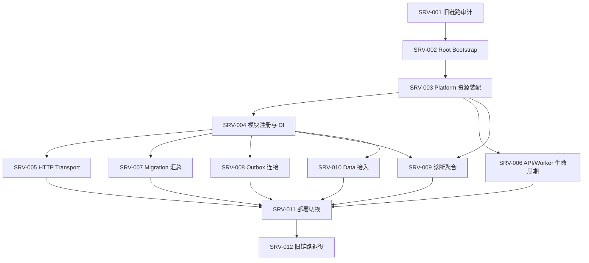

# Server 层实施规划

> 文档状态：实施规划（部分跨模块契约待冻结）
> 适用代码分支：`feat/research-analysis-flow-native-go`
> 文档目录：`doc/server/`
> 代码范围：Server 运行入口、应用装配、HTTP Transport、Worker 生命周期、Migration 汇总、事件连接和运行诊断。
> 本文是 Server 分支的唯一任务主计划。模块内部实现仍以各模块自己的 `doc/<module>/` 为准；项目级架构和跨模块契约以 `feat/design_doc` 上的项目总览及契约目录为准；当前项目总览权威路径为 `doc/整体任务规划/01-项目总览/整体任务规划总览.md`，契约登记簿为 `doc/整体任务规划/02-契约治理/跨模块契约目录与冻结状态.md`。

## 1. 目标与边界

Server 是应用组合根（Composition Root）和进程运行入口。它负责把 Platform 与业务模块组装成可运行服务，并管理进程级资源和生命周期；不实现业务领域规则，不拥有业务数据和业务状态机。

### 1.1 Server 负责

- 统一启动入口、配置装载和启动参数校验。
- 创建并管理 Platform 公共资源，明确资源所有权、共享方式和关闭顺序。
- 创建业务模块实例，并通过公开构造入口和 Application Port 完成依赖注入。
- 注册 HTTP 路由、中间件、认证授权接入和统一错误映射。
- 按运行角色启动 API、Worker 或组合进程，并处理优雅关闭。
- 收集模块 Migration，由 Platform Migration Runner 执行。
- 按已冻结的事件契约连接生产方 Outbox 与 Notification Inbox。
- 聚合平台及模块的 Health、Readiness、Diagnostics。
- 分阶段切换新 Go 服务并退役旧 Analysis/Python 启动链路。

### 1.2 Server 不负责

- 不实现 Data/News/Quant/Research/Researchflow/LLM/Notification 的领域逻辑、Repository、业务状态机或业务重试策略。
- 不把模块私有实现、数据库表或 Repository 暴露给其他模块。
- 不在 Server 内复制模块 Migration；模块拥有自身 Migration 内容。
- 不把 Platform Task Queue 改造成业务 DAG、Outbox Relay 或通用业务任务平台。
- 不把 Notification 当作 Researchflow 的同步 Stage Provider。
- 不在 `integration` 分支开发 Server 功能或修复业务问题。

### 1.3 依赖规则

1. Server 可以依赖 Platform 和各模块的公开装配入口。
2. 业务模块不得反向 import Server 私有实现。
3. 模块之间的调用必须遵循项目契约定义的 Application Port；Server 负责注入，不替代调用方执行业务逻辑。
4. 模块间事件通过明确的 Outbox/Inbox 契约连接；不得直接访问对方数据库。
5. Platform 只提供公共技术原语和资源能力，不承接业务语义。


### 1.4 架构决议（与项目总览对齐，作为本分支执行基线）

经复审，采用以下唯一方案，不再保留入口路径的并行候选：

1. **唯一进程入口**：继续使用根 Go Module 的 cmd/analysis-api/main.go。它在迁移完成后仍是可执行入口，逐步缩减为启动参数/信号处理和对 internal/server/bootstrap 的委托；不新增 cmd/server/main.go，不同时维护两套启动链路。
2. **唯一组合根**：新 Server 实现落在 internal/server/**。Bootstrap 负责配置、资源、模块装配和启动；Transport 负责统一 HTTP 接入；Runtime/Lifecycle 负责组件启停。目标目录仅是渐进落位，不代表当前代码已存在。
3. **统一 API 宿主**：Root Server 是唯一对外 HTTP 宿主。模块拥有自己的 Application Port、传输 DTO 和 HTTP Handler/Adapter；Server 只显式注册经批准且已实现的 Handler，不代替模块实现业务接口，不自动公开所有内部 Port。
4. **模块化单体优先**：同进程调用使用强类型 Application Port，不通过 localhost HTTP 或伪造 API Key；只有有明确隔离/扩缩容/安全需求并完成网络契约评审时才考虑拆进程。Data 迁移完成前，保留有明确边界的 Remote Adapter，不做静默 InProcess/Remote fallback。
5. **公共能力归 Platform**：配置/Secret、Security、Request ID/Fault、受控 HTTP Client、Storage、Migration Runner、Diagnostics Runner 由 Platform 提供；Server 负责创建、装配、路由接入和生命周期，不复制实现。旧 internal/platform/httpapi 与 internal/platform/taskqueue 是历史 Analysis 专用代码，不视为通用 Router/Worker。
6. **领域所有权不变**：Data、News、Quant、Research、Researchflow、LLM、Notification 拥有各自领域规则、Repository、Migration 内容、公开 Port 和模块 Worker；Server 不新增领域模型或业务状态机。Researchflow 是跨模块流程编排者，Server 不是工作流引擎。
7. **共享根改动集中协调**：根入口、DI、路由注册、Worker 启动、根 Migration 汇总和部署配置属于受控集成面；模块分支不得各自修改。integration 只做代码聚合，不承接 SRV 开发任务。

以上决议与项目总览 doc/整体任务规划/01-项目总览/整体任务规划总览.md 第 2.4～2.6 节一致。若项目级权威文档后续改变，以 feat/design_doc 的新决议为准，并在本文件同步，不自行创造第二套架构规则。

## 2. 代码目录与文档目录

### 2.1 目标代码目录

以下是 Server 目标目录，不代表这些目录目前都已存在。实施时按任务逐步创建，避免一次性生成空目录或占位文件。

```text
cmd/
  server/
    main.go                    # 规划候选入口；当前项目总览仍要求沿用 cmd/analysis-api，未决前不得创建第二入口

internal/
  server/
    app.go                      # 应用对象及统一生命周期入口
    bootstrap/
      bootstrap.go              # 配置、资源、模块和运行角色的启动编排
    config/
      config.go                 # Server 进程配置结构、默认值和校验
    modules/
      registry.go               # 模块构造、注册和 Application Port 装配
    transport/
      http/
        server.go               # net/http Server 创建、启动和关闭
        router.go               # 路由注册
        middleware/             # 请求 ID、日志、认证授权接入等 HTTP 中间件
        handlers/               # Server 层或模块公开 HTTP Handler 的挂载适配
    runtime/
      roles.go                  # api、worker、all 等运行角色定义与解析
      lifecycle.go              # 组件启动顺序、失败回滚和关闭顺序
    worker/
      manager.go                # Worker 注册、启动、停止和错误汇总
    migration/
      registry.go               # 汇总模块 Migration 注册项
      runner.go                 # 调用 Platform Migration Runner
    events/
      wiring.go                 # Outbox/Inbox 适配器装配；不实现业务投递规则
    health/
      handler.go                # Health/Readiness HTTP 入口
      aggregate.go              # Platform 与模块诊断结果聚合
    observability/
      logging.go                # Server 进程级日志初始化（复用 Platform 约定）
      diagnostics.go            # 进程级诊断上下文和关联信息

doc/
  server/
    README.md                   # 本文件：Server 唯一任务主计划
```

目录约束：

- 当前及目标进程入口统一为 `cmd/analysis-api/main.go`；项目总览 2.4/2.5 已明确沿用该入口渐进迁移。不得创建 `cmd/server/main.go`，不得保留第二套配置、资源或生命周期入口，也不得擅自重命名现有命令。
- `internal/server/**` 只放进程级装配、Transport、生命周期和跨模块连接代码。
- `internal/platform/**` 继续归 Platform 所有；Server 通过公开接口使用，不复制实现。
- `internal/{data,news,quant,research,researchflow,llm,notification}/**` 继续归各业务模块所有。
- 旧 `cmd/analysis-api`、`internal/service`、旧 Analysis 适配器在迁移完成前保留为兼容基线；不在 SRV-001 审计阶段提前删除。
- 具体目录可根据仓库现有包结构微调，但必须保持上述所有权边界，不为迎合目录树而搬动模块代码。

### 2.2 文档目录规则

- `doc/server/README.md` 是 Server 分支唯一任务主计划和实施状态入口。
- Server 的设计决策、任务拆分、验收标准和风险在本文件更新，不另建重复路线图。
- 跨模块契约若涉及公共语义，应回到 `feat/design_doc` 的契约目录维护；本文件只记录 Server 的消费方式和对应阻断条件。
- 模块自身的接口、Migration 和 Worker 实现细节留在模块文档，不复制到 Server 文档。

## 3. 运行模型

### 3.1 进程角色

目标上至少支持以下运行角色：

| 角色 | 运行内容 | 说明 |
|---|---|---|
| `api` | HTTP API、Health/Readiness | 不启动非必要后台 Worker |
| `worker` | 被配置启用的模块 Worker、事件消费循环 | 不对外提供业务 API；是否提供内部诊断端口由部署契约决定 |
| `all` | API 与 Worker | 适合本地开发或单实例部署 |

角色名称是规划目标，最终命名和部署拓扑需要结合现有部署约束确认。API 与 Worker 应共享一致的配置和装配代码，但启动集合必须显式可控。不能把“同进程”写成模块架构前提；同一二进制应能按角色运行，后续可独立部署。

### 3.2 启动顺序

1. 加载并校验配置。
2. 初始化进程日志和诊断上下文。
3. 创建 Platform 公共资源。
4. 执行启动所需 Migration（仅在明确启用且符合部署策略时）。
5. 构造模块实例和 Application Port 连接。
6. 注册 Health/Readiness。
7. 按角色启动模块 Worker。
8. 启动 HTTP Server（api/all 角色）。
9. 标记 Readiness 为 ready。

启动失败必须返回明确错误，并按已成功启动的逆序回滚；不能遗留 goroutine、连接池或 Worker。

### 3.3 关闭顺序

1. Readiness 切换为 not-ready，停止接收新工作。
2. HTTP Server 停止接收新请求并在超时内完成在途请求。
3. Worker 停止领取新任务，按各模块契约完成或中止在途工作。
4. 停止事件 Dispatcher/Consumer（其所有权契约冻结后接入）。
5. 关闭模块级资源。
6. 关闭 Platform 资源（DB、Redis、HTTP Client 等）。
7. 刷新日志并退出。

具体顺序需以实际依赖图确定；资源提供方必须晚于所有消费者关闭。关闭操作应幂等、有超时，并保留首个错误及后续错误信息。

## 4. 配置设计要求

Server 配置应集中定义、校验和记录来源，不允许各模块在启动入口重复读取任意环境变量。

建议配置分组：

- `server.name`、`server.environment`、`server.role`
- `http.address`、`http.read_timeout`、`http.write_timeout`、`http.idle_timeout`、`http.shutdown_timeout`
- Platform 资源配置：引用 Platform 已定义的配置结构，不重新定义连接池和客户端语义
- `migration.enabled`、`migration.mode`（最终值以 Platform Migration 契约为准）
- 各模块配置：由模块提供配置结构或解析接口，Server 负责汇总和传递
- Worker 启停开关、并发和关闭超时：具体业务参数由模块拥有，Server 只负责运行角色与生命周期配置
- Diagnostics/Health 暴露策略

配置要求：

1. 环境变量、配置文件和默认值的优先级必须统一并写入配置说明。
2. 敏感值不得写入日志、诊断输出或错误文本。
3. 配置错误应在启动早期失败，不能静默回退到不安全默认值。
4. 记录生效配置时只输出非敏感字段。
5. 不在 Server 中复制模块内部全部配置项；通过模块公开配置契约装配。

## 5. 模块装配契约

每个模块接入 Server 前，必须具备可被 Server 使用的公开装配边界。具体接口名称由模块现有代码和项目契约决定，不在此文档中臆造统一构造函数。

接入检查至少包括：

- 模块配置如何解析和校验。
- 模块实例如何构造，构造失败如何释放已创建资源。
- 模块对外提供哪些 Application Port/HTTP Handler/Worker。
- 模块依赖哪些 Platform 资源，以及是否共享 Server 创建的实例。
- 模块是否提供 Migration 注册项。
- 模块是否提供 Health/Readiness/Diagnostics 贡献项。
- Worker 的启动、停止、超时和失败语义。
- 模块关闭是否幂等。

Server 的 Registry 负责装配，不得因此把模块内部 Service、Repository 或 Domain 类型提升为跨模块公共接口。跨模块依赖只能使用冻结的公开 Port。

## 6. Migration 所有权与执行

采用三层职责：

| 层 | 所有权 |
|---|---|
| 业务模块 | 创建和维护自己的 Migration 内容、版本及领域表结构 |
| Platform | 提供数据库连接能力和通用 Migration Runner |
| Server | 收集已启用模块的 Migration 注册项，建立唯一执行入口和顺序 |

要求：

- Server 不编写业务表 DDL，不复制模块 Migration 文件。
- 模块 Migration 必须有稳定的模块标识、版本和可诊断结果。
- Migration 注册必须避免同一模块重复注册、版本冲突和不确定执行顺序。
- 执行失败应阻止依赖该 Schema 的服务进入 Ready。
- 是否在 API 启动时自动执行 Migration，必须由部署策略显式配置；生产环境不能依赖多个副本同时无协调地执行。
- Migration Runner 的具体 API、锁和事务能力以 Platform 契约为准；若能力缺失，回 Platform 分支补齐，不在 Server 复制 Runner。

## 7. Outbox / Notification 事件连接

目标关系：

```text
Quant Outbox ─────────┐
Research Outbox ──────┼──> Notification Inbox -> Subscription -> Delivery -> Channel
Researchflow Outbox ──┘
```

Server 只负责把生产方公开的 Outbox 读取/Dispatcher 能力与 Notification 接收入口连接起来，并管理相关组件生命周期。事件 Schema、业务事件产生时机、重试语义、Inbox 去重和 Delivery 状态由相应模块所有。

**未冻结决策：Dispatcher 所有权。** 当前存在两种候选方案：

- 方案 A：每个事件生产方拥有自己的 Dispatcher；Server 注入 Notification 接收适配器并统一启停。
- 方案 B：Server 运行统一 Relay，但必须通过每个生产方公开的 Outbox Port 访问，不能直接读写生产方表。

在项目契约明确选择之前，SRV-008 只能完成接入设计和接口准备，不得把任一方案写成既定事实。Platform Task Queue 不能被默认当作 Outbox Relay。

## 8. HTTP Transport 与安全边界

Server HTTP 层负责：

- 路由注册和版本前缀。
- 请求 ID / Trace 上下文传递。
- 认证和授权中间件的装配；身份校验具体能力使用 Platform 或项目已冻结的 Auth 契约。
- 统一 Fault 到 HTTP 状态码和响应结构的映射。
- 请求体大小、超时、并发和优雅关闭限制。
- Health/Readiness/Diagnostics 端点的访问策略。
- OpenAPI 聚合或生成入口（各模块 API 描述的所有权需明确）。

Server 不重写模块业务 Handler 的校验和领域错误，不在路由层拼接 SQL 或调用 Repository。所有外部请求必须经过明确的认证授权策略；不能因为是个人使用就把管理接口默认暴露为匿名接口。

## 9. Health、Readiness 与 Diagnostics

至少区分：

- **Liveness**：进程是否仍能运行。
- **Readiness**：当前实例是否能够安全接收目标流量/工作。
- **Diagnostics**：依赖和模块能力的详细状态，包含 pass/degraded/fail/skipped/not-comparable 等项目约定状态。

聚合规则：

- Server 聚合模块诊断结果，不擅自改变模块给出的业务判定。
- 非关键可选依赖不可用时，是否 degraded 由系统级服务等级策略定义。
- 必需 DB、Migration 或关键模块未就绪时，不得错误报告 Ready。
- 诊断必须保留 reason_code、evidence_ref、dependency 等契约字段，不能只输出自由文本。
- Health 响应不得泄露凭证、内部地址中的敏感部分或用户数据。

## 10. 任务清单与验收标准

任务状态统一使用：`未开始`、`进行中`、`待契约`、`阻塞`、`完成`。任务完成必须有代码、测试或可复核证据；仅文档设计不等于实现完成。

### SRV-001：旧系统和启动入口审计

- 状态：进行中（已完成第一轮启动链路与核心资源审计，剩余路由/迁移/部署引用清点）
- 工作内容：
  - 审计 `cmd/analysis-api/main.go`、`internal/service/wiring.go`、旧 HTTP API、Task Queue、Storage、Market Data Adapter、Python Adapter。
  - 绘制当前启动依赖和资源生命周期。
  - 将旧 API 路由、配置项、Worker、Migration、诊断端点逐项映射到新 Server 或对应业务模块。
  - 标注保留、迁移、替换、删除及其前置条件。
- 交付物：旧链路迁移清单、现状依赖图、配置映射表、删除门禁。
- 验收：
  - 所有旧启动职责均有唯一归属。
  - 不将旧 Analysis 业务逻辑误归到 Server。
  - 未提前删除仍在使用的入口和适配器。

### SRV-002：Root Bootstrap

- 状态：阻塞（SRV-001 完成前不启动；入口路径还存在项目总览与本专项文档冲突）
- 前置：SRV-001；先按项目总览确认复用 `cmd/analysis-api` 的渐进迁移方式，或由项目级文档正式决议调整入口路径
- 工作内容：建立 `cmd/server/main.go` 和 `internal/server/bootstrap`；统一配置加载、构造应用、启动和错误返回。
- 交付物：最小可运行的新 Server 入口。
- 验收：配置错误可诊断；启动失败返回非零退出；入口不包含业务逻辑；有启动和失败路径测试。

### SRV-003：Platform 资源装配

- 状态：未开始
- 前置：SRV-002；依赖 Platform 已公开能力
- 工作内容：创建 DB、Redis、HTTP Client 等公共资源；明确资源共享、超时、关闭顺序和失败回滚。
- 交付物：资源 Registry/Container 和生命周期管理。
- 验收：资源只创建一次或按契约隔离；创建失败能回滚；关闭顺序正确；不复制 Platform 实现。

### SRV-004：模块注册与依赖注入

- 状态：未开始
- 前置：SRV-003；各模块提供可用公开装配入口
- 工作内容：按明确的依赖 DAG 显式创建模块实例；注入强类型 Application Port；校验缺失、重复和循环依赖。不得通过扫描私有包、隐式全量注册或 Server 直接访问 Domain/Repository 来装配。
- 交付物：模块 Registry、依赖装配图和模块接入清单。
- 验收：不 import 模块私有实现；无隐式全局单例；每个跨模块依赖都有契约依据；模块可独立构造和关闭。

### SRV-005：HTTP Transport

- 状态：未开始
- 前置：SRV-004；认证、Fault、Request ID 等公共契约可用
- 工作内容：建立 Router、通用中间件、统一错误映射、路由注册和 OpenAPI 汇总机制。
- 交付物：HTTP Server、路由清单、安全配置和 Transport 测试。
- 验收：认证授权按路由生效；错误映射稳定；超时和请求限制生效；业务逻辑仍由模块实现。

### SRV-006：API/Worker 运行角色和生命周期

- 状态：未开始
- 前置：SRV-003、SRV-004
- 工作内容：实现角色解析、组件选择、启动依赖排序、失败回滚、优雅关闭和超时。
- 交付物：Runtime Role 与 Lifecycle Manager。
- 验收：api 角色不启动非必要 Worker；worker 角色不启动业务 HTTP API；all 角色可组合运行；启动失败和 SIGTERM 路径均有测试。
- 待决：生产环境 API/Worker 是分进程部署还是允许同进程部署，由部署架构决策冻结；代码必须支持显式角色隔离。

### SRV-007：Migration 注册与执行

- 状态：未开始（Platform Migration Runner 已有公开实现，Server 侧尚未装配）
- 前置：SRV-003、SRV-004；核对 Platform `storage.ApplyMigrations` 实际签名和各模块 Migration 注册形态
- 工作内容：在模块装配阶段收集各模块拥有的 Migration 描述，校验 namespace/version 唯一性及顺序，再按部署策略调用 Platform Runner，输出可追踪结果。MariaDB DDL 部分执行失败后的恢复按 Platform Runner 契约执行，不在 Server 自行重试失败 Migration。
- 交付物：Migration Registry、执行策略和集成测试。
- 验收：Server 不拥有业务 DDL；重复注册和版本冲突可检测；失败阻止 Ready；并发启动不会造成无协调的重复执行。

### SRV-008：Outbox 事件交付集成

- 状态：待契约
- 前置：SRV-004；生产方 Outbox Port、Notification Inbox Port 和 Dispatcher 所有权决议冻结
- 工作内容：装配事件适配器、启动停止相关 Dispatcher/Relay、传递诊断和错误。
- 交付物：事件连接配置、生命周期集成和端到端测试。
- 验收：不直接访问其他模块数据库；重复事件不会绕过去重契约；失败可重试且可诊断；不依赖 Platform Task Queue 的隐式语义。

### SRV-009：Health、Readiness、Diagnostics 聚合

- 状态：未开始
- 前置：SRV-003、SRV-004；Platform Diagnostics 契约可用
- 工作内容：聚合进程、公共资源和模块状态；区分 liveness/readiness/diagnostics。
- 交付物：健康端点、聚合器和故障场景测试。
- 验收：必需依赖故障时 Ready=false；可选依赖降级不被误报为成功；保留结构化诊断证据；不泄露敏感信息。

### SRV-010：Data 迁移成果接入

- 状态：阻塞（等待 Data 迁移门禁）
- 前置：Data M0/M1 迁移门禁通过；Data 公开 Application Port、配置、Migration 和生命周期契约可用
- 工作内容：将迁移后的 Data 模块接入模块 Registry、资源、Migration、诊断和 API 路由。
- 交付物：Data Server Adapter/注册配置和端到端查询链路。
- 验收：浏览器不持有 Provider API Key；凭证只在服务端；Data 查询通过公开 Port；不在 Server 重写 Provider 或 Repository。

### SRV-011：部署切换

- 状态：未开始
- 前置：SRV-005、SRV-006、SRV-007、SRV-009、SRV-010；核心模块运行链路可用
- 工作内容：整理环境变量、容器/进程入口、健康检查、Worker 副本策略、迁移执行策略、回滚步骤和日志采集。
- 交付物：部署配置、运行手册、切换/回滚清单。
- 验收：新旧入口切换可控；服务启动和停止可重复；配置无凭证泄露；回滚路径经过演练。

### SRV-012：系统集成与旧链路退役

- 状态：未开始
- 前置：SRV-011；新链路通过系统验收；旧数据/任务迁移策略确认
- 工作内容：验证端到端业务流程，停止旧 Analysis API/Runner/Python Adapter/旧 Task Queue；删除不再使用的代码和配置。
- 交付物：端到端验收记录、旧链路删除清单、退役说明。
- 验收：新链路覆盖已确认的旧能力；无流量或任务仍依赖旧入口；数据库兼容窗口和回滚期限明确；旧代码删除后全仓构建与测试通过。

## 11. 任务依赖图



这是逻辑依赖图，不要求所有任务串行执行。各业务模块可以并行实现；Server 在公开接口达到可接入状态后逐步装配。跨模块契约未冻结的任务保持待契约，不得用临时私有接口绕过。

## 12. 当前代码基线与迁移映射

### 12.1 第一轮代码审计结果（基于分支 HEAD `3cccc7d365d106f2dc75823a335316ba8b0bdad2`）

本分支相对 `integration` 仅领先 3 个提交，差异文件只有本规划文档；当前没有 `cmd/server/**` 或 `internal/server/**` 实现。不得把目标目录树误认为现有能力。

| 现有位置 | 已核实职责与事实 | Server 迁移边界/注意事项 |
|---|---|---|
| `cmd/analysis-api/main.go` | 当前唯一根模块 Go API 入口；加载 `.env`、日志、MariaDB/Redis 与 Market Data 配置；创建 Store、Analysis Runner、旧 Task Queue；启动 Worker 和 HTTP Server；处理 SIGTERM 与 HTTP Shutdown | 入口仍直接装配具体实现；逐步将装配委托给 Server Bootstrap。项目总览要求沿用该入口，不得未经决议新增并行入口 |
| `internal/service/wiring.go` | 构造旧 Analysis Runner 的具体领域组件，连接 Market Data、Python API、策略/风险等组件 | 这是旧业务装配，不应整体搬入 Server；待各新模块公开 Application Port 接入后逐项替换 |
| `internal/platform/httpapi/server.go` | 旧 Analysis 专用 HTTP Handler；包含 `/healthz`、`/readyz`、同步 Run、Run 查询/事件、异步 Task 创建/查询；自行实现 Request ID、日志、Recover、错误响应和部分输入校验 | 不能直接当作通用 Platform Router；先盘点路由与 DTO，再把入口中间件迁移到 Server，业务 Handler 归属需按模块拆分 |
| `internal/platform/observability/request_id.go` | 已有 Request ID 校验/生成、Context 传递、响应头写回和出站传播能力 | 可复用，不在 Server 重复实现；后续统一中间件时应保留该能力并核对项目 Request ID 契约 |
| `internal/platform/httpclient/**` | 已有受控 HTTP Client、DestinationPolicy、超时/响应大小/并发/重试及流式相关公共实现 | 由 Server 创建并按模块公开构造入口注入；不得为 Market Data、LLM 等复制 HTTP Client |
| `internal/platform/taskqueue/queue.go` | 旧 MariaDB 分析任务队列；直接依赖 `internal/analysis/domain`，包含旧 Analysis Run 恢复、Worker 启停和任务持久化 | 不是通用 Platform Worker，也不是 Researchflow DAG/Outbox Relay；不能直接注册为新模块 Worker，旧链路退役前保留 |
| `internal/adapters/storage/mysqlredis/config.go`、`store.go` | 直接读取 DB/Redis 环境变量；打开连接、Ping、可选执行旧 Analysis Migration、检查 4 张旧表、Health/SelfTest；Store 暴露 `*sql.DB` 与 Redis Client | 属于旧 Analysis Storage Adapter，不是已确认的公共 Platform Storage Container 或 Migration Runner；不得把旧表 Migration 当作新模块 Migration 汇总 |
| `internal/adapters/marketdata/**` | 旧 Analysis 的 Go Market Data HTTP Adapter；配置含 API Key、超时、历史窗口、并发、响应大小、复权和时区 | Data 并入 Root Server 仍受 Data MDM 门禁约束；Server 只注入 Data 公开 Port，不接管 Provider 规则 |
| `internal/adapters/pythonapi/**` | 旧 Python API Adapter，含 Bearer/Cookie、HTTP 请求和响应解码 | 作为迁移/退役对象审计，不得把它当新 Go 模块的长期默认依赖 |
| `docker-compose.yml`、`Dockerfile` | 当前部署仍以 `stock-analysis-server` 容器构建 `./cmd/analysis-api`；Market Data 是独立容器，WebUI 单独容器；Server 通过 `MARKET_DATA_BASE_URL` 和 API Key 访问 Data | 部署尚非 Data 与 Root Server 同进程的最终形态；切换必须等待 Data 迁移门禁，不能在本任务提前改部署 |

第一轮审计确认：`internal/platform` 已有可复用的 Request ID、受控 HTTP Client、类型化 Config/Secret 原语、Diagnostics Check/Runner、SQL/Redis 生命周期和 Migration Runner。Platform 文档明确 PLAT-005 的服务 Config Bootstrap 接入、PLAT-006 的服务入口/Worker/日志接入、PLAT-007 的领域 Adapter/受保护诊断路由、PLAT-009 的生产拓扑/共享资源生命周期仍待 Server 或领域消费者完成；旧 `mysqlredis.Store` 尚未切换到 Platform Storage。`internal/platform/httpapi` 和 `internal/platform/taskqueue` 则是旧 Analysis 专用实现，不能误当通用 Router/Worker。Server 应直接使用 Platform 已有原语；仅当确认公开接口缺失时才回 Platform 补齐，禁止复制实现。

### 12.2 仍需完成的 SRV-001 审计项

- 完整列出旧 HTTP API 的全部路由、请求/响应 DTO、认证现状、调用方和兼容期限。
- 从旧 Store 的 Migration 实现中提取表清单、版本/执行策略和与模块 Migration 的关系；不得把旧 Analysis 四表与新模块表混为一谈。
- 清点旧 Analysis Worker 的启动/恢复/关闭行为及部署副本约束，明确其与 Researchflow Worker 的差异。
- 核对 Quant、Research、Researchflow、LLM、Notification 当前公开构造入口、Application Port、Handler、Worker、Migration 和 Diagnostics 实际可用性；模块 README 的“已实现”不自动等于 Server 可装配。
- 清点 Nginx、Compose、环境变量和旧 Python 服务引用，形成保留/迁移/删除门禁。

当前已核实的旧入口至少包含：

- `cmd/analysis-api/main.go`：读取 dotenv/日志/存储/行情配置，创建 MariaDB/Redis Store、旧 Analysis Runner、Task Queue Worker、HTTP API，处理 HTTP 监听和 SIGTERM。
- `internal/service/wiring.go`：装配旧 Analysis 用例和模块，依赖旧 Market Data/Python API Adapter。
- 旧 `internal/platform/taskqueue`：当前由旧入口启动；不能直接认定为 Researchflow 调度器或 Outbox Relay。
- 旧 `internal/adapters/**`：逐项审计后决定迁移、替换或退役，不能整体搬入 Server。

上述是审计起点，不是完整迁移结论。SRV-001 必须读取当前分支最新代码，补齐 HTTP Handler、Repository、Migration、Worker、配置和部署引用。

## 13. 分支与协作规则

- 本规划及 Server 代码实施位于 `feat/research-analysis-flow-native-go`。
- `feat/design_doc` 负责项目级架构和跨模块契约；Server 不在本分支私自改变公共契约语义。
- 各业务模块在自己的分支实现领域能力和公开装配接口。
- `integration` 只做代码聚合：接收已完成的模块/Server 代码，处理合并冲突并运行聚合 CI。不得在 integration 承接 SRV 任务、业务缺陷修复或跨模块开发。
- 如果聚合后发现问题，按所有权回到 Server、Platform 或对应业务模块分支修复，再重新聚合。
- 只在当前 Server 分支修改 Server 代码和 `doc/server/**`；不得代替其他模块修改其目录。
- 每个功能批次按完整交付聚合提交，提交信息和文档使用中文。

## 14. 完成定义

Server 层完成不是“服务能够启动”这么简单。至少同时满足：

1. 新入口具备可配置、可诊断、可优雅关闭的生命周期。
2. 所有模块通过公开装配契约注册，不存在业务模块反向依赖 Server。
3. API 与 Worker 角色可显式控制，部署拓扑明确。
4. Migration 由模块拥有内容、Server 统一注册、Platform 负责执行。
5. Outbox/Inbox 按冻结契约可靠连接，具备幂等、重试和诊断证据。
6. Health、Readiness、Diagnostics 语义一致且不泄露敏感信息。
7. Data 迁移和服务端凭证边界通过验收。
8. 旧 Analysis/Python 链路已完成替换和退役，或每项保留项均有明确理由和期限。
9. 当前分支编译、单元测试、集成测试和部署构建通过。
10. 所有任务状态、验收证据和未决风险在本文件中更新。

## 15. 当前状态总表

| 任务 | 状态 | 说明 |
|---|---|---|
| SRV-001 | 进行中 | 已审计启动入口、旧 Runner 装配、HTTP API、Request ID、HTTP Client、旧 Task Queue、Storage、Market Data/Python Adapter 和 Compose；剩余路由/迁移/模块装配/部署引用清点 |
| SRV-002 | 未开始 | 入口决议已明确；等待 SRV-001 审计收敛后，将现有 cmd/analysis-api 委托给 Root Bootstrap |
| SRV-003 | 未开始 | 尚未建立 Server 统一资源装配 |
| SRV-004 | 未开始 | 等待各模块公开装配入口 |
| SRV-005 | 未开始 | 旧 HTTP API 尚待迁移映射 |
| SRV-006 | 未开始 | 运行角色和生命周期尚未建立 |
| SRV-007 | 未开始 | Platform Migration Runner 已有实现；待 Server 资源装配及模块 Migration 注册入口就绪 |
| SRV-008 | 待契约 | Dispatcher 所有权未冻结 |
| SRV-009 | 未开始 | 尚未建立系统级诊断聚合 |
| SRV-010 | 阻塞 | 等待 Data 迁移门禁和公开接口 |
| SRV-011 | 未开始 | 等待核心运行能力 |
| SRV-012 | 未开始 | 等待新链路验收 |

> 状态说明以本文件编写时已检查的 Server 代码基线为起点。每次继续实施前，必须重新核对当前分支 HEAD 和对应模块契约，不得把历史状态当作实时状态。
